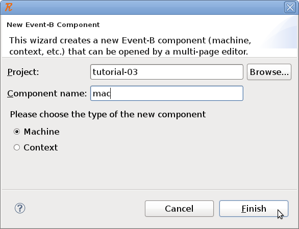
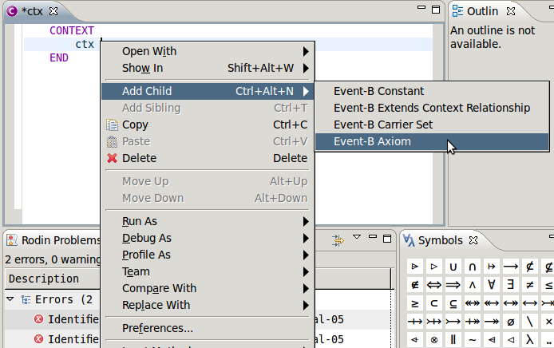
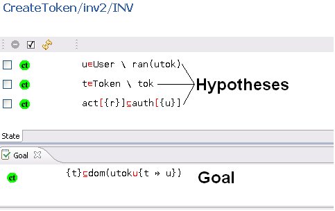

# 附录　Rodin 界面对照

三张图取自《Rodin User’s Handbook》v2.9 的示例界面。本包使用 Rodin 3.10，窗口外观、菜单位置随系统和编辑器变化。对照英文入口与字段即可操作。截图中的工程名和公式属于官方示例，下面的练习使用单车道桥工程。

## 1　新建上下文或机器

在已有工程上右击，选 **New → Event-B Component**。第一栏 Project 确认所属工程，第二栏 Component name 填名称。建容量上下文时填 **C0_Capacity** 并选 **Context**，建机器时填 **M0_Capacity** 并选 **Machine**，最后点 Finish。在 3.10 的精简菜单中也可从 **File → New → Other…** 搜索组件向导。[官方图 2.6](https://stups.hhu-hosting.de/handbook/rodin/current/html/tut_project_setup.html#fig_tut_03_new_component_wizard)

## 2　在上下文中添加公理

先双击上下文，在正文的组件名旁右击，选 **Add Child → Event-B Axiom**。在桥模型中可先建常量 d，再填写公理的 Label 和 Predicate，例如 axm0_1 与 d ∈ ℕ。图中的 Symbols 面板可以输入 ∈。若 3.10 打开的是表单编辑器，进入底部 **Edit** 页并展开 **Axioms** 即可录入。[官方图 3.11](https://stups.hhu-hosting.de/handbook/rodin/current/html/new_eventb_editor.html#fig_ref_01_neweditor_add_element)

## 3　读一项待证目标

在 Event-B Explorer 展开机器的 **Proof Obligations** 并打开一项。图顶端是义务名，上方 Hypotheses 列出可用假设，下方 **Goal** 是当前待证公式。回到桥的 ML_out，守卫给出 n < d，动作执行后要解释 n+1 ≤ d。若视图布局不同，在 **Proving** 透视图中按 **Selected Hypotheses** 和 **Goal** 标签寻找。[官方图 3.30](https://stups.hhu-hosting.de/handbook/rodin/current/html/proving_perspective.html#fig_ref_01_proving_perspective3)

**图片署名与许可**　三张原图由《Rodin User’s Handbook》编写团队与贡献者提供，按 CC BY-SA 3.0 Unported（署名—相同方式共享）转载。保留原图内容，中文说明另写，显示时按版面缩放。手册前言署名 Michael Jastram。[原作致谢](https://stups.hhu-hosting.de/handbook/rodin/current/html/sec-acknowledgements.html) · [手册许可声明](https://stups.hhu-hosting.de/handbook/rodin/current/html/sec-cc.html) · [CC BY-SA 3.0](https://creativecommons.org/licenses/by-sa/3.0/)
