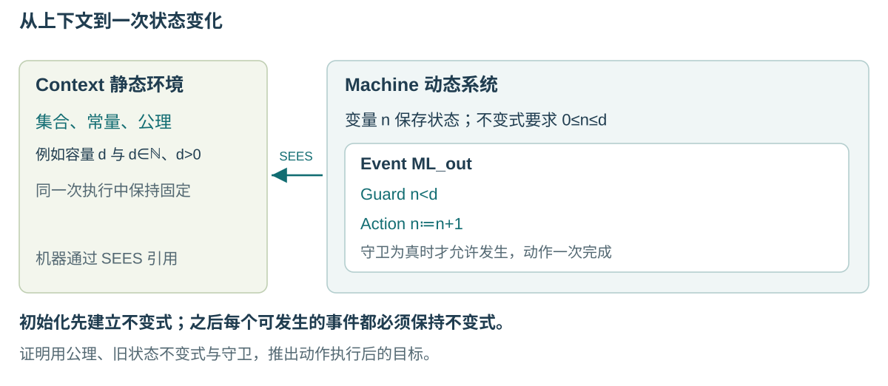
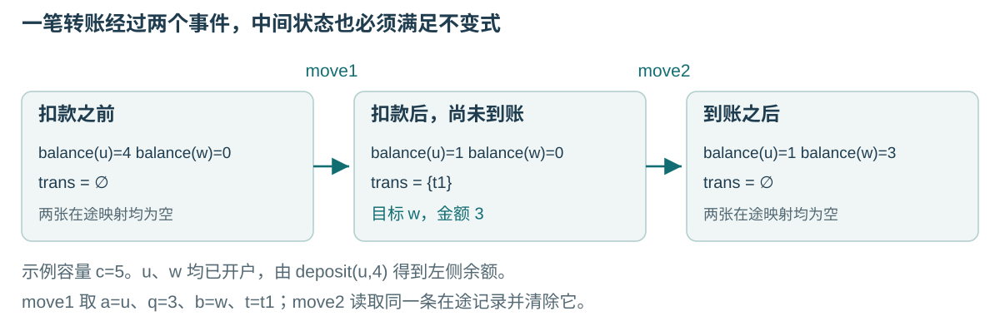
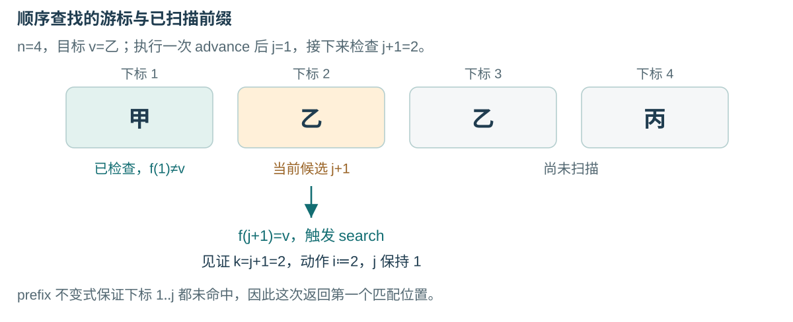

# 第一讲　从需求到 Event-B 模型

打开 [L1_Bank 银行账户工程](../03-Rodin工程/L1_Bank) 和 [L1_Search 序列查找工程](../03-Rodin工程/L1_Search)。先在银行基础机里试着关闭一个仍有余额的账户，再读精化机里一笔转账为何要分两次执行。最后用查找工程练习给抽象参数写见证。下文页码对应《course 1》共 63 页。

| 课件页 | 本讲要回答的问题 | 在 Rodin 中看哪里 |
|---|---|---|
| 1–22 | 为什么仅凭需求描述和几次顺利运行，很难确认软件正确？ | 先用银行需求区分环境假设和系统义务 |
| 23–35 | 形式化开发的产物是什么？怎样选择验证方法？ | 区分静态检查、证明义务和动画 |
| 36–48 | 怎样把账户、持有人、余额和开户条件写成数学对象？ | 银行工程的 c0 和 m0 |
| 49–54 | 怎样用两步转账精化取款、存款？怎样读证明义务？ | 银行工程的 c1 和 m1 |
| 38、51 | 普通账户转入储蓄账户如何补充进模型？ | 银行工程的 c2 和 m2，教学扩展 |
| 55–61 | Context、Machine、Event 的栏目各放什么？具体事件如何代替抽象选择？ | 查找工程的 ctx_0、m_0a 和 m_1a |
| 62–63 | 如何把同一套方法迁移到下一讲的桥梁控制？ | 先找安全性质，再选状态和事件 |

## 1　软件工程为什么需要规格

**第 1–16 页。** 规模、并发交互和环境变化会放大一个小小的假设。第 6–7 页把车库门漫画和实际装置放在一起。用户看到“按一下按钮，门就打开”，设计要区分遥控器、驱动器、门体和安全传感器。第 8–9 页的 ATM 图也有两种读法：领域图标出顾客、出钞装置和银行远端数据中心等参与者，取款场景把验证账户、查询余额、出钞和记账排成步骤。图上的示例从余额 100 中取 60；要判断剩余 40 是否正确，得先约定账本更新的时刻。这几页给出系统边界和交互图，课件在第 36 页才开始给出带需求编号的银行 Event-B 案例。

第 10–13 页用元胞自动机、兰顿蚂蚁及群体行为说明，局部规则简单，长期行为仍可能很复杂。第 14–16 页回到工程问题。用户描述问题和目标，工程师要写出允许的行为，再据此实现。瀑布式开发较难吸收后期变更，演化式开发较难预测进度，螺旋式开发需要投入风险评估，基于变换的开发需要建模技能。建立规格的实际收益是让团队能指出“哪条需求变了”“会影响哪些状态和事件”。

**第 17–22 页。** 瓦萨号案例强调变更后的设计缺少清晰规格，已有测试迹象也没有得到充分处理。阿丽亚娜 5 号案例强调运行范围：在旧型号上成立的数值范围假设，换到新型号后导致溢出，冗余计算机也受同一设计影响。课件用两例导出同一个问题：**正确性总是相对于一份规格和一组环境假设而言。** 单元测试和集成测试看特定输入下的执行，白盒和黑盒测试区分用例是否依赖内部实现。验证则可以对模型中的所有合法状态提出“这次更新一定安全吗”的问题。测试仍可用来检查数学模型是否反映用户真正需要的行为。

### 1.1　从用户的一句话找出系统边界（第 3–14 页）

用“取出 60 元”练习第 14 页的需求图。顾客能看到现金，银行能看到账本余额，两种观察发生在不同位置。先把问题写成可回答的问句：请求来自哪一位顾客？账户是否存在？余额是否够？账户减少 60 和现金离开机器之间，是否允许发生其他事？第一讲后半段选择银行账本作为系统边界。账本事件可以精确规定余额变化。读卡、认证、机器点钞和网络重试都在这个边界之外。正因为清楚画出了边界，后面才可用一个瞬间的 withdraw 表示账本扣款。

车库门的两张图也可以这么读。使用者说“开门”，实际装置将输入、驱动力、门的位置和传感器联系起来。若只关心控制器输出过什么命令，状态也许只需记录命令。若要断言现实中的门已到位，还需另一个描述门体位置或位置传感器的状态。即便证明“下达了开门命令”，要推出“门真的打开”，还缺少执行机构响应的假设。第 6–9 页训练的是观察范围的选择，课件没有为这些物理部件指定可唯一还原的 Event-B 变量和事件。

第 10–11 页的局部规则则解释了为什么状态空间增长很快。以一个只有两种状态的格子为例，若有四个可独立取值的格子，组合上限已经是 16 种。扩为十个格子，上限变为 1,024 种。规则可能使其中很多组合永远到不了，单靠观察头几步通常看不出来。把这个想法带到账户系统：账户数、各自余额和未完成转账组合后会形成大量状态，因此“我亲自试过一笔成功转账”只能说明这条路径存在。

### 1.2　从工程事故分辨三种问题（第 15–22 页）

1. **需求是否说清了？** 规格写“账户的余额必须为正”，同时又写“只能关闭零余额账户”。仅检查拼写和类型，两句都可以通过。模型若允许一开始以零开户，就会在模型审查或不变式证明中发现两句的矛盾。第 36–48 页的具体区间决定了本课程银行模型对零的处理。
2. **设计是否保持规格？** 假设规格已有明确上限。规定存款后直接加 1，在余额已到上限时仍可执行，就能从一个合法状态一步进入非法状态。此时要修的是存款守卫或业务定义。增加一条公理断言“超限存款绝不发生”，会把原本该由系统执行的检查移交给环境。
3. **实现是否继承模型的意义？** Event-B 中的数学整数可表达任意大小，某种实现可能采用有最大值的固定宽度整数。即使已证抽象层结果总在 `0‥c`，还要说明所选表示能容纳 c，计算中间值也在安全范围。第 19–20 页中旧环境里的数值假设不再适用，提醒我们同时记录环境和表示的前提。

给一次验证活动选对象时，先写出“给定什么，观察什么，比较什么”。给定余额 4、上限 5，观察请求存 2 后账户能否变化，这可以作为一条边界测试。给定任意合法余额和金额，证明每一次允许的存款都落在区间里，这是不变式保持。询问每一笔等待中的转账最终都能否到账，又要求把时间上的多步行为及调度条件说清楚。三者对应不同的任务。

## 2　怎样用数学模型表达需求

**第 23–31 页。** 第 25 页将需求、设计、实现、验证和维护放在同一生命周期里。第 26 页把设计细分为抽象规格、逐层精化的中间模型和实现模型。每层要写清楚新增了什么信息、保留了什么已承诺的行为。自动生成代码需要适合的实现模型、数据表示和生成工具。课堂提供的机器主要用于建模、动画和证明。

| 方法 | 检查的问题 | 用账户模型举例 |
|---|---|---|
| 类型检查 | 运算是否适用于给定种类的值？ | 余额是整数，持有人来自人员集合，两者不能相加 |
| 静态分析 | 在程序的可能执行路径上，是否会发生某类错误？ | 由实现的数值范围分析定长整数会不会溢出 |
| 模型检测 | 在所探索的状态空间里，有无违反给定性质的轨迹？ | 在有限账号、有限额度的实例中寻找“余额非零却已销户”的路径 |
| 定理证明 | 在假设和守卫成立时，结论是否对所有允许取值成立？ | 对任意已开户的 a 及合法金额 q，证明取款后的余额仍属于规定区间 |

**第 32–35、39–45 页。** Event-B 用集合和谓词描述一个状态，用事件描述从旧状态到新状态的一次原子变化。第 42 页称之为转换系统。状态之间没有必须按书写顺序执行的事件列表；当前守卫决定有哪些事件可以发生。第 39 页用蓝图解释模型的抽象性。配合 ProB 等工具，可以在具体取值的实例上做动画，以检查蓝图允许哪些行为。

写需求时给每一条编号。ENV 类描述环境中的对象或假设，FUN 类描述系统应当提供的行为。常量、公理和载体集放在 **Context**。可变状态、不变式和事件放在 **Machine**。机器通过 **SEES** 使用上下文，具体机器通过 **REFINES** 连接抽象机器。新上下文通过 **EXTENDS** 引入原上下文的内容。定理应从已有事实推出，把某性质写成公理会改变所有后续证明的前提。

下图预览第二讲的桥梁计数模型，把第 44–45 页的三个栏目放到一个状态变化里。容量 d 是上下文中的常量，车辆数 n 是机器中的变量，ML_out 是进入受控区域的一次事件。读关系名时从机器出发：机器 **SEES** 上下文，因此才能在守卫中使用 d。



设 `d=2`、当前 `n=1`，守卫为真，执行后 n 为 2。再执行同一事件时守卫为假，从而不会出现 n=3。图中的连续不等式是数学简写；在 Rodin 中可以分成 `n∈ℕ` 与 `n≤d` 两行，或明确使用合取。下一节回到本讲自己的银行模型，使用 c 表示金额上限，不要把两个工程的常量混用。

### 2.1　四种验证方式怎样配合（第 23–34 页）

在类型层，Rodin 可以判断“用账户编号索引余额表”有意义，也可以拒绝对持有人做减法。但把 `balance(a)+q` 错写成 `balance(a)−q` 仍是整数表达式；检查器需要需求或性质才知道符号写反了。静态分析常在程序的抽象表示上计算可能的值，例如追踪一个数组下标的范围。模型检测从初始状态出发，寻找通向错误状态的事件序列；在给定有限实例中穷尽可达图时，其结论覆盖那个实例的所有可达状态。第一讲的数学证明则把 c 等常量保留为任意合法值，不必分别试遍 c=1、2、3。

读第 26 页的图时，自上而下走一次。非形式需求给出承诺，例如“钱可以从一个账户转到另一个账户”。第一层只承诺单次账本更新的性质，第二层加入“在途编号”，这时还要证明分步处理的每个可观察动作都符合上一层。若继续走到代码，数据结构、数值表示和调度都要有对应关系。反向再读一遍：发现一个反例时，可以沿着精化链确定它暴露的是底层处理不当、上层规格遗漏条件，还是环境假设发生了变化。

### 2.2　把建模公式读成可检查的中文（第 35、39–47、55–60 页）

先认清字母指什么，再读符号。用 `A={u,w,z}` 举例，A 是允许作为账号的值的集合，u 是其中一个值。设银行当前只开了两个账户，于是可以有 `account={u,w}`。这个具体取值用于演算；符号模型的 A 没有写死成这三个名字。

| 记号 | 在模型中的读法 | 代入上例 |
|---|---|---|
| `a ∈ account`、`a ∉ account` | 单个元素在或不在集合中 | u 已开户，z 尚未开户 |
| `account ⊆ A` | 左边每个元素都在右边，可相等 | 已开集合允许为空，也可能刚好包含全部可用账号 |
| `∅`、`{a}` | 空集合、只含一个元素的集合 | `{u}` 可以和 account 做集合运算 |
| `S ∪ {a}`、`S ∖ {a}` | 加入或移除元素 a | 对 `{u,w}` 移除 w 得 `{u}` |
| `0‥c`、`1‥n` | 两端都包含的整数区间 | `0‥2={0,1,2}`，`1‥0=∅` |
| `ℕ`、`ℤ` | 自然数含零；整数还含负数 | 余额和金额的类型都是整数，实际可取值由区间再限定 |
| `u ↦ 4` | 键与值构成一个有序对 | 对中前一项是账号，后一项是余额 |
| `dom(g)`、`ran(g)` | 函数 g 中出现过的键、实际出现过的值 | 若 g 记录 u 为 4、w 为 0，则定义域为 `{u,w}`，值域为 `{4,0}` |

把函数真的写成一张有限表。若 `balance={u ↦ 4, w ↦ 0}`，则 `balance(u)=4`。此时不能给 `balance(z)` 随便指定一个默认值；模型没有登记 z。若两人各有一个账户而余额均为 0，余额表仍然是函数，因为每个键只有一个值。两个不同键指向相同值合法，`ran(balance)` 只包含一个 0。若同一个键同时指向 2 和 4，这个关系便不能作为余额函数。

`g ∈ S → V` 表示 g 是从 S 到 V 的**全函数**。它承担两项工作：S 中每个元素恰有一个像，每个像都属于 V。其定义域一定等于 S，值域只需包含在 V 内。换成**偏函数** `g ∈ S ⇸ V`，仍要求每个键最多有一个像，但 S 中的某些键可以缺席。因此同一张余额表可以是“从实际已开 account 出发的全函数”，也是“从全部候选 A 出发的偏函数”。生成的良定义目标中出现 `balance∈A ⇸ ℤ`，与源文件里更严格的全函数不变式相容。只写偏函数会放过一种坏状态：某账号已经开了户，查询其余额却没有结果。

逻辑符号决定一句规格到底限制了谁。 `P ∧ Q` 需要两个条件同时成立，事件下列出的多条守卫也是合取。`P ∨ Q` 只要求至少一个成立。`P ⇒ Q` 表示每当 P 成立，Q 都成立；P 不成立时，该蕴含没有给出 Q 的结论。例如“如是已开账户就有余额”允许未开账户没有余额。`∀k·P(k) ⇒ Q(k)` 是对所有 k 检查这个蕴含，当前满足 P 的 k 若一个也没有，断言成立。查找模型正是用这一点建立“初始已排除前缀为空”。`∃k·P(k)` 才承诺至少存在一个这样的 k。

最后分清等式、赋值与事件参数。`x = 3` 描述当前状态中的真假条件。`x ≔ 3` 描述下一状态里 x 应取什么值。ANY 下的参数只在该次事件内有效；把收款人写成 move1 的参数 b，下一次 move2 不能凭空读到 b。因此两步转账必须把 b 保存在一个状态变量里。Rodin 没有默认的“上一次执行这个事件时的参数”。

### 2.3　怎样分别检查公理、初始化和事件

**构造一个实例检查假设。** 写完上下文后，可以手算一个同时满足所有公理的例子。对 c0，任选非空账号集合、人员集合并取 `c=5` 就可以。若公理里误写 `c>0` 同时又写 `c=0`，上下文便没有任何实例。由矛盾前提推出的“证明成功”无法说明真实系统可以工作。后面储蓄层和查找层也会各给一个实例。

**检查最初是否已有坏状态。** 初始化以前还没有可用的业务状态。初始化动作必须一次设定所有本层需要的变量，并建立类型及业务不变式。刚初始化时，开户集合及两张函数表均为空，或第一次扫描以前游标为零，都应单独论证。不能直接在初始化证明中假设这些变量已经满足即将建立的不变式。

**检查一步之后是否合法。** 设旧状态满足不变式 I，某次参数选择满足守卫 G。将所有动作同时代入 I 中相应变量，待证目标成为后状态的 I。若存在一组旧状态和参数能使 G 真而代入后的 I 假，就得到能指导修模的反例。用数学归纳的眼光看，初始化给基例，每个可执行事件给归纳步，于是从初始化可达的每一个状态都满足 I。

## 3　银行基础模型　开户后余额从哪里来

### 3.1　先把需求对到模型上

第 36–38 页列出 ENV-1 至 ENV-3 和 FUN-1 至 FUN-5。第 43 页给出状态转换示意，第 46–48 页展示了基础模型的字段与事件。

| 需求 | 含义与取舍 | 对应模型 |
|---|---|---|
| ENV-1 | 区分所有可能的账号和自然人 | c0 的载体集 A、P |
| ENV-2 | 已开账户的余额有上限；开户和销户规则均需要零余额 | c0 的正上限 c，m0 的余额区间 0 到 c |
| ENV-3 | 每个已开账户有且仅有一位持有人；同一人可以持有多个账户 | owner 是 account 到 P 的全函数 |
| FUN-1、FUN-2 | 可以开户和销户，销户前余额必须为零 | open 和 close |
| FUN-3 | 向已开账户存款、取款，并保持余额合法 | deposit 和 withdraw |
| FUN-4 | 从一个账户扣款，再向另一账户入账 | m1 的 move1、move2 |
| FUN-5 | 人可以从普通账户向储蓄账户转账 | 第 38 页提出需求，本包用 m2 单独示范 |

注意 ENV-2 的自然语言使用了 “positive”，但第 43、48 页明确允许余额为 0，开户也把余额设为 0。工程依照课件公式使用闭区间 `0‥c`，并把上限明确声明为自然数且大于零。若对所有账户写 `balance(a)>0`，第一次开户就会破坏不变式。

### 3.2　模型本身

**上下文 c0。** 载体集 `A` 包含可能使用的账号，`P` 包含可能的持有人；`c` 在一次运行中固定。**机器 m0** 用三条不变式组织动态状态。

| 不变式 | 读法 | 容易误解的地方 |
|---|---|---|
| `account ⊆ A` | 实际已开户的账号组成 account | 空状态仍然拥有 A 这类可能的账号 |
| `balance ∈ account → 0‥c` | 每个已开账号恰有一个合法余额 | 其定义域就是 account，销户必须删掉对应余额 |
| `owner ∈ account → P` | 每个已开账号恰有一个持有人 | 不同账号的持有人可以相同 |

| 事件 | 什么时候可以做 | 同一次事件做什么 |
|---|---|---|
| INITIALISATION | 建立首个状态 | account、balance、owner 都取空集；空函数也写作 ∅ |
| open(a,p) | `a ∈ A ∖ account`，且 `p ∈ P` | 加入 a，同时设 `balance(a) ≔ 0`、`owner(a) ≔ p` |
| close(a) | a 已开户，且 `balance(a)=0` | 从 account 移除 a，并从两张函数表中删去键 a |
| deposit(a,q) | a 已开户，金额在 `0‥c`，相加后的余额仍在区间内 | `balance(a) ≔ balance(a)+q` |
| withdraw(a,q) | a 已开户，金额在 `0‥c`，相减后的余额仍在区间内 | `balance(a) ≔ balance(a)−q` |

三个 `open` 动作读取同一个旧状态，合起来形成一个新状态。函数点更新会在原函数里加入新键，已有键则被覆盖。关闭账户时，`{a} ⩤ balance` 表示定义域减法，保留所有键不为 a 的映射；直接做 `balance ∖ {a}` 混淆了函数中的有序对和账号这两种元素。第 48 页的存取款都允许金额 0，所以这两个事件可以执行而余额保持原值。

### 3.3　对照源文件逐项录入 c0 和 m0

下面各块按 Rodin 的字段排列，标签右边是可以录进谓词或动作格的完整公式。EXTENDED 表示编辑器继承父事件内容。撰写练习时，组件名、标签和公式分别填在对应的格子里。模型文件可在 [c0.buc](../03-Rodin工程/L1_Bank/c0.buc) 和 [m0.bum](../03-Rodin工程/L1_Bank/m0.bum) 中对照。

```text
CONTEXT c0
SETS  A, P
CONSTANTS  c
AXIOMS
  axm1  c ∈ ℕ
  axm2  c > 0
```

第 48 页截图的公理是 `c > 0`。工程把自然数类型也明写一行，故这项正性条件在文件中叫 axm2。取 c=5 的含义是**每个账户**都允许余额 0、1、2、3、4、5。u 和 w 可以各有 5，模型没有给所有账户余额之和设置 5 的上限。常量 c 无法通过普通存取款改变。若要允许银行临时调整限额，应另行决定什么事件改变限额、降低限额时如何处理已有大额余额；这已经是另一份需求。

```text
MACHINE m0
SEES  c0
VARIABLES  account, balance, owner
INVARIANTS
  inv1  account ⊆ A
  inv2  balance ∈ account → 0‥c
  inv3  owner ∈ account → P
```

m0 中唯一记录开户集合的是 account。为何还要保留它，而不只用余额表？独立的 account 直接对应第 43 页“已经有哪几个账户”的观察；两个全函数的定义域都必须和它一致，因而还可以检查不同记录之间有没有遗漏。另一种设计可以用 dom(balance) 表示所有账户，但届时要重写“持有人表与余额表使用同一批键”的规格。

```text
EVENT INITIALISATION
  THEN
    act1  account ≔ ∅
    act2  balance ≔ ∅
    act3  owner ≔ ∅
```

这里的三个空集含义不同。account 的元素将是账号，balance 的元素将是“账号、整数”有序对，owner 的元素将是“账号、人员”有序对。Rodin 从三个不变式推断各自的类型。虽然三个值都印成 ∅，仍必须分别给三项状态赋初值。数学上，从空定义域到任意集合恰有一个全函数，即空关系，这就是初始化能建立 inv2 和 inv3 的原因。

```text
EVENT open
  ANY  a, p
  WHERE
    grd1  a ∈ A ∖ account
    grd2  p ∈ P
  THEN
    act1  account ≔ account ∪ {a}
    act2  balance(a) ≔ 0
    act3  owner(a) ≔ p
```

第 48 页截图用 `a ∉ account` 表示新账号；工程将静态类型及新鲜性一起写为 `a ∈ A ∖ account`。取值举例：若 account 已有 u，申请 u 会在 grd1 被挡住；申请 w 且持有人 Lin 属于 P 时，三个动作都能执行。act2 对尚不存在的键写入 0 合法，右边只读常量 0。若把它改为读旧余额再写回，例如把右边写成 `balance(a)+0`，由于此时 a 尚不在定义域，模型会出现良定义问题。给一个新键写值和读取这个新键是两件事。

```text
EVENT close
  ANY  a
  WHERE
    grd1  a ∈ account
    grd2  balance(a) = 0
  THEN
    act1  account ≔ account ∖ {a}
    act2  balance ≔ {a} ⩤ balance
    act3  owner ≔ {a} ⩤ owner
```

close 的参数来自已有账号，因此先检查 grd1，再读取余额检查 grd2。若旧余额表是 `{u ↦ 0, w ↦ 2}`，关闭 u 得到 `{w ↦ 2}`，金额 2 仍属于 w。owner 表做同样的定义域减法。即使 u、w 的持有人都是 Lin，也只删除和 u 搭配的那一个有序对。删除所有“值为 Lin”的映射会把 w 的持有人也删掉，这能说明为何这里选择定义域而不是值域。

```text
EVENT deposit
  ANY  a, q
  WHERE
    grd1  a ∈ account
    grd2  q ∈ 0‥c
    grd3  balance(a)+q ∈ 0‥c
  THEN
    act1  balance(a) ≔ balance(a)+q
```

```text
EVENT withdraw
  ANY  a, q
  WHERE
    grd1  a ∈ account
    grd2  q ∈ 0‥c
    grd3  balance(a)−q ∈ 0‥c
  THEN
    act1  balance(a) ≔ balance(a)−q
```

两者的 grd1、grd2 形状相同，grd3 只在加减号上有区别。为什么要把单次金额检查和结果检查分开？令 c=5、旧余额为 2。若允许 q=−1，存款动作会把余额变成 1，结果仍在范围内，但业务上发生了反向存款。grd2 排除这种调用。再取 q=4，q 本身是合法金额，但存款后 6 超限，所以被 grd3 排除。对于取款，旧余额为 2、q=3 时结果为 −1，grd3 同样起作用。一次调用要同时经过这两个检查。

### 3.4　把账户开关过程写成状态表

选 `A={u,w,z}`、`P={Lin,He}`、`c=5`。下面“u:2”仅用来缩短表格，表示映射 `u ↦ 2`。“阻止”行表示守卫为假，当前状态没有发生转移。用 ProB 动画时先查看它为载体集、常量选择的实际值，再按这些角色选择相应元素。

| 起点或用户请求 | account 与 balance | owner 或守卫结果 |
|---|---|---|
| 初始化 | ∅，∅ | ∅ |
| 选择 a=u、p=Lin 开户 | {u}，{u:0} | {u:Lin} |
| 再以 p=He 为 u 开户 | 保持上一行 | grd1 假，原账户不会被覆盖 |
| 为 w 以 Lin 开户 | {u,w}，{u:0,w:0} | {u:Lin,w:Lin} |
| 给 u 存 5 | {u,w}，{u:5,w:0} | 恰等于上界，允许 |
| 再给 u 存 1 | 保持上一行 | 6 大于上限，存款 grd3 假 |
| 从 u 取 0，再尝试关闭 u | {u,w}，{u:5,w:0} | 取 0 是合法的自循环；关闭被余额守卫阻止 |
| 从 u 取 5，然后关闭 u | {w}，{w:0} | 只剩 {w:Lin}；取款与销户先后是两个事件 |
| 再以 He 为 u 开户 | {u,w}，{u:0,w:0} | {u:He,w:Lin} |

最后两行显示了一个容易被忽略的选择：工程允许回收账号 u，因为判断新鲜性只看当前 account。模型也没有永久保留交易历史，所以无法由它证明“某一编号终生只属于一位持有人”。若题目要求终身不复用，应先提出这条需求，再决定增加哪些历史状态。

### 3.5　把业务文字翻译回公式

从“每人都有账户”能推出 owner 是全函数吗？先明确箭头向哪边。工程写 `owner ∈ account → P`，它推出“每个已开账号有持有人”。即使人员 He 在 P 中从未开户，这个式子仍成立。要要求每个人至少有一个账户，还得写 `ran(owner)=P`，而初始 account 为空时这样的要求往往与需求冲突。用空状态反查公式，可以尽早发现把方向写反的问题。

从“最多有 5 个账号”能推出 c=5 吗？该模型把 c 用在余额区间，account 的约束中从未出现 c。即使 c 取 1，只要 A 中有足够多不同账号，也可以打开很多个余额为 0 的账户。看清每条约束究竟作用在哪个表达式上，比看到“有上限”就写一个 MAX 更可靠。

### 3.6　在 Rodin 里建一遍

1. 在 **File → New → Event-B Project** 新建工程。若 New 菜单没有该项，点 **Other…** 搜索 Event-B Project。例如把工程命名为 `Bank_Practice`。右击工程，选 **New → Event-B Component**，在向导选 **Context**、Component name 填 `c0`，点 **Finish**。向 **Sets** 添加 `A`、`P`，向 **Constants** 添加 `c`。在 **Axioms** 逐行录入 `c ∈ ℕ`、`c > 0`。保存。
2. 在同一工程新建 Machine `m0`。在 **Sees** 选 `c0`。在 **Variables** 输入三个变量，在 **Invariants** 输入第 3.3 节 m0 块的 inv1、inv2、inv3。每行谓词都有独立的标签。勾选 **Project → Build Automatically**，在 **Problems** 中看是否有未声明的名字。
3. 双击 m0，在事件名或相应栏目右击 **Add Child** 来添加子元素。展开预建的 **INITIALISATION**，在其下选 **Action**，分三次添加三条形如 `account ≔ ∅` 的动作。返回机器名通过 **Add Child → Event** 添加普通事件 **open**。在 **Parameters / ANY** 逐个填 a、p，在 **Guards** 分行填条件，在 **Actions** 分行填三条更新。其余事件依第 3.3 节各事件的完整字段录入。函数定义域减法可在公式编辑器键入 `<<|` 并触发数学键盘转换。
4. 保存后在 Event-B 工程浏览器展开 m0 的 **Proof Obligations**。可顺着第 54 页的例子打开 `open/inv2/INV` 和 `close/grd2/WD`。这两个标签在本包的对应工程中实际存在。进入 Proving 视图时，先读目标里用动作代换出的新值，再选用假设。
5. 做一次边界练习。假设 `c=5`，从空状态依次取 `open(a,p)`、`deposit(a,4)`。此时 `deposit(a,2)` 会超出 5，`withdraw(a,5)` 会得到负数，`close(a)` 也不能执行。执行 `withdraw(a,4)` 后再关闭，此时三个变量恢复为空。使用动画时可采用工具给出的账户标识和可选常量值，调整数字使其满足同样的大小关系。

### 3.7　怎样读两条具体证明

**开户保持余额类型（第 54 页）。** 目标是新余额函数属于 `(account ∪ {a}) → 0‥c`。将定义域分两种情况看。旧账户的映射保留，旧不变式给出它们的值在范围内。新账号 a 对应 0，由 `c>0` 得到 `0 ∈ 0‥c`。开户守卫说明 a 是新键，所以每个键恰有一个值。对 owner 的证明同理，把“0 在区间内”换成“p 属于 P”。

**销户守卫有定义（第 54 页）。** 在判断 `balance(a)=0` 之前必须确认 `a∈dom(balance)`。第一条守卫给出 `a∈account`，全函数不变式给出 `dom(balance)=account`，合起来正是所需结论。如果新手把取值守卫挪到账号存在性检查前，可以在练习副本里观察对应的良定义目标。对一条失败的证明，先找缺少了哪条前提，再决定修改规则还是补证明。

### 3.8　销户和取款的证明怎样落到纸上

**销户后的余额定义域。** 在 m0 的证明树中打开 `close/inv2/INV`。它要证明 `{a} ⩤ balance ∈ (account ∖ {a}) → 0‥c`。从旧的不变式取 `dom(balance)=account`。定义域减法只保留第一分量不在 {a} 的有序对，所以新定义域是 `dom(balance) ∖ {a}=account ∖ {a}`。剩余键都保留唯一的旧值，且该值仍在 `0‥c`。三项合在一起，就是新全函数类型。请注意，这里关于函数形状的证明甚至不需要“余额为零”这个假设。余额守卫承担的是 FUN-2 的业务承诺；不能因为这个 INV 不需要它就从模型中删去。

**取款后的上、下界。** 打开 `withdraw/inv2/INV`。旧假设是 `balance∈account→0‥c`，参数满足 `a∈account`、`q∈0‥c` 和 `balance(a)−q∈0‥c`。作点更新，只会换掉以 a 为键的有序对。对任意其他已开账号 x，更新后的值就是旧的 balance(x)，由旧不变式得范围；对于 x=a，更新后的值是差，直接用 grd3 得范围。a 已经在定义域，所以定义域不增不减。若把 grd3 删除，再取 `c=5, balance(a)=1, q=2`，原守卫都真而目标假。由这个反例可看出问题出在取款规则，而非证明器“没有找到聪明的证明”。

**证明窗口里多出一项偏函数条件。** `close/grd2/WD` 的实际目标同时要求 `a∈dom(balance)` 和 `balance∈A ⇸ ℤ`。第一项由 grd1 和全函数的定义域立即得到。第二项用到 `account⊆A`、`0‥c⊆ℤ` 以及函数单值性：将键的候选类型扩成 A、值的候选类型扩成整数，原来的函数仍是偏函数。看到 WD 时不能用“我想读取它，所以它存在”作为理由。查验顺序应从类型约束推到定义域，再推到取值合法。

**一眼区分存款的三棵枝。** `deposit/grd3/WD` 在检查结果是否超限前须知道 balance(a) 可读；`deposit/act1/WD` 在动作右边算同一个和时也须知道它可读；`deposit/inv2/INV` 才要求更新后整个余额表仍是合法全函数。前两项目标的文字在这个例子中相同，出现位置却不同。实际包中的 m0 共生成 13 项义务。参照三个位置看一次，比从头反复点击“自动证明”更能解释错误应改在哪一行。

**自己做一个对照试验。** 在重新建立的练习工程里，只改 close 的动作，暂时漏掉对 owner 的定义域减法。闭合一例：有唯一账户 u、余额为 0、持有人 Lin 时，守卫允许销户，新 account 为 ∅，但 owner 仍有 u 这个键。此时 `close/inv3/INV` 所需的从空定义域出发的全函数无法成立。在 **Proving** 中先定位 inv3，再回到 **Edit** 还原 `owner ≔ {a} ⩤ owner` 并保存，就能把反例和修复对上。练习副本中做这一改动即可，随包的原工程可留作对照。

## 4　银行转账精化　扣了款，钱在哪里

### 4.1　模型本身

第 49–51 页让具体机 `m1` 精化 `m0`。想表示“已扣款、未到账”，需要一个旧模型观察不到的状态。扩展上下文 `c1` 新增转账编号集合 `T`。具体机保留账户、余额、持有人，增加三项状态。

| 变量 | 约束 | 含义 |
|---|---|---|
| trans | `trans ⊆ T` | 正在途中的转账编号 |
| a_of_trans | `a_of_trans ∈ trans → account` | 每笔在途转账有一个仍然开放的收款账户 |
| q_of_trans | `q_of_trans ∈ trans → 0‥c` | 每笔在途转账有一个确定的金额 |

**第一步 move1 精化 withdraw。** 参数 a、q 来自原取款事件。新增的 b 必须是另一个已开账户，新增的 t 必须是空闲编号。原动作从 a 扣除 q；新增动作把 t 登记在 trans，记录目标 b 和金额 q。只看旧机器可见的变量，本步就是一次取款。

**第二步 move2 精化 deposit。** 现在只选参数 t。需检查 `t∈trans`，并保证目标余额加上这笔金额后仍在上限内。一次事件给目标账户入账，随后状态中已没有这笔在途记录。抽象存款的参数在具体事件中消失，两个 **Witnesses** 分别规定 `a = a_of_trans(t)`、`q = q_of_trans(t)`。这样，Rodin 可以将具体更新与相应的抽象存款动作逐项相对照。动作均读取旧状态，所以同一次事件既能读取 t 的金额，又能从两个函数中删掉 t。

**销户守卫为何变强。** 一个未收款的账户可以暂时余额为零。如果在此时关闭它，`a_of_trans` 将指向已不存在的账户，破坏全函数的值域约束。具体 close 增加 `a ∉ ran(a_of_trans)`。新增条件依然蕴含抽象机的两个销户条件，只是缩小了可销户的时机。普通开户、存款和取款继续可用。

**这里保证了什么。** `move1` 允许扣款后先等待；`move2` 只在有额度时入账。举例，`c=5`、目标余额为 5、转账额为 1 时，到账尚不能发生。该模型没有承诺预留额度、限时到账或调度公平性。始终选择其他使能事件也可能延迟这笔转账。可据此区分“执行后余额总合法”和“每笔最终都会完成”。若要证明后一个需求，需要另写前提或改设计。

### 4.2　读全一笔在途转账的工程字段

对照 [c1.buc](../03-Rodin工程/L1_Bank/c1.buc) 和 [m1.bum](../03-Rodin工程/L1_Bank/m1.bum)。c1 引入一种与账号、人员都不同的标识符。题目没有要求每个人只能发起一笔，所以交易号 t 不宜拿付款账号 a 代替。一个账号可以有多笔不同交易，一个在途编号在同一时刻只对应一笔记录。

```text
CONTEXT c1
EXTENDS  c0
SETS  T
```

```text
MACHINE m1
REFINES  m0
SEES  c1
VARIABLES  account, balance, owner, trans, a_of_trans, q_of_trans
INVARIANTS
  inv1  trans ⊆ T
  inv2  a_of_trans ∈ trans → account
  inv3  q_of_trans ∈ trans → 0‥c
```

相同的标签 inv1 在不同机器中是不同的谓词。例如 m0/inv1 约束账号集合，m1/inv1 约束转账集合。读证明义务时先看左侧所属机器，再看后面的事件和标签。m1/inv2 中 account 在箭头右侧，这允许不同交易都转往同一账户。m1/inv3 与它共享同一左侧 trans，因而同一笔交易不能只有待收款账户却缺少金额。若用一个金额集合搭配一个目标集合而不保留共同键，就无法判断哪个金额应给哪个账户。

```text
EVENT INITIALISATION
  EXTENDED
  THEN
    initTrans  trans ≔ ∅
    initDest  a_of_trans ≔ ∅
    initAmount  q_of_trans ≔ ∅
```

原有 account、balance、owner 的三个初始化来自 m0。这三个新增动作保证在途账本初始为空，一共初始化六个变量。原 m0 的 open、deposit、withdraw 在 m1 各有一个同名的扩展事件。它们没有新增参数、守卫或动作；例如在等待到账期间，普通存款仍然可能改变目标余额。原有 close 在下面这一处多了一条守卫。

```text
EVENT close
  REFINES close
  EXTENDED
  WHERE
    noPendingCredit  a ∉ ran(a_of_trans)
```

如果两笔交易 t1、t2 都要打给 w，即使 w 的账面余额暂为 0，也不允许关闭它。因为 `ran(a_of_trans)` 只须有一个元素 w，守卫就失败。反过来，刚刚把钱全部转出的付款人余额可能回到 0。若没有任何待入账交易以其为目标，模型允许关闭这个付款账户。其原因是待处理记录只保存了**目标和金额**，没有保存付款人的账号。把“在途记录永远能追查最初付款人”作为新需求时，现有两个函数不足以回答。

```text
EVENT move1
  REFINES withdraw
  EXTENDED
  ANY  b, t
  WHERE
    destOpen  b ∈ account
    distinct  b ≠ a
    fresh  t ∈ T ∖ trans
  THEN
    recordTrans  trans ≔ trans ∪ {t}
    recordDest  a_of_trans(t) ≔ b
    recordAmount  q_of_trans(t) ≔ q
```

继承的部分要连同这几行一起读。有效参数共有 a、q、b、t。旧的取款守卫给出 a 已开、q 合法、扣款后仍在区间，新守卫给出 b 已开、b 与 a 不同、t 尚未使用。有效动作共有四条：从 a 扣款，以及登记编号、目标、金额。源文件的 fresh 把 t 属于集合 T 写明；第 51 页截图借助已知类型把守卫写成 t 不在 trans。两种读法都要检查 t 的新鲜性。若允许已有 t 再次使用，新交易就可能覆盖旧交易的收款信息。

```text
EVENT move2
  REFINES deposit
  ANY  t
  WHERE
    pending  t ∈ trans
    destOpen  a_of_trans(t) ∈ account
    amountOK  q_of_trans(t) ∈ 0‥c
    room  balance(a_of_trans(t))+q_of_trans(t) ∈ 0‥c
  WITH
    a  a = a_of_trans(t)
    q  q = q_of_trans(t)
  THEN
    credit  balance(a_of_trans(t)) ≔ balance(a_of_trans(t))+q_of_trans(t)
    clearTrans  trans ≔ trans ∖ {t}
    clearDest  a_of_trans ≔ {t} ⩤ a_of_trans
    clearAmount  q_of_trans ≔ {t} ⩤ q_of_trans
```

通过 pending 先确定 t 是有效记录。再拿 t 到两张表中查一个目标账号和一个金额，最后才能到余额表中查目标的旧余额。比如目标为 w、金额为 3、w 的余额为 1，credit 就是把 w 的余额写为 4。若目标旧余额为 4 且 c=5，room 为假，应当等待。WITH 两行只用于解释本事件模拟哪次抽象存款；这两个等式不会另外生成记账动作。从 trans、a_of_trans、q_of_trans 一次性清除 t 后，再选择同一个 t 会因 pending 为假而失败。日后若把这个空闲编号分配给另一笔新交易，模型允许重新使用。

### 4.3　读图与并发交错

下图的第一个状态已经完成开户。u 和 w 都已开户，持有人为 Lin，额度 c 为 5。先给 u 存 4，以 t1 将其中 3 转往 w。沿状态框从左向右读：在中间状态数账面看得见 1，再数在途能看到另外 3。等到第二步完成，两个余额相加又是 4。



用图检验一次精化。只观察 m0 原来的 account、balance、owner，move1 的效果恰好与从 u 提 3 相同，move2 恰好与给 w 存 3 相同。观察到 m1 的新增变量，才看得出这两步由同一笔 t1 联系。这里的 FUN-4 是分步转账：两步之间允许其他事件插入，图中的中间状态属于模型的可观察状态。

**一笔转账被另一次普通存款延后。** 在图的中间状态，给 w 普通存入 4，两个余额成为 1、4，t1 仍然在途。此时报告 t1 到账会导致 w 的余额为 7；守卫 room 使 move2 无法执行。接着由 w 普通取出 2，余额变成 2。现在以 t1 执行 move2，w 的余额恰好为 5，trans 变空。这条轨迹说明，move1 时即使目标尚有空间，也不能推断轮到 move2 时空间仍在。若业务要求扣款时同时预留目标的额度，还需记录待入账总额并据此约束后续对目标的存入。

**两笔在途转账不必按发送顺序入账。** 仍取 c=5，已开的 u、z、w 余额依次为 3、4、1，目标都是 w。先以 t1 从 u 扣 2，再以 t2 从 z 扣 3。此时 u=1、z=1、w=1，在途记录是“t1→w 金额 2”和“t2→w 金额 3”。若先完成 t2，w 变成 4，t1 等待；若先完成 t1，w 变成 3，t2 等待。这两个执行次序都符合模型，因为 t 在 ANY 中被选择，没有先进先出的守卫。两笔付款可以交错发生，但同一事件的四条动作仍形成一次原子变化。

**一个手算量帮你查漏记。** 只考虑上述有限实例，取所有已开账户的余额之和，再加各笔在途金额之和。把每个编号的金额各算一次，即使两个金额相同也要算两笔。在没有普通存取、仅有 move1、move2 的片段，这个总量不变：move1 让第一项减 q、第二项加 q；move2 让第一项加 q、第二项减 q。它是读图和核算轨迹的方法。工程没有声明所有集合都有限，也没有把一个对任意集合求和的表达式写为不变式；普通存取款本身也会改变上述总量。

### 4.4　从守卫到见证的四个证明

1. **close 后所有待入账户仍存在。** 在 m1 打开 `close/inv2/INV`。旧假设是每个 t∈trans 都有 `a_of_trans(t)∈account`；新守卫是即将关闭的 `a∉ran(a_of_trans)`。任取 t∈trans，其目标属于旧 account 且不等于 a，故属于 `account ∖ {a}`。转账函数没有被改动，其定义域仍为 trans，因而它是 trans 到新 account 的全函数。若去掉新守卫，用一笔待打给零余额 w 的 t1 即可构造反例。
2. **新转账的两张表保持同步。** 在 `move1/inv2/INV` 中，旧定义域为 trans；fresh 说明 t 在定义域之外。点更新在原表中增加 `t ↦ b`，得到的新定义域为 `trans ∪ {t}`，且 b 被 destOpen 约束在 account 内。其他编号的目标从旧函数继承，仍在 account 内。将 b 换为 q，将 account 换为 `0‥c`，再用继承的金额守卫，就得到 `move1/inv3/INV`。
3. **move2 的见证确实可取。** `move2/a/WWD` 先要求 `a_of_trans(t)` 有定义，由 pending 和 `dom(a_of_trans)=trans` 得到。金额的 `move2/q/WWD` 同理。再看 `move2/grd3/GRD`：抽象的待证条件是存款后余额在区间中。把抽象 a 替成 a_of_trans(t)，抽象 q 替成 q_of_trans(t)，得到 `balance(a_of_trans(t))+q_of_trans(t) ∈ 0‥c`，这恰好是具体守卫 room。先检查项能否求值，再代换守卫与动作，是使用见证的完整顺序。
4. **动作模拟与清理记录。** `move2/act1/SIM` 将抽象存款的点更新作相同代换，得到和 credit 相同的函数更新，所以能模拟抽象的余额变化。剩下三条清理只影响抽象层看不到的状态，但须保持本层不变式。`move2/inv3/INV` 中，左边从 q_of_trans 的定义域删 t，右边要求从 trans 删 t；二者恰好同步。若只删 trans 而忘掉金额表，旧表中仍有 t 键，目标全函数的定义域就会比所要求的大。

输入这些事件时可以按依赖顺序短暂停下检查。先保存 c1 看能否找到 T。再保存 m1 的变量和三项类型，看有无 unknown identifier。接着加初始化，让三张新表同时为空。最后创建 move1、move2 事件，在事件编辑器展开 **Guards / Witnesses / Actions**，逐项按上述标签定位。这样，m1 中某一项 `room/WD` 未关闭时，可以用窗口里的目标判断缺的是 t 的定义域还是目标账号的定义域。

### 4.5　在 Rodin 里精化并核对

1. 新建 `c1`，将 **Extends** 指向 `c0`，添加集合 T。右击 `m0` 使用 **Refine** 创建 `m1`，将其 **Sees** 设为 `c1`。在 m1 的变量列表中保留三个同名抽象变量，添加 trans、a_of_trans、q_of_trans，再录入上表三条不变式。
2. 让 **INITIALISATION** 继承抽象的初始化（**Extended**）。增加三条把在途记录置为空的动作。打开 close，保留继承内容，另加 `a ∉ ran(a_of_trans)`。若编辑器默认折叠继承项，可在 **Pretty Print** 查看展开后的有效事件。
3. 新建事件 **move1**，设 **Refines = withdraw**、**Extended = true**。继承的 a、q 及扣款动作已经存在；只增加 b、t、新守卫和三条登记动作。包内保留了普通 withdraw，因此底层对“取钱”的实现包含普通取款和转账扣款两个分支。
4. 新建 **move2**，设 **Refines = deposit**、**Extended = false**。参数区仅创建 t。在 Witnesses 中，标签要分别填写抽象参数名 `a`、`q`，谓词写对应等式。按上一节加入守卫、入账和清理动作。若将这两个标签误写成 `wit1` 和 `wit2`，编辑器无法把它们与消失的参数配对。
5. 看一次完整轨迹。设上限 5，有两个已开的账户 a、b，余额为 4、0。选择 `move1(a,3,b,t)` 后，余额应为 1、0，`trans={t}`，记录的目标为 b、金额为 3。尝试关闭 b，它会被新增守卫阻止。选择 `move2(t)`，余额变为 1、3，trans 及两张在途记录表恢复为空。再次用 t 入账会因 `t∉trans` 而被阻止。

### 4.6　储蓄转账　根据 FUN-5 补做的一层

第 38 页提出普通账户向储蓄账户转账，第 51 页的截图止于通用在途转账。工程另建 `c2`、`m2` 示范如何继续精化。这里采用“一个人从自己的普通账户转入自己的储蓄账户”这一解释。账户种类由账号固定决定，`savingsIds ⊆ A` 表示储蓄类，`A ∖ savingsIds` 表示普通类。c2 要求两类都有可用标识，便于构造正例。

在银行工程右击选 **New → Event-B Component → Context** 建 c2。在其 **Extends** 选 c1，在 **Constants** 添 savingsIds，在 **Axioms** 逐条添下方三行并保存。右击 m1 选 **Refine** 建 m2，双击 m2，在 **Sees** 选 c2。新增普通事件 `save`，设 **Refines = move1**、**Extended = true**。在继承的事件上增加四条守卫：a 是普通账户，b 是储蓄账户，`owner(a)=owner(b)`，`q>0`。继承的动作登记同一笔在途转账，到账仍由 move2 完成。保留原 move1，使通用转账继续支持不同人的账户。练习时选相同持有人和两个不同种类的账户，先执行 save 再执行 move2。改用不同持有人时，save 不再使能，通用 move1 仍可能使能。

#### c2 的三个假设如何支持一个可运行的例子

```text
CONTEXT c2
EXTENDS  c1
CONSTANTS  savingsIds
AXIOMS
  axm1  savingsIds ⊆ A
  axm2  savingsIds ≠ ∅
  axm3  A ∖ savingsIds ≠ ∅
```

其第一条公理保证储蓄标识全是有效账号标识；后两条分别保证储蓄类、普通类都至少有一个候选标识。可以取 `A={u,w}`、`savingsIds={w}`，此时普通类为 `{u}`。这既是一个满足公理的见证，也说明初始为空的动态 account 与非空的静态 savingsIds 可以同时成立。取 `savingsIds=A` 则违背 axm3，无法作为这个上下文的实例。若业务需求允许一家银行暂时没有储蓄类型，应重新考虑这两个非空假设的适用范围。

```text
MACHINE m2
REFINES  m1
SEES  c2
VARIABLES  account, balance, owner, trans, a_of_trans, q_of_trans
```

对照本层事件树时，可以把已继承的工作一行行认出来。

| m2 中的事件 | 直接对应的 m1 事件 | 本层编辑器中要额外录入的内容 |
|---|---|---|
| INITIALISATION | 父机器的初始化 | 勾选 Extended，六个状态的初值都沿用 |
| open、close | 分别为 open、close | 均选 Extended，close 的未收款保护也随父事件而来 |
| deposit、withdraw | 分别为 deposit、withdraw | 均选 Extended，合法范围与父事件相同 |
| move1、move2 | 分别为 move1、move2 | 均选 Extended，普通转账的扣款与到账仍可执行 |
| save | move1 | 选 Extended，再加下面四条守卫 |

```text
EVENT save
  REFINES move1
  EXTENDED
  WHERE
    sourceNormal  a ∈ A ∖ savingsIds
    targetSavings  b ∈ savingsIds
    sameOwner  owner(a) = owner(b)
    positiveAmount  q > 0
```

**模型读法。** m2 保留了 m1 中所有同名状态和同名事件，也保留通用 move1 给普通转账使用。save 是另一个精化同一 move1 的分支。它继承从 withdraw 来的扣款守卫、动作，以及 m1 登记在途交易的守卫、动作，再增加四条检查。sourceNormal 和 targetSavings 检查的是账号类别，sameOwner 检查的是已开账户记录的实际持有人，positiveAmount 排除没有金额变化的“储蓄动作”。只有 save 要求正金额；同一层保留的普通 deposit、withdraw 和 move1 仍允许 q=0。

**一次通过、三次拒绝。** 让 u 和 w 均由 Lin 持有，初始余额为 4 和 0。取 t1、q=3，从 u 到 w 的 save 被允许，后状态仍是上图的在途状态；move2 后得到余额 1、3。改取 q=0，则普通 move1 的所有范围条件可成立，但 save 的 positiveAmount 为假。调换源和目标，即使 w 有足够余额，也过不了 sourceNormal 和 targetSavings。若 w 是 He 的账户，前两项都可满足，但 sameOwner 为假。在每种情况下先指出失败的**具体守卫**，才知道模型到底禁止了哪一种行为。

**手算本层实际的 WD。** 双击 `save/sameOwner/WD`。Goal 中有 `a∈dom(owner)`、`owner∈A ⇸ P` 与 `b∈dom(owner)`。a 已开户来自两层以前 withdraw 的第一条守卫，b 已开户来自 move1/destOpen。m0/inv3 告诉我们 `dom(owner)=account` 且 owner 是单值函数。由此两个调用都有定义，等号左右也属于同一人员类型 P。注意此处证明的只是“可以比较这两个人”。在实际运行中，比较仍可能为假，此时 save 被禁用。

**在 Rodin 中还原这条继承链。** 打开 m2 的 **save**，在其继承关系里找 move1，再转到 m1 的 move1 找 withdraw；最后在 m0 的 withdraw 中找到扣款动作。回到 m2 的 Pretty Print，把 sourceNormal、targetSavings、sameOwner、positiveAmount 分别和刚才的三个反例对照。如果自行创建事件后看到扣款动作重复，先检查是否已选 Extended 并另外手录了继承动作。两笔转账仍使用同一套在途表，m2 不需要另造一套“储蓄到账”动作。

## 5　查找模型　把“随便选一个匹配位置”变成逐个检查

### 5.1　上下文与抽象机

第 55–59 页给出上下文、机器、事件的书写结构，第 56、58、61 页以查找为例。课件显示了核心公式，略去初始化及如何推进游标。工程保留了抽象上下文和命中事件，并补齐下面的顺序扫描，使例子可以单独导入。

| 字段 | 数学约束 | 中文解释 |
|---|---|---|
| D，n | D 是载体集，`n ∈ ℕ` | D 是数据类型，n 是序列长度 |
| f | `f ∈ 1‥n → D` | 每个从 1 到 n 的位置都有一个数据 |
| v | `v ∈ ran(f)` | 要找的值至少出现一次 |
| thm1 | `n > 0` | 这是定理。若 n 为 0，位置区间、函数和值域都为空，与上一公理矛盾 |
| i | `i ∈ 1‥n` | 机器记录选中的下标，初始暂取 1 |

抽象机 `m_0a` 的 `search` 有参数 k。守卫为 `k ∈ 1‥n` 和 `f(k)=v`，动作为 `i ≔ k`。若多个位置匹配，抽象规格允许任取其一。比如 `f(1)=甲, f(2)=乙, f(3)=乙` 且 `v=乙`，执行 search 后 i 可以是 2 或 3。初始 i 只满足下标类型；只有执行命中事件后，才能由守卫断定 `f(i)=v`。

### 5.2　查找的前提、结果和抽象事件原式

```text
CONTEXT ctx_0
SETS  D
CONSTANTS  n, f, v
AXIOMS
  axm1  n ∈ ℕ
  axm2  f ∈ 1‥n → D
  axm3  v ∈ ran(f)
  thm1  n > 0    [Theorem]
```

在 [ctx_0.buc](../03-Rodin工程/L1_Search/ctx_0.buc) 中，D 的元素可理解为资料、标签或颜色。它们只需支持相等性比较，无需能排序，更无需能做加法。整数计算都发生在位置上。f 是一张以位置为键的表，第 1 项和第 3 项存相同元素完全合法。将值 f(k) 与目标 v 比较，绝不等于将位置 k 与 v 比较。

**为什么要加存在性公理？** 取 `n=2`，`f={1 ↦ 甲, 2 ↦ 丙}`，`v=乙`。f 的定义域正确，并且对每个位置都有值，但 v 没有出现在值域中。此时抽象 search 找不到合法的 k，扫描到了末尾也不可能给出正确结果。axm3 把这一类输入排除。如果问题想处理“不存在时报告失败”，就需要把失败作为合法结果并设计相应的终止事件。不能一边保留“任何输入都一定能找到”的语义，一边删除 axm3。

**上下文的定理由何而来？** `v∈ran(f)` 意味着存在至少一个键 k，使 `k ↦ v∈f`。axm2 把其定义域定为 `1‥n`，所以有 `1≤k≤n`，进而 `n≥1`，即 thm1。直接构造的反证也成立：若 n=0，区间为空，全函数只能为空函数，值域也为空，不可能包含 v。把 `n>0` 标为 Theorem 会生成 `thm1/THM`；标为普通 axiom 则相当于自己新增了假设，后人没有机会从这个位置检查上述论证。

```text
MACHINE m_0a
SEES  ctx_0
VARIABLES  i
INVARIANTS
  inv1  i ∈ 1‥n
```

```text
EVENT INITIALISATION
  THEN
    act1  i ≔ 1
```

```text
EVENT search
  ANY  k
  WHERE
    grd1  k ∈ 1‥n
    grd2  f(k) = v
  THEN
    act1  i ≔ k
```

[抽象机 m_0a](../03-Rodin工程/L1_Search/m_0a.bum) 公开的可变状态只有 i。 `i ≔ 1` 是为课件中省略的初始化选的一种补全，合法性来自 thm1。初始化不承诺首项已经匹配，这是为什么 inv1 只写索引范围。对抽象 `search/grd2/WD`，由 grd1 知道 k 在定义域，由 f 的全函数类型知道读取 f(k) 安全。对 `search/inv1/INV`，将动作代入 `i∈1‥n`，目标变成 `k∈1‥n`，就是 grd1。另一方面，命中事件结束后确有 `f(i)=v`，由 grd2 和 `i≔k` 得出；这个局部后条件与“所有状态包括初始化都要满足”的不变式是两种说法。

**参数的非确定性。** 一个事件能否执行，要问“是否存在一组参数使全部守卫成立”。当多个 k 都匹配，模型允许多种具体后状态；它没有优先选择最小 k 的规则。想在 Rodin 中比较两种正当选择，可取 f 的第 2、3 项都等于 v，在同一初始化状态分别选择两个 k。得到的 i 不同，但它们都满足抽象规格。

### 5.3　具体机和见证

具体机 `m_1a` 新增游标 j，令它表示“已经排除了前 j 项”。两个不变式是 `j ∈ 0‥(n−1)`、`∀k·k ∈ 1‥j ⇒ f(k) ≠ v`。空前缀不含 v，所以 j 初始为 0。每轮候选是 `j+1`。

| 当前情况 | 可执行事件 | 为什么合法 |
|---|---|---|
| `f(j+1) ≠ v`，且 `j+1 < n` | **advance**，令 `j ≔ j+1` | 新排除的位置确实不匹配，仍有下一个位置可检查 |
| `f(j+1)=v` | **search**，令 `i ≔ j+1` | 见证 `k = j+1` 同时满足抽象的范围和命中守卫 |
| `j=n−1` | 只可能命中最后一项 | 前 n−1 项已被排除，而 v 属于整个函数的值域 |

advance 是新增的内部事件，对抽象可见的 i 没有影响。设置状态为 **convergent**，变式写 `n−j`。每执行一次 advance，游标加 1，变式恰好减少 1；其非负性来自游标范围。命中事件保留普通状态。第 61 页写作 `j+1=k`，工程使用等价的 `k=j+1`。这个等式提供抽象参数 k 的取值，不会修改变量。

这个模型能作为一步一步的查找演示。命中后 j 保持原值，search 可以再次执行并得到同一索引。若需求是一次调用返回后进入专门的“已结束”状态，则需另外显式建模调用状态。

### 5.4　把扫描过程与具体机器对上

```text
MACHINE m_1a
REFINES  m_0a
SEES  ctx_0
VARIABLES  i, j
INVARIANTS
  cursor  j ∈ 0‥(n−1)
  prefix  ∀k·k ∈ 1‥j ⇒ f(k) ≠ v
VARIANT  n−j
```

```text
EVENT INITIALISATION
  EXTENDED
  THEN
    initCursor  j ≔ 0
```

```text
EVENT advance
  CONVERGENT
  WHERE
    grd1  j+1 < n
    grd2  f(j+1) ≠ v
  THEN
    act1  j ≔ j+1
```

```text
EVENT search
  REFINES search
  WHERE
    grd1  f(j+1) = v
  WITH
    k  k = j+1
  THEN
    act1  i ≔ j+1
```

[具体机 m_1a](../03-Rodin工程/L1_Search/m_1a.bum) 把已检查部分和下一候选明确分开。j 是**已经确定不匹配的位置数**，所以从 0 开始；读数据时使用 j+1，从第 1 项开始。若把 j 理解为当前候选的下标，就容易在初始化时读取并不存在的 f(0)。prefix 只排除了位置 1 到 j。它没有对 j+1 处的值下结论，因此下一步既可能排除候选，也可能命中。

下面的图把抽象选择和具体扫描放在同一个有重复项的实例里。设 `n=4`，第 1–4 项分别为甲、乙、乙、丙，v=乙。抽象机能选第 2 或第 3 项，具体机沿前缀向右检查，在首次执行 search 时固定选择第 2 项。



| 时刻 | i、j、变式 | 状态中可以确认什么 |
|---|---|---|
| 初始化后 | i=1，j=0，n−j=4 | 排除前缀为空，候选为第 1 项。当前 i 是合法下标，尚未命中 |
| 第一次执行 advance | i=1，j=1，n−j=3 | 第 1 项为甲，确实不等于乙；候选为第 2 项 |
| 执行 search | i=2，j=1，n−j=3 | 第 2 项等于乙；见证给抽象 k 取 2 |
| 如果再次执行 search | i=2，j=1，n−j=3 | 同一事件仍可使能。advance 因候选已经命中而不再使能 |

**最短输入。** 若 n=1，公理强制首项就等于 v。初始 j=0，候选为 1，`j+1 < n` 是 `1<1`，故 advance 被阻止；search 可以执行并选中 1。**最后位置才命中。** 取 n=3，数据为甲、甲、乙，v=乙。advance 可从 j=0 到 1，再到 2。此时 `j+1=n`，再 advance 会使游标越界；命中守卫则为真，最后返回 3。换成“所有项都不匹配”的例子会违反 ctx_0 的 axm3，不能把这种输入当本模型的运行反例。

### 5.5　从每一步代换推导扫描性质

**1．prefix 里的函数调用为什么总有定义。** 打开 `prefix/WD`。任取一个落在 `1‥j` 内的 k，则 `1≤k≤j`。cursor 给出 `j≤n−1`，所以 `k≤n`，从而 `k∈dom(f)`。对不在区间内的 k，蕴含的前件为假，不需它对应任何有效位置。这个例子也解释了书写全称量词时，为何用蕴含连接取值范围和结论。

**2．初始化建立两条不变式。** 在 `INITIALISATION/cursor/INV` 中代入 j=0，待证 `0∈0‥(n−1)`；使用 thm1 可知区间上端至少是 0。在 `INITIALISATION/prefix/INV` 中代入 j=0，得到对整数 k，如果 k∈1‥0 则 f(k)≠v。这样的 k 根本不存在，所以公式成立。这里没有检查第 1 项，也未对它作任何匹配假设。

**3．推进既不能越界，也不能漏掉匹配项。** 对 `advance/cursor/INV` 作代换，目标是 `j+1∈0‥(n−1)`。下界由旧 j 非负给出，上界由整数条件 `j+1<n` 给出。对 `advance/prefix/INV`，要证明 `∀k·k∈1‥(j+1) ⇒ f(k)≠v`。任取新前缀里的 k。若 k≤j，使用旧 prefix；余下只有 k=j+1，使用 advance/grd2。删掉“候选失配”的守卫，取第一项就是 v 且 n=2，原本不该排除的第 1 项就会进入排除前缀，新不变式立刻为假。这是检验循环式推理最常用的分区法。

**4．收敛性由哪一行支持。** `advance/NAT` 要求变式 n−j 在事件前是自然数，旧游标范围甚至给出它至少为 1。`advance/VAR` 的结论为 `n−(j+1)<n−j`；展开左侧等于旧变式减 1。于是单靠 advance 不可能无限运行。精化新的内部步时，这项义务防止具体系统在同一个抽象状态里无休止地活动。命中事件取 ordinary，模型没有给它布置相同的严格递减要求，所以“整个系统每次事件都必然终止”不是这里可得出的结论。

**5．见证把确定的位置送回抽象规格。** 在具体 search 中 `j+1` 是位置表达式， `k` 是抽象搜索任取的位置。 `search/grd1/GRD` 用 cursor 推出 `1≤j+1≤n`。 `search/grd2/GRD` 把 k 替成 j+1，所需的 `f(j+1)=v` 正由当前唯一守卫给出。对 `search/act1/SIM`，代入见证后，要证明具体赋给 i 的值与抽象赋给 i 的值一致，化简为 `j+1=j+1`。若误填 `k=j`，在图的命中状态 j=1 时，它会声称第 1 项是乙，和 f(1)=甲 冲突。定位 GRD 和 SIM 时要同时核对见证自己的数学含义。

**从“找得到某项”到“返回第一项”。** 具体 search 发生时有 `i=j+1` 且候选匹配。对任意小于 i 的合法位置 k，都有 k≤j，旧 prefix 已说明 f(k)≠v。因此该次结果是首个命中位置。这比抽象事件只要求“任一命中位置”更具体，却没有跑出抽象允许的结果集。若只有 advance 和 search 两种可选事件且运行一直选择使能事件，每个失配状态的 advance 都使 j 增大，最后必到一次命中；命中之后重复 search 的行为仍然存在。讨论算法完成一次调用时，应把这两个阶段分开。

**课件第 60 页的两种非确定性。** `x :∈ S` 允许选择 S 的任一元素赋给变量 x。当 S 可能为空，需要说明事件使能时它有元素。抽象 search 采用另一种常见写法：先用 ANY 选择 k、守卫约束 k、动作 `i ≔ k`。给定 k 后赋值结果唯一，但对整个事件而言仍可能有许多可选参数。具体 search 则连 k 也省掉，用具体状态计算出 `j+1`。这三种读法有助于在别的课件中辨认“选择发生在哪个层次”。

### 5.6　在 Rodin 里做查找实验

1. 打开 [L1_Search](../03-Rodin工程/L1_Search) 的 `ctx_0`。检查 D 在 Sets 下，n、f、v 在 Constants 下。在 Axioms 中选择 `thm1`，确认其 **Theorem** 标记。练习时可在副本删除 `v ∈ ran(f)`，观察为何不能再从剩余公理推出 `n>0`；也要留意 v 的类型需要另行给出。
2. 打开 `m_0a`。在抽象 search 的 **ANY / Parameters** 中看 k，在 Guards 中看下标范围排在函数调用之前。要复建它，可先用一行不变式、一个初始化动作、两条守卫和一个赋值完成基础机。
3. 从基础机建立精化 `m_1a`。保留 i，新增 j 及两条不变式，初始化额外令 j 为 0。在机器的 **Variant** 栏输入 `n−j`。新建 advance，设 **Convergence = convergent**，不指定父事件。新事件在抽象层相当于不改变任何抽象状态。
4. 在具体 search 中取消 **Extended**，设 **Refines = search**。移除已被替代的抽象参数 k 以及相应的具体副本，使本事件没有参数；填入命中守卫、见证和动作。打开见证时核对标签确为 k。保存后对比 search 的守卫强化或动作模拟义务，以及 advance 的变式义务。
5. 用上面的三项例子手算：初始 `i=1,j=0`；第 1 项为甲，advance 后 `j=1`，变式从 3 减到 2；第 2 项等于乙，search 后 `i=2`。若 `n=1`，因为 v 必在值域，首项就匹配，advance 一次也不会发生。具体机返回第一个匹配位置，它仍是抽象机允许的一种结果。

### 5.7　亲手建立见证并在证明窗口验收

在自己的查找工程中，把具体 search 的字段逐格核对一遍。双击 `m_1a` 后选中该事件，确认 **Refines** 一栏的目标是抽象事件 search。**Extended** 取消时，有的编辑器会把原有参数、守卫和动作复制成可编辑项。逐个检查复制项：删去具体参数 k，删除旧守卫中仍引用自由 k 的行，换成 `f(j+1) = v`，并让实际动作只留下 `i ≔ j+1`。然后在事件下用 **Add Child → Witness** 加一行。Label 填 `k`，Predicate 填 `k = j+1`。给同名的新具体参数 k 建一个普通 guard，会变成另一种模型，无法练到本例中“抽象参数消失后由见证恢复”的做法。

按保存后，先打开 **Problems**。若提示 k 未声明，要看它出现在哪个字段：k 只应当在见证标签和对应的见证谓词中作为待恢复的抽象参数出现。若 j 未声明，检查具体机的 Variables；若 f 未声明，查看 Sees 是否可见 ctx_0。配齐字段后，在 **Event-B Explorer** 展开 m_1a 的 Proof Obligations，按名称打开 `search/grd1/GRD`。其目标应涉及 j+1 是否在 `1‥n`，而不是要求凭空寻找一个 k。再打开 `search/act1/SIM`，实际简化后左右两边都是 j+1。正确连上抽象事件和见证时，这两个目标能替新手检查字段是否填到了正确位置。

检查 advance 时，在事件属性中找 **Convergence**，在这里选择 convergent；变式属于**机器**，所以返回 m_1a 的一级组件再填写 **Variant**。如果把 `n−j` 填成了一个 invariant，编辑器期待的是可判真假的谓词，却读到了整数表达式。正确的两项是 Variant 格的 `n−j`，以及 advance Actions 格的 `j ≔ j+1`。在 `advance/VAR` 的 Goal 中能读出 `n−(j+1)<n−j`，就说明状态更新与变式确实被工具关联了起来。

## 6　怎样把证明义务和课堂需求连起来

第 52–54 页列出需要思考的性质，第 59–60 页给出事件语法。**Guard** 是判断事件能否发生的谓词，**Action** 是状态更新。确定赋值 `x ≔ E` 给出一个新值；非确定赋值 `x :∈ S` 允许从 S 中选择任意元素，因此还要考虑 S 在事件使能时是否非空。**Witness** 解决精化时抽象参数或某些后状态值如何由具体信息确定的问题。

| 见到的义务 | 要回答的问题 | 本讲可用的推理 |
|---|---|---|
| WD | 表达式能否合法求值？ | 读 balance(a) 前由 a∈account 推出 a 在定义域 |
| INV | 某事件的每个合法结果是否保持不变式？ | 新开账户余额为 0，且其余余额不变 |
| GRD、SIM | 具体守卫能否保证抽象守卫？具体更新能否模拟相应的抽象更新？ | 把 move2 的两个见证代入 deposit |
| FIS | 非确定动作是否至少存在一个合法的后状态？ | 若让变量从候选集合中选，必须能证明候选集非空 |
| NAT、VAR | 数值变式是否非负？收敛事件是否严格减小它？ | 查找工程执行 advance 后得到 n−(j+1) |
| 无死锁、最终响应 | 是否总有事件可执行？等待能否最终结束？ | 按目标阶段写出事件使能条件的析取，或明确调度与环境假设；无死锁需排除所有事件均被禁用的状态；最终响应还需处理持续拖延 |

### 6.1　按文件定位课堂证明

在随包工程上看已生成的义务，也可在练习副本里改动一项守卫然后保存。下表列的是本包 Rodin 3.10 在这些源模型上实际生成的义务数。自动化程度、当前安装的证明器，以及有没有导入已保存的证明树，会影响当前显示的已完成数。0 项的上下文仍定义了后续机器依赖的数学对象。

| 组件 | 生成数 | 学习时值得打开的目标 |
|---|---:|---|
| 银行 c0、c1、c2 | 各 0 | 切回 Axioms / Sets，看哪些事实以后可以作为证明前提 |
| 银行 m0 | 13 | open/inv2/INV、close/grd2/WD、withdraw/inv2/INV |
| 银行 m1 | 18 | close/inv2/INV、move2/a/WWD、move2/grd3/GRD、move2/act1/SIM |
| 银行 m2 | 1 | save/sameOwner/WD |
| 查找 ctx_0 | 1 | thm1/THM |
| 查找 m_0a | 3 | INITIALISATION/inv1/INV、search/grd2/WD、search/inv1/INV |
| 查找 m_1a | 12 | prefix/WD、advance/prefix/INV、advance/NAT、advance/VAR、search/act1/SIM |

这 48 个目标要求做的工作各不相同。初读时在 Proving 里选一条，先将目标翻译成一句话，例如“销户后每一笔待收款交易仍有合法目标”。再从假设栏挑出最小的一组：旧映射是全函数，且本次被关闭的账号不在映射值域。最后选其推导。如果手算时必须加入一个既不是公理、也不是不变式或守卫的事实，就要重新审视模型。对于标为 Theorem 的行，还可以回到录入位置，检查所用事实是否在它之前已经建立。

### 6.2　三道自测及核对方法

**题一。** 在 c=5 的银行中，u 余额为 5。依次尝试存 0、存 1、取 5、销户。哪些事件能发生，哪条守卫挡住其余事件？**核对：** 存 0 后仍为 5，允许。存 1 的结果 6 不在 `0‥5`，其 grd3 为假，余额保持 5。取 5 后变为 0，基础机就允许销户；精化机还需检查 u 是否为任何在途交易的收款目标。若未给出 trans 状态，不能不加条件地断言 m1 能销户。

**题二。** 两个账户均余额为零时，可以立刻从 u 向 w 发起转账吗？**核对：** 先确定模型层和金额。在 m1，若两账户不同且均已开、有空闲交易号，q=0 满足区间和扣款结果条件，故 move1 可以发生；q=1 会导致余额为负，不能发生。在 m2 的专用 save 中，q=0 也不满足 positiveAmount。相同的“余额都是零”，由于所选事件有不同守卫，答案会不同。

**题三。** 数据表第 2、3 项都等于 v。如果扫描先命中 2，却把动作写为 `i ≔ j+2`，本例恰巧仍指向 v。证明为何可能失败？**核对：** 规格对任意满足公理的数据和任意合法的 n 成立。紧跟候选的位置可能不是 v，也可能超过 n。即使在这个重复值示例中，具体见证 k=j+1 要模拟的抽象动作也是取 j+1，写成 j+2 会让 `search/act1/SIM` 要求两个不同整数相等。一次看起来成功的测试不能代替对精化语义的检查。

**复习路线（第 62–63 页）。** 先用一句自然语言说出禁止出现的状态，再决定哪些事实在 Context、哪些状态在 Machine，最后逐事件问“哪些条件使动作有定义”“动作后哪个不变式最容易被破坏”。下一讲把“余额不能超上限”换成“受控区域的车辆数不能超容量”。这两类模型都从一个可检查的范围约束起步，但后续精化增加的状态及守卫取决于各自的系统边界。

**配套小规模复核。** 对银行教学规则，取上限 2、两个账号、两位可选持有人、一个在途编号，其中一账号为普通类，另一账号为储蓄类。从空状态作独立有限枚举，得到 301 个可达状态、2,738 个带事件及参数选择的转移，检查了余额范围及在途记录的目标有效性。对查找规则，取长度 1 到 5、两个可选元素、目标在序列中出现，共 114 组输入，逐组检查都得到第一个命中位置。这里记录的是上述有限取值的规则复核；各工程的实际 Rodin 构建和证明状态见资料包的验证记录。

工具术语可进一步查阅 [Rodin 官方手册的精化实例](https://stups.hhu-hosting.de/handbook/rodin/current/html/tut_refinement.html)、[事件字段说明](https://stups.hhu-hosting.de/handbook/rodin/current/html/machine.html) 和 [Rodin 数学键盘表](https://wiki.event-b.org/index.php/Rodin_Keyboard_User_Guide)。
