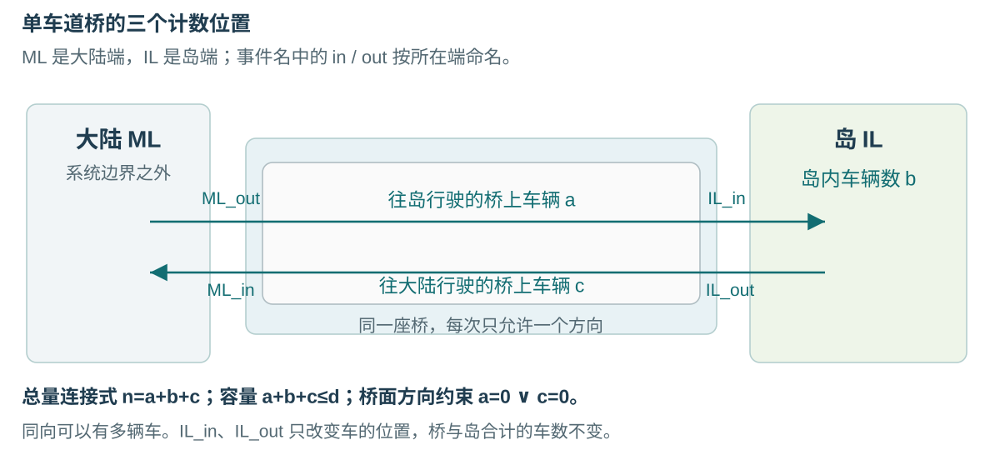
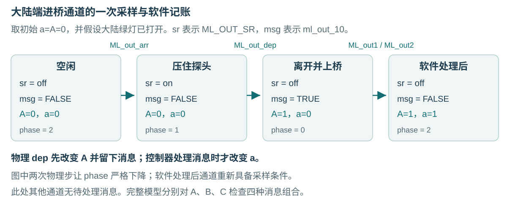

# 第二讲 单车道桥的车辆控制

一座只能单向通车的窄桥连接大陆和小岛。怎样让两端轮流上桥，同时保证桥与岛上的车辆总数不超过容量？本讲从一个计数器开始，依次加入车辆位置、信号灯和传感器。读到最后，应能解释这样一种看似矛盾的状态：桥上实际已有一辆车，控制器仍显示零辆，而系统依然安全。

课件为 Jean-Raymond Abrial 的 *Event-B Course 2. Controlling Cars on a Bridge*。以下页码从 PDF 封面第 1 页起算，与部分页面右上角的课件编号有差异。对应工程为 [L2_Bridge](../03-Rodin工程/L2_Bridge/)。

## 1 先读需求，再确定精化次序

| PDF 页 | 本层需要回答的问题 | 在工程中打开 |
|---|---|---|
| 1–25 | 系统的边界在哪里？设备能提供什么信息？ | 对照下表的 FUN 和 EQP |
| 26–90 | 一次放行怎样保持容量上界？如果系统不动，安全性还够吗？ | C0_Capacity、M0_Capacity |
| 91–163 | 一辆车在桥上向哪边走？哪些移动会改变总数？ | M1_Bridge，沿用 C0_Capacity |
| 164–247 | 灯的颜色怎样替代司机看不见的全局计数？ | C2_Lights、M2_Lights |
| 248–271 | 现场移动和软件更新不同步时，安全性怎样落到真实车辆？ | C3_Sensors、M3_Sensors |
| 272–288 | 哪些结论由初始化、事件保持、精化或收敛证明支持？ | 各机器的 Proof Obligations |

下图把同一座桥的两个行驶方向分开画。读箭头时以车从哪里驶出、到哪里驶入为准，最后再把两个方向想象成同一条窄路。

**系统边界。** ML 指大陆端，IL 指岛端。名称按该端观察，`ML_out` 是车离开大陆、上桥去岛，`IL_in` 是车在岛端下桥进岛。因此一辆车完整往返的事件顺序是 `ML_out → IL_in → IL_out → ML_in`。大陆可提供车辆；桥上和岛上合计最多容纳 `d` 辆。同向可以同时有多辆车。

| 类别 | 需求及其在模型中的落点 |
|---|---|
| FUN-1、2、3（第 9、16 页） | 控制桥梁交通。桥岛总量受限，见 M0 的 `n ≤ d`。桥上两个方向互斥，见 M1 的 `a = 0 ∨ c = 0`。M3 将两条性质表述为真实车辆的性质。 |
| EQP-1、2、3（第 10–12 页） | 两端各有一盏红绿灯，分别控制驶入桥梁的车辆。环境假设是司机遵守红灯。M2 用颜色许可车辆进入，M3 把许可放到车辆离开入口传感器的实际动作上。 |
| EQP-4、5（第 13–14 页） | 四个有车／无车探头负责两个方向、两端的检测。M3 区分探头被压住和车辆已离开、待软件记账两种情况。 |
| FUN-4（第 77–86 页）、FUN-5（第 261 页） | 证明过程中补出了运行应能继续、控制器应及时处理信息的要求。前者用事件可用性分析，后者用单槽消息和下一次采样的守卫表达。这里没有毫秒级截止时间，也没有给每一辆车规定等待时限。 |

### 1.1 先在纸上划出边界

把纸从左至右分为大陆、去岛的桥面、岛、回大陆的桥面四块。中间两块桥面表示同一实体桥的两个行驶方向。画两条处在大陆边界的箭头，再画两条处在岛边界的箭头。站在大陆数“出去又回来”的次数，只会得到一个差值。站在岛上，能分辨进岛和离岛，但此时一辆车并没有跨越“桥加岛”这条总边界。一次物理往返因此可以被四层模型以不同粒度记录。

| 对同一辆车提问 | 在哪一层第一次能回答 | 用什么观察 |
|---|---|---|
| 它是否增加了桥岛总数？ | M0 | 离开大陆时加一、返回大陆时减一 |
| 桥上的车能否与它迎面相遇？ | M1 | 两个方向的分量能否同时为正 |
| 大陆司机能否只看本侧灯决定上桥？ | M2 | 绿灯能推出哪些本来需要查看全局状态的条件 |
| 实车已经转移，软件凭什么知道？ | M3 | 探头从 on 到 off 时留下哪个通道的消息 |

课件第 6–23 页的需求有两个来源。对于装在路边、有几个状态等已确定的事实，可以在上下文或状态类型中描述。对于系统要保证的行为，例如车数上界，须找到**会改变这个量的每个事件**。如果把“永远不超量”只当成有关现场状态的外部公理，那么模型就无法检查自己的放行动作是否破坏上界。本讲在机器里把它作为不变式，让每次进车都面对这个检验。

工程中的 Refines 链按下图从上到下逐层增加可观察信息。阅读每一层时，上方记它要满足的旧要求，旁边记本次新引入的变量。

### 1.2 读模型和读证明时的两个坐标

第一个坐标是“当前状态还是动作后的状态”。模型编辑器的守卫只读当前值；纸上写的撇号标记动作后的值，例如 `a′=a+1`。第二个坐标是“哪个观察层”。在物理层，`A′` 是实际车辆的新计数，`a′` 是软件账本的新计数。先问是哪一层、再加撇号，就不会在物理车辆通过时同时修改两份计数。

下面各层都用同一条读法：先从不变式找到安全边界，再从事件找到谁可能触碰它；然后把动作右端代入边界公式，问旧状态要满足什么条件，才能让更新后的公式成立。Rodin 把这个问题展开为证明义务。导入的 `.bpr` 保存了正式工程的证明树。若要体验从失败到修复，请在独立项目中实验，或打开 [桥梁反例实验](../05-反例实验/L2_Bridge_Lab/README.md)。

## 2 M0 用一个自然数限制总量

### 2.1 状态、事件与反例

把桥和岛看成一块区域。常量 `d` 是上限，上下文给出 `d ∈ ℕ`、`0 < d`。变量 `n` 是区域里的车数，机器要求 `n ∈ ℕ`、`n ≤ d`。自然数包含零。在没有车辆的初态，两个不变式分别化为 `0 ∈ ℕ`、`0 ≤ d`。

| 事件 | 守卫 | 并行执行的动作 | 看见的物理含义 |
|---|---|---|---|
| INITIALISATION | 无 | `n ≔ 0` | 从空区域开始 |
| ML_out | `n < d` | `n ≔ n + 1` | 一辆车离开大陆，桥岛总数加一 |
| ML_in | `0 < n` | `n ≔ n − 1` | 一辆车回到大陆，桥岛总数减一 |

第 34–71 页先去掉守卫，借失败的证明寻找遗漏的条件。要证明 `ML_out` 保持 `n ≤ d`，把不变式里的 `n` 换成动作右侧的 `n + 1`，得到目标 `n + 1 ≤ d`。取 `n=d=2` 就能推翻这个目标，故需要在进车之前检查 `n<d`。同理，把 `n=0` 代入出车动作，得到 −1，说明 `ML_in` 须有 `0<n`。另外两项保持义务分别由自然数对加一封闭，以及减一不会增大数值推出。

第 72–89 页再问两个守卫是否可能一起为假。取 `d=n=0` 便是回答。两条不变式都成立，两件事却都做不了。补上 `d>0` 后，若 `n=0` 则可进车；若 `n>0` 则可出车。工程把 `n < d ∨ 0 < n` 录成机器定理 `thm0_dlf`，让 Rodin 给出 THM 目标。普通 INV 义务只考察事件发生时的安全。

课件第 42–63 页把判断写成相继式。横线或 `⊢` 左边是可用假设，右边是目标。例如 `n<d ⊢ n+1≤d` 依赖整数离散性。证明树从目标向上拆解，直到叶子可由假设或算术规则结束。课件里的 MON 允许略去无关假设，HYP 表示目标本身已在假设中；在 Rodin 中选择与目标有关的假设再用自动证明器，就在做相似的事。

### 2.2 在 Rodin 里做一遍

1. 导入工程后，展开 `L2_Bridge`，双击 `C0_Capacity`。在 Constants 找到 `d`，在 Axioms 找到 `axm0_1` 和 `axm0_2`。自己新建时先建 Context，再建 Machine，并在机器的 Sees 中选择它。
2. 打开 `M0_Capacity`。在 Variables、Invariants、Events 依次读 `n`、`inv0_1`、`inv0_2`、`INITIALISATION`。在 `ML_out` 的 Guards 与 Actions 中分别填写谓词和赋值。各行标签、谓词和动作正文是不同编辑栏。
3. 保存并构建。展开机器的 Proof Obligations。在 `ML_out/inv0_2/INV` 或相应的已消解目标中，读出假设 `n<d` 与结论 `n+1≤d`。部分简单义务会被生成器直接化简，可通过显示过滤器检查。
4. 在练习副本删除 `ML_out` 的守卫并重建。试写出上述 `d=n=2` 的反例，再恢复守卫。若已安装 ProB，可以把一次常量设置选成 `d=2`，连续触发两次 `ML_out`；第三次进车不可用，此时 `ML_in` 可用。

### 2.3 不用猜守卫，从四个保持目标反推

第 37–46 页建议先写出前后谓词。对当前状态 `n` 和下一状态 `n′`，进车满足 `n′=n+1`，出车满足 `n′=n−1`。这两条等式只说“执行会发生什么”。是否有资格执行，要由守卫另行回答。第 47–52 页把这两个事件分别与两条不变式配对，正好有四个问题；若错误地把两件事合成一段加一又减一的程序，四个独立的问题就消失了。

| 假设事件已经发生 | 把动作代入哪条不变式 | 哪些旧状态足以支持结论 |
|---|---|---|
| ML_out | `n+1∈ℕ` | 旧值是自然数，自然数的后继仍是自然数。无需借助容量守卫。 |
| ML_out | `n+1≤d` | 用 `n<d`，配合整数性质得到 `n+1≤d`。若只用 `n≤d`，等号处会溢出。 |
| ML_in | `n−1∈ℕ` | `n∈ℕ` 和 `0<n` 给出 `n≥1`，所以 `n−1≥0` 且仍是整数。 |
| ML_in | `n−1≤d` | 原有 `n≤d` 而 `n−1≤n`。即使边界守卫还没补，这个单独的结论也成立。 |

这里的“反推”只利用这两条需求。也能写出更严的条件，比如进车要满足 `n+2≤d`。它确实保护上界，却会在还剩一个车位时拒绝进车，在 `d=1,n=0` 时甚至会把两条路都堵死。形式化要求安全之外仍要核对行为是否符合需求。课件第 53–64 页用证明失败找最紧要的缺口，第 65–71 页才把两个守卫带回全部保持目标，避免只修一个而忘记重验另一个。

**把一次纸上推导与证明树对应。** 在 `ML_out/inv0_2/INV` 中，公理里有 `d∈ℕ`，机器约束里有 `n∈ℕ`、`n≤d`，本事件另有 `n<d`。目标只剩 `n+1≤d`。课件中的 MON 表示可舍去当前没有用处的假设；INC 把整数的严格上界变成后继的非严格上界。反过来，在 `ML_in/inv0_1/INV`，选 `n≤d` 无法解释为什么不是负数；应选 `0<n`。遇到红色未证目标，先问“证明的是非负，还是上界”，比把所有假设逐个尝试有效得多。

### 2.4 初始化和无死锁是两个不同的起点问题

初始化前没有旧的机器状态可用，所以在 `INITIALISATION/inv0_2/INV` 里不能拿旧的 `n≤d` 来论证。代入 `n≔0`，目标就是 `0≤d`，来自上下文。这里 `d∈ℕ` 已足够，严格正的公理是后来为活性要求补上的。若只看初始化能否建立不变式，很容易误以为零容量也完全符合通车要求。

现在任取已经初始化且满足约束的状态，问还能否走一步。两个事件的守卫连成 `n<d ∨ 0<n`。课件第 77–86 页尝试在没有 `0<d` 的情况下证明它。思路可以写成反证：若左支为假，由 `n≤d` 得 `n=d`；若右支也为假，由 `n∈ℕ` 得 `n=0`；两者合并得 `d=0`。因此排除零容量便可结束证明。正式机的 `thm0_dlf` 把这个结论标为 Theorem，证明只许使用前面的公理和不变式，不能把该定理自身当作假设。

**最小可运行例子。** 把 `d` 取成 1，初始化后从空到满，再从满回空。空时出车守卫假、进车守卫真；满时恰好相反。若把进车符号误录为 `≤`，在满状态仍能进入，下一步立即产生 2 辆；若误录为 `n+1<d`，从初态就走不了。这两个错误在 Rodin 中指向不同目标，前者看 `ML_out/inv0_2/INV`，后者在采用相应新守卫的无死锁析取后检查 THM。自己改变守卫时也要同步调整显式书写的无死锁定理，否则检查的仍是旧析取。

### 2.5 对照模型树做一次独立录入验收

第一次练习可以把包中工程留作答案，另建项目。从 Event-B Explorer 右击项目，选 New → Event-B Component，先新建 Context，填写名称 `C0_Capacity`。在 Constants 加一项，Identifier 只填 `d`；在 Axioms 分两行填公理。再建 `M0_Capacity`，添加 Sees Context，把上下文选为目标。只在变量栏填 `n`，它的类型由不变式给出。把两条不变式和一条定理分别加入，定理行启用 Theorem。

选中新机器自带的 `INITIALISATION` 添加 Action，两个普通事件各添加一条 Guard 和一条 Action。Guard 的 Predicate 栏接受能判真假的表达式，例如 `n<d`；Action 的 Assignment 栏填写一次更新，例如 `n ≔ n+1`。若在动作栏写成 `n=n+1`，Rodin 连语法检查都不能通过。保存后先查看 Problems，再在 Proof Obligations 查看 7 个目标：初始化两项，两条普通事件各两项，加无死锁定理一项。该数量属于随包工程，和课件第 275 页的课堂统计口径不同。

在已保存的工程中打开 `thm0_dlf/THM`，找出目标的左、右两支；再打开 `ML_out/inv0_2/INV`，留意这里的守卫已经在假设侧。这就是读定理与读事件目标时最直观的差别。可以用状态序列 `0,1,2,1,0` 再做一次 `d=2` 的纸上验收：写下每一步的事件，并检查首尾两次事件是否真的使能。

## 3 M1 把同一个车数分到三个位置

### 3.1 粘合不变式给出两个观察层的关系

`a` 是桥上驶向岛的车数，`b` 是岛上的车数，`c` 是桥上驶向大陆的车数。三者都是自然数。用 `a + b + c = n` 把新状态与 M0 的抽象状态联起来，这叫粘合不变式。于是 `a+b+c≤d`。用 `a=0 ∨ c=0` 表示桥上至多有一个行车方向。两边都是零时，桥为空。`n` 在本层作为抽象机的变量出现在粘合式中，本层的具体事件只维护三个分量。

| 事件 | 所精化的事件 | 守卫 | 动作 |
|---|---|---|---|
| INITIALISATION | 抽象初始化 | 无 | `a,b,c` 各置 0 |
| ML_out | M0.ML_out | `a+b<d ∧ c=0` | `a ≔ a+1` |
| ML_in | M0.ML_in | `0<c` | `c ≔ c−1` |
| IL_in | 新事件，抽象层看作 skip | `0<a` | `a ≔ a−1`，`b ≔ b+1` |
| IL_out | 新事件，抽象层看作 skip | `0<b ∧ a=0` | `b ≔ b−1`，`c ≔ c+1` |

第 99–131 页证明旧事件怎样精化。以 `ML_out` 为例，由 `c=0` 与粘合式可得 `n=a+b`，因此具体守卫 `a+b<d` 蕴含抽象守卫 `n<d`，这正是 GRD。再比较动作后的两边，`(a+1)+b+c = n+1`，说明总数改变方式一致。第 132–143 页的两个岛端事件都在桥岛区域内部移动一辆车，两个分量一增一减，总数不变。每个事件内部多行动作同时生效，各右侧表达式均读取旧状态。

第 144–161 页用变式 `V=2∗a+b` 控制新事件。每个计入 `a` 的车辆还有“到岛、从岛出发”两个内部步骤，计入 `b` 的还有一个。于是 `IL_in` 使 V 从 `2a+b` 变为 `2(a−1)+(b+1)=V−1`，`IL_out` 也使 V 减一。V 是非负整数，所以仅靠内部事件无法无限运行。普通事件 `ML_out` 可以使 V 增加。相对无死锁还要考察**全部守卫的析取**。若 `a>0` 可进岛，若 `c>0` 可回大陆；剩下 `a=c=0` 时，`b>0` 可离岛，`b=0` 则由 `d>0` 可离大陆。

### 3.2 在 Rodin 里建精化并走一圈

1. 从 `M0_Capacity` 创建 Refine 精化机，命名 `M1_Bridge`，设置 Sees 为 `C0_Capacity`。若向导复制了 `n` 和相关动作，在具体层改为 `a,b,c`，保留 Refines 指向 `M0_Capacity`。加入 `inv1_1` 至 `inv1_5` 后保存。
2. 初始化将三个分量各置零。把 `ML_out` 和 `ML_in` 的 Refines 分别指向同名抽象事件。重写动作时使用非 Extended 事件，这样不会继承已被替代的抽象赋值。
3. 新建 `IL_in`、`IL_out`，让它们的 Refines 留空，Convergence 选 Convergent。在机器 Variant 处录入 `2 ∗ a + b`。工程里另有可直接用于后续推理的容量定理 `thm1_cap` 与相对无死锁定理 `thm1_dlf`。
4. 取 `d=2`。从 `(0,0,0)` 经 `ML_out → IL_in → IL_out → ML_in` 依次到 `(1,0,0) → (0,1,0) → (0,0,1) → (0,0,0)`。在第三个状态后，大陆端进车应被 `c=0` 拦住。若误把 `IL_out` 的方向守卫删除，在有向岛车辆且岛上有车时就可能双向占桥。

### 3.3 五条不变式怎样一起描述一段桥

| 标签与原式 | 读法与用途 |
|---|---|
| `inv1_1` · `a ∈ ℕ` | 去岛途中车辆必须是自然数。守住减法的是进岛事件的正数守卫。 |
| `inv1_2` · `b ∈ ℕ` | 岛上存量允许为零。空岛时应由离岛事件的守卫阻止继续扣减。 |
| `inv1_3` · `c ∈ ℕ` | 返回大陆途中可有多辆车，回大陆事件只有在本分量为正时才可减一。 |
| `inv1_4` · `a + b + c = n` | 将三个具体分量加起来还原父机中的总数。它让同一辆车经过岛端边界时不改变抽象 n。 |
| `inv1_5` · `a = 0 ∨ c = 0` | 当一个方向为正，另一个方向必须为零。两者均为零是合法的空桥状态。 |

`thm1_cap` 是后续层经常使用的便利结论。把 `inv1_4` 与抽象层的 `inv0_2` 连用，一次代入即可得到它。它没有要求三处人数分别小于各自的上限，也没有要求桥上只能有一辆车。例如容量取 3，`(a,b,c)=(2,1,0)` 满足所有这些约束，同向两辆可以同时在桥。另一个状态 `(1,0,1)` 虽然总数才 2，两个方向却都不为零，所以被 `inv1_5` 排除。用两个具体小数值就能检验自己是否把“单向”误读成“单辆”。

### 3.4 两个旧事件怎样跨越两层的状态表示

第 102–108 页的图可看成一个方框。左上角是动作前的抽象状态 `n`，左下角是动作前的具体状态 `(a,b,c)`，二者要满足粘合式。沿两条水平边分别执行抽象、具体事件，右边的状态还须满足同一粘合式。只证明“具体动作后是合法状态”，并不能保证它真的模拟父事件；反之，只把总数算对，也不能推出方向安全。

**大陆进桥。** 具体守卫有两行，`a+b<d` 与 `c=0`，须同时满足。要证明 `ML_out/grd1/GRD`，先用 `a+b+c=n` 把目标 `n<d` 改写为 `a+b+c<d`，再代入 `c=0`，得到现有守卫。方向条件本身也不可随意删除。若有车正在回大陆，再放进一辆去岛的车，具体状态就违反单行要求。更新后的 `a′=a+1`，其余分量不动，抽象更新 `n′=n+1`。四角形右边写作 `(a+1)+b+c=n+1`，由旧粘合式两边加一得到。方向不变式的目标是 `a+1=0 ∨ c=0`，右支直接来自守卫。

**驶回大陆。** 这里守卫只有 `0<c`。验证 `ML_in/grd1/GRD` 时，利用 `a,b∈ℕ` 读出 `c≤a+b+c=n`，即得 `0<n`。新分量为 `c′=c−1`，守卫保证新值仍是自然数，两层总量同减一。方向的保持稍微不同：因为 `c>0`，旧析取 `a=0 ∨ c=0` 只能由左支成立，故 `a=0`。这一分量未被事件修改，动作后仍能选择左支。第 119–127 页对这两个保持目标分别展开；可先手写到“左支一定为真”为止，再对照 Rodin 的目标。

**初始化。** 抽象机写 `n≔0`，具体机的三项初始化均写零。新粘合式化为 `0+0+0=0`；方向条件化为 `0=0 ∨ 0=0`。该计算不需要假设旧状态里桥已经是空的。初始化在模型启动时建立桥为空这一事实。

### 3.5 两个新事件为什么可以在抽象层“看不见”

第 132–143 页引入进岛和离岛。对于 `IL_in`，假定 `a>0`。新状态是 `(a−1,b+1,c)`。两项同时赋值，求和给出 `a−1+b+1+c=a+b+c`，等于旧的 `n`。于是抽象机选择一步 skip，即 `n′=n`。方向不变式也成立：旧状态有 `a>0`，由互斥得 `c=0`；动作没有给 c 加车。在 `IL_in/inv1_5/INV` 中，不必费力证明 `a−1=0`，因为旧的 a 可以是 2，右支便足够了。

对于 `IL_out`，离岛需要 `b>0`，因为减少的是岛上存量；同时需要 `a=0`，因为本次要将向大陆车道的 `c` 加一。动作后总数 `a+(b−1)+(c+1)=n`，用抽象 skip 即可匹配。左支 `a=0` 未改变，所以方向安全。把这两条涉及 b 的事件交换顺序会改变是否使能：若初始为空，`IL_out` 并不能先“借”随后才会到岛的一辆车。

留意守卫加强与新增事件之间的分工。旧事件被额外条件堵住时，有时得先执行一连串内部事件才能继续。例如 `(a,b,c)=(1,0,0)` 且 `d=1`，抽象层的 `ML_in` 可用，具体的 `ML_in` 却因 `c=0` 暂时关闭。依次执行 `IL_in → IL_out` 后，车进入回程桥面，这时 `ML_in` 才可执行。GRD 只要求“具体可用则抽象可用”。反方向的立即可用在这个例子中显然过强。

### 3.6 给内部进展选一个会严格下降的量

第 144–149 页选 `2 ∗ a + b`，其中乘号是 Rodin 的数学符号 `∗`。先试 `a+b+c` 会发现两种内部事件都保持总数，不能严格下降。若只试 `a+b`，进岛时 `a` 减一、`b` 加一，两项抵消。现在设候选量为 `k∗a+b`。在 `IL_in` 后的变化量是 `1−k`，要为负，整数权重就至少取 2；在 `IL_out` 后的变化量是 −1。取最小可用权重 2，正好得到课件的式子。

Rodin 在两个新事件下分别给 NAT 和 VAR。NAT 目标可以由 `a,b∈ℕ` 与自然数加乘封闭推出。VAR 对 `IL_in` 要验证 `2∗(a−1)+(b+1)<2∗a+b`，展开左式，系数为 `2a−2+b+1`，所以左边恰是右边减一。对 `IL_out` 则是 `2∗a+(b−1)<2∗a+b`。只需比较具体动作前后的这一个量，不需让岛上人数或桥上每个分量都下降。普通的 `ML_out` 能把变式加二，故“变式一直下降直到永久停车”是错误的读法。

### 3.7 在 Rodin 对照事件映射、相对无死锁与一次完整测试

在 M1 的 Edit 页先展开 Refines Machine，应只有 `M0_Capacity`；Sees Context 中是 `C0_Capacity`。展开 Variables 只见 a、b、c。双击 `inv1_4` 可以引用抽象变量 n；若复写时编辑器报 n 未声明，先检查当前机器是否真正 refines M0，切勿为消标记就把 n 又加成需要每次更新的具体变量。进入 Events，`ML_out` 和 `ML_in` 各有一项 Refines Event。两个 IL 事件不填这个链接，其 Convergence 都设为 convergent。最后点击机器节点添加数值 Variant 并保存。

去 Proof Obligations 查找 `thm1_dlf/THM`。它的前件是 M0 两个守卫的析取，后件是 M1 四个守卫的析取。这让“出现任何新的死锁”成为可检验的问题。若想在纸上还原第 150–157 页较长的证明，可以依次问三个小问题：有去岛的车吗？有回大陆的车吗？两者均无时岛上有车吗？依次对应 `IL_in`、`ML_in`、`IL_out`。若三者答案皆否，状态全零，由正容量可 `ML_out`。每次只需写出一条可用事件，不需要证明四条同时可用。

| 取 d=2，动作后 | a | b | c | 抽象 n | 数值变式 | 下一步为什么可选 |
|---|---:|---:|---:|---:|---:|---|
| INITIALISATION | 0 | 0 | 0 | 0 | 0 | 大陆有容量且回程桥空 |
| ML_out | 1 | 0 | 0 | 1 | 2 | 同向第二辆车仍有位置 |
| ML_out | 2 | 0 | 0 | 2 | 4 | 容量已满，桥上去岛车可下桥 |
| IL_in | 1 | 1 | 0 | 2 | 3 | 岛上虽有车，仍因 a>0 不能反向上桥 |
| IL_in | 0 | 2 | 0 | 2 | 2 | 去岛方向清空，允许离岛 |
| IL_out | 0 | 1 | 1 | 2 | 1 | 一辆已上回程桥，另有一辆在岛上 |
| IL_out | 0 | 0 | 2 | 2 | 0 | 内部移动已无可选，回大陆仍可选 |
| ML_in | 0 | 0 | 1 | 1 | 0 | 尚有一辆要回大陆 |
| ML_in | 0 | 0 | 0 | 0 | 0 | 回到空态，可以重新进车 |

这条轨迹可以用来逐列检验三种不同结论：抽象 n 看总数，`a=0 ∨ c=0` 看单行，变式看两个 IL 事件。没有哪一列可以替另外两列完成检查。

## 4 M2 信号灯怎样实现单行桥

### 4.1 驾驶员看到什么，控制器须保证什么

上下文 `C2_Lights` 扩展容量上下文，引入集合 `COLOR={green,red}` 和 `green ≠ red`。机器保留 `a,b,c`，添加 `ml_tl, il_tl ∈ COLOR`。第 167–198 页把绿灯解释成对驾驶员的承诺：

- 大陆灯为绿意味着 `c=0 ∧ a+b<d`，即对向已经清空，区域还有车位。
- 岛端灯为绿意味着 `a=0 ∧ 0<b`，即对向已经清空，岛上确实有车可出。
- `ml_tl=red ∨ il_tl=red` 保证至少一侧是红灯，允许两侧同时红灯。

两个绿灯条件单独使用仍可能允许双绿。例如桥空、岛上有一辆车且容量为二时，两边各自的条件都成立。一旦大陆驶入一辆车，`a` 变为 1，便破坏岛端绿灯的承诺。加入互斥不变式后，开一侧绿灯的同一事件也须把另一侧变红。

第 199–221 页把两端的上桥事件各拆为两个分支。剩最后一个车位时，大陆必须在放行后立即变红。岛上只剩最后一辆时，岛端也必须在放行后立即变红。第 224–239 页又发现，两灯只要反复换色，即使没有一辆车移动，系统也能无限执行换灯事件。为记录本次绿灯是否已有车通过，加入数值标志 `ml_pass,il_pass∈{0,1}`。当一侧为红，要求该侧标志为 1。开本侧绿灯要求对侧标志为 1，同时把本侧标志清零；本侧有车驶入则重新置 1。初始化取两灯红、两个标志均为 1，允许第一次放行。

| 事件与抽象目标 | 守卫 | 动作（同一行并行） |
|---|---|---|
| ML_out1 → ML_out | 大陆绿，`a+b+1<d` | `a≔a+1`，`ml_pass≔1` |
| ML_out2 → ML_out | 大陆绿，`a+b+1=d` | 同上，并令大陆灯红 |
| IL_out1 → IL_out | 岛端绿，`b≠1`（由绿灯知 `b>0`） | `b≔b−1`，`c≔c+1`，`il_pass≔1` |
| IL_out2 → IL_out | 岛端绿，`b=1` | 同上，并令岛端灯红 |
| ML_in → ML_in；IL_in → IL_in | 各自沿用 `c>0`、`a>0` | 各自沿用 M1 的回大陆、进岛动作 |
| ML_tl_green，新事件 | 大陆红，`a+b<d`，`c=0`，`il_pass=1` | 大陆灯绿，岛端灯红，`ml_pass≔0` |
| IL_tl_green，新事件 | 岛端红，`0<b`，`a=0`，`ml_pass=1` | 岛端灯绿，大陆灯红，`il_pass≔0` |

每次换灯都把原来为 1 的本侧标志清零，另一标志不变。因此 `ml_pass+il_pass` 严格下降。旧的车辆事件可把标志置回 1，所以这条收敛结论专门排除了“只有换灯”的无限内部序列。旧事件在同时保留的车辆变量上必须模拟父事件的更新，这就是课件第 179–185、241 页的 SIM。

### 4.2 在 Rodin 里检查事件分支

1. 先创建 `C2_Lights`，Extends 选 `C0_Capacity`；在 Sets 新建 `COLOR`，在 Constants 新建 `red,green` 两项，录入两个公理。再从 M1 精化出 `M2_Lights`，设置 Sees 为新上下文，保留三个车辆变量。
2. 建立四个新变量和 `inv2_1` 至 `inv2_9`。对照表逐项填写事件。两个大陆分支都在 Refines 选 `ML_out`，两个岛端分支都选 `IL_out`。无须按分支再造两台机器。初始化加入两灯与标志的四个赋值。
3. 两个换灯事件设为 Convergent，Variant 设为两标志之和。构建后可从换灯事件的 VAR 目标，追到 `ml_tl=red ⇒ ml_pass=1` 或相应的岛端不变式。自动证明残留时，先选“本侧灯红”和相应蕴含式，再做算术推理。
4. 取 `d=2`。从双红开始，执行 `ML_tl_green → ML_out1 → IL_in → ML_out2`。此时 `(a,b,c)=(1,1,0)`，两灯均红，第二辆车占掉了最后的容量。再执行 `IL_in → IL_tl_green → IL_out1 → ML_in → IL_out2`。用每一步的 `b` 和灯色判断为什么两个岛端分支按这个次序触发。

### 4.3 逐条读颜色、方向和 pass 标志

上下文从 `C0_Capacity` 扩展出 `C2_Lights`，故本层仍可读容量 d。把颜色写成独立载体集，可以在静态检查中发现把绿灯与整数 1 相比较的错误。公理 `COLOR = {green, red}` 说明没有黄灯等第三种状态，`green ≠ red` 说明两个名字代表不同对象。两条合用才能从“一盏灯不是 green”推出“它等于 red”。只声明两个名字，并不能排除二者恰好相等。

| 标签与原式 | 读法与用途 |
|---|---|
| `inv2_1` · `ml_tl ∈ COLOR` | 大陆信号始终取一种合法颜色；依上下文只能为红或绿。 |
| `inv2_2` · `il_tl ∈ COLOR` | 岛端有自己独立的颜色。某端绿时另一端为何要红，由后面的互斥式建立。 |
| `inv2_3` · `ml_tl = green ⇒ (a + b < d ∧ c = 0)` | 大陆开绿给出两项承诺：有余量且没有回大陆的车。大陆进桥的 GRD 需要这两项。 |
| `inv2_4` · `il_tl = green ⇒ (0 < b ∧ a = 0)` | 岛端开绿证明岛上有车且没有去岛的迎面车辆。两个岛端分支的守卫依赖这条保证。 |
| `inv2_5` · `ml_tl = red ∨ il_tl = red` | 至少一端为红。它允许双红，同时排除了单车道的两端都获准进车。 |
| `inv2_6` · `ml_pass ∈ {0, 1}` | 大陆本轮放行标志用整数编码，可与另一标志相加形成变式。 |
| `inv2_7` · `il_pass ∈ {0, 1}` | 岛端通行标志用相同编码，两个标志各属于拥有它的一侧。 |
| `inv2_8` · `ml_tl = red ⇒ ml_pass = 1` | 大陆处于红灯时，其标志一定为 1。给大陆开绿时本侧由 1 降至 0。 |
| `inv2_9` · `il_tl = red ⇒ il_pass = 1` | 岛端处于红灯时，其标志一定为 1。给大陆开绿会重置灯色，所以也要确保岛端标志能满足此式。 |

绿灯承诺是单方向蕴含。知道大陆绿，便能推知安全上桥所需的条件；如果桥空且有容量，控制器仍可暂时保持大陆红。这个自由使控制器有机会照顾岛端。pass 标志也不能仅凭名字读成累计流量。一次进桥后置 1，再进一辆仍为 1。即使当前两方面实际都没有车经过，也可在初态取两个 1，作为允许首次启用相应方向的起始许可。若双红时把两个标志初始化为 0，立刻违反最后两条不变式，空桥还可能失去开灯的条件。

### 4.4 为什么把一次进桥拆成两个事件

可以顺着第 166–185 页的第一稿自己推一遍。先只加灯、保留三个计数，再让 `ML_out` 的具体守卫只读大陆绿。守卫加强立即成立，因为绿灯蕴含父事件的 `c=0`、`a+b<d`。父事件和子事件对 `a` 的赋值完全一致，所以在共同变量上的模拟也成立。但这时还没有证明动作执行后那盏绿灯作出的承诺仍是真的。若 `a+b=d−1`，一次放行使 `a′+b′=d`，而灯没有改变，便留下“有空位”这一假承诺。三个检查中前两个通过，第三个失败，正好解释为什么第 179–185 页要区分 GRD、SIM 和 INV。

在大陆绿的前提下 `a+b<d`，所有量是整数，因此 `a+b+1≤d`。按严格小于或等于分支便覆盖所有此时可以进桥的状态，两分支互斥。在第一分支动作后 `a′+b′=a+b+1<d`，可保持绿灯；在第二分支容量用完，本侧灯原子地变红，此时 `ml_tl′=green` 为假，相应蕴含式仍为真。若把“关灯”拆成之后才可能执行的独立事件，在两事件之间仍有一个错误的绿灯状态，INV 检查会在放行事件处失败。分支中的额外守卫是对本次更新后余量的**旧状态计算**，不是先赋值再检查。

岛端的边界是待出岛车辆存量。由岛端绿得 `b>0`，因而 `b≠1` 实际意味着 `b≥2`；减少一辆后仍有 `b′>0`。当 `b=1`，这次放行后岛上成为空，必须同一步关岛端灯。大陆的判断有常量 d，岛端只看当前 b。若简单照抄大陆的容量判断去写岛端的两个分支，可能在岛上只剩一辆时给出错误许可。

### 4.5 从四种失败理解最终的协调协议

**双绿。** 第 186–198 页尝试证明一侧放行后不破坏另一侧绿灯条件。假设桥空且岛上有车、区域未满，两个绿灯条件分别可满足。如果两个灯都能开绿，`ML_out` 的动作就使 `a=0` 变假，破坏岛端承诺。由此引入“至少一侧为红”。随后每个换灯事件都必须同时令对侧为红，见第 223 页。单独加入互斥不变式而不修改动作，只会把问题转化成另一条红色 INV。

**最后一个车位与最后一辆车。** 第 199–212 页追大陆绿的保持，第 213–221 页追岛端绿的保持。两种失败都发生在更新后仍把本端灯留绿的分支，但触发边界不同。可把正式机的 `ML_out2` 与 `IL_out2` 并排打开，注意前者给 a 加一，后者给 b 减一、给 c 加一；两者各自只关闭本端灯，不把对方直接改绿。对方是否有资格变绿，要由独立换灯事件重新检查桥上状态。

**灯在动，车不动。** 第 224–231 页的情形须满足 `a=c=0`、`0<b<d`。岛上有可出的车，大陆也有空位。只要两侧互相把另一灯变红，再分别打开自己，本地动作就能永远切换，两个安全车数和互斥条件一直正确。分支补救了容量边界，但不能消除这种无限内部序列。第 232–237 页才增加通行记录，要求不能在对侧刚得到通行机会、却没有车辆利用机会时马上夺回绿灯。

**两个变式为什么不同。** M1 用 `2∗a+b` 限制新出现的岛内移动。到了 M2，要限制的新内部动作是换灯，换灯根本不改三个车数，因此原变式不可能在它们上面严格下降。M2 的 `ml_pass+il_pass` 只衡量这两种换灯。以 `ML_tl_green` 为例：旧的大陆灯红蕴含旧 `ml_pass=1`，守卫又要求 `il_pass=1`；事件把大陆标志置 0，岛端标志保持。旧和为 2，新和为 1。换过以后，若立即尝试开岛灯，就被新的 `ml_pass=0` 拦住。大陆一辆车通过后置回 1，才可能让对面换灯。对 `IL_tl_green` 交换两侧名称即可写出同样的算式。这里断言的是不可能仅换灯而无限运行，行人、交通需求与最大等候时间均未建模。

### 4.6 一次从录入到证明树的核对

在 `M2_Lights` 的事件编辑区，先展开 `ML_out1` 的 Refines，确认目标是 M1 中的 `ML_out`。新建第二个分支时 Refines 仍选同一目标。让 M1 中已经改变的守卫不自动出现在 M2 新事件里，可使用非 Extended 形式，逐行输入绿灯判断和余量判断。双击 `ML_out1/grd2/GRD`，父守卫 `c=0` 出现在 Goal，具体守卫“大陆绿”属于可用假设。用 `inv2_3` 的右支便能证明。这时 Goal 中没有 `a′`，因为正在比较执行之前的使能条件。

接着切到 `ML_out1/inv2_3/INV`，现在 Goal 里要处理更新后的量，特别是 `a+1+b<d`。用本分支的余量守卫即可。再看 `ML_out2/inv2_3/INV`，动作已给大陆灯赋 red，应该从前件 `red=green` 不可能去结束，而非试图从 `a+b+1=d` 推出严格小于。用同一变量、同一安全承诺比较两个分支，比机械浏览几十个目标更容易发现误关另一盏灯或漏写动作。

对于 `ML_tl_green/inv2_9/INV`，动作会把岛端灯改为红；要证明岛端变红后 `il_pass=1`，就要回到换灯守卫的第四行 `il_pass=1`。这个守卫同时承担两项工作：保证对侧已获得一次机会，也保证对侧红灯与通行标志的联系。最后看 `ML_tl_green/VAR`，这次有用的却是本端旧灯为红以及 `inv2_8`。若分不清两侧标志，分别追这两条目标会指出应检查哪一端。

| 取 d=2，动作后 | (a,b,c) | 大陆灯／岛灯 | (ml_pass,il_pass) | 此处可观察到的事 |
|---|---|---|---|---|
| INITIALISATION | (0,0,0) | 红／红 | (1,1) | 第一次放行由正容量支持 |
| ML_tl_green | (0,0,0) | 绿／红 | (0,1) | 本侧尚无车使用本轮绿灯 |
| ML_out1 | (1,0,0) | 绿／红 | (1,1) | 还有一个车位，允许保持绿灯 |
| IL_in | (0,1,0) | 绿／红 | (1,1) | 桥已经清空，此时换向也可行 |
| ML_out2 | (1,1,0) | 红／红 | (1,1) | 选择再放大陆车，达到容量上界 |
| IL_in | (0,2,0) | 红／红 | (1,1) | 两辆都在岛上 |
| IL_tl_green | (0,2,0) | 红／绿 | (1,0) | 轮到岛端，岛端标志清零 |
| IL_out1 | (0,1,1) | 红／绿 | (1,1) | 岛上还有一辆，保持绿灯 |
| ML_in | (0,1,0) | 红／绿 | (1,1) | 第一辆返回大陆 |
| IL_out2 | (0,0,1) | 红／红 | (1,1) | 岛上的最后一辆离开，岛灯红 |
| ML_in | (0,0,0) | 红／红 | (1,1) | 回到与初态相同的具体状态 |

相对 M1，本层的每个上桥动作都能由其父事件模拟，两个换灯动作则让 `a,b,c` 全部保持。模型保有非确定选择，例如表中第一次 `IL_in` 以后可选先换向，也可选再放一辆大陆车。两种选择都必须满足不变式。验证 `thm2_dlf/THM` 时按“有桥上去岛车、有桥上返程车、任一侧绿灯、最后双红”依次分情况。前两种直接用出桥事件，两种绿灯按边界选择放行分支；若桥空且双红，两个通行标志均为 1，岛上有车则开岛灯，岛上也为空则开大陆灯。

## 5 M3 接入四个传感器，并证明真实车辆安全

### 5.1 把控制器和环境放进同一台机器

第 250–264 页的闭合模型把软件、物理世界和两者之间的通信放在一起。大写 `A,B,C` 是三处的真实车数，小写 `a,b,c` 是控制器已记账的数量；两盏灯是控制器向环境发出的信号。每个探头有一个 `SENSOR={off,on}` 型状态和一个 `BOOL` 型的单槽消息。名称后缀 `10` 表示探头从 on 跳变到 off 时产生消息。下表的三个动作可能与别的通道交错。

| 通道 | 车辆压住探头 arr | 车辆离开探头 dep | 控制器处理消息 |
|---|---|---|---|
| ML_out | 大陆外来车辆可到入口 | 大陆绿灯才能离开；`A≔A+1` | `ML_out1/2` 更新 `a` 和本侧通行标志 |
| IL_in | `A>0` 才可到岛端出口 | `A≔A−1, B≔B+1` | `IL_in` 更新 `a,b` |
| IL_out | `B>0` 才可到岛端入口 | 岛端绿灯才能离开；`B≔B−1, C≔C+1` | `IL_out1/2` 更新 `b,c` 和本侧通行标志 |
| ML_in | `C>0` 才可到大陆端出口 | `C≔C−1` | `ML_in` 更新 `c` |

每个 `*_arr` 都要求本探头为 off 且本通道消息为 FALSE，动作只把探头置 on。司机可以在红灯时到达入口等待。每个 `*_dep` 都要求本探头为 on，动作包括关掉探头、将本通道消息置 TRUE 以及表中的真实车数更新。刚产生消息时，小写计数还没动。对应软件事件运行时清除消息，同时完成逻辑记账。下一个同通道的 arr 必须等单槽腾空，从模型上表达 FUN-5。

以下图的大陆入口为例。观察两次探头跳变与一次软件确认之间的间隔：实际 A 在 dep 处改变，逻辑 a 在控制器取消息时才追上。

**八个逻辑事件的具体守卫。** `ML_out1/2` 读取 `ml_out_10=TRUE`，分别检查 `a+b+1<d` 或 `=d`；`IL_out1/2` 读取 `il_out_10=TRUE`，分别检查 `b≠1` 或 `b=1`。四个分支执行 M2 同名动作，并清除本通道消息。入口消息成立蕴含相应的灯仍是绿灯，这使四个逻辑事件满足父事件的灯色守卫。`ML_in` 要求 `ml_in_10=TRUE ∧ c>0`，`IL_in` 要求 `il_in_10=TRUE ∧ a>0`，两者也用 M2 的计数动作并清除消息。`ML_tl_green` 沿用 M2 四条守卫并加 `il_out_10=FALSE`；`IL_tl_green` 对称地加 `ml_out_10=FALSE`。当对侧已经实际放行但控制器尚未记账时，不能再抢先换灯。

### 5.2 用尚未处理的消息计算物理量与逻辑量之差

工程将课件 `inv3_1` 至 `inv3_34` 按顺序写在 `M3_Sensors`。可以先读末尾的安全目标，再回头找支撑它们的等式。

| 标签 | 阅读方法 |
|---|---|
| inv3_1–11 | 四个探头属于 SENSOR，三个物理计数为自然数，四个消息为 BOOL。 |
| inv3_12–14 | 岛端出口探头为 on 意味着 `A>0`，岛端入口探头为 on 意味着 `B>0`，大陆出口探头为 on 意味着 `C>0`。大陆入口外侧不计数。 |
| inv3_15–20 | 一个入口消息待处理时，该入口仍为绿灯；每个探头为 on 时，本通道尚无待处理消息。 |
| inv3_21–32 | 分别把每处的两条相关消息按真值组合列为四种情况，精确给出 `A−a`、`B−b`、`C−c`。 |
| inv3_33–34 | 要保证的物理结论为 `A=0 ∨ C=0` 和 `A+B+C≤d`。检查逻辑计数通过，还须证明这两行对物理事件也保持。 |

为口算方便，令 `[m]` 在消息 m 为 TRUE 时取 1，在 FALSE 时取 0。这是读公式的简写；工程逐条录入课件式的布尔分类。

- `A = a + [ml_out_10] − [il_in_10]`。一辆车从大陆已上桥、尚未记账，真实数比账面多一；一辆车已进岛、尚未记账，真实数比账面少一。
- `B = b + [il_in_10] − [il_out_10]`。进岛留下正差，从岛驶出留下负差。
- `C = c + [il_out_10] − [ml_in_10]`。驶向大陆的物理队列在岛端加入车辆，在大陆端移走车辆。

以 `ML_out_dep` 的容量证明为例。探头为 on 意味着 `ml_out_10=FALSE`；绿灯意味着 `c=0` 且 `a+b<d`。把三个差值式相加，岛端的两项各自抵消，得到 `A+B+C=a+b+c+[ml_out_10]−[ml_in_10]`。动作前总数至多为 `a+b`，再进一辆车仍不超过 d。这个推导解释了为什么上界能对传感器刚发消息、软件仍未运行的瞬间成立。

### 5.3 在 Rodin 里实现并观察消息滞后

1. 扩展 `C2_Lights` 创建 `C3_Sensors`。输入集合 `SENSOR`、常量 `off,on` 与枚举、互异公理。工程还定义辅助函数 `phase` 供下面的收敛证明使用。注意声明 `ml_pass∈{0,1}` 和 `ml_out_10∈BOOL` 时各用自己的类型。
2. 从 M2 精化出 `M3_Sensors` 并 sees 新上下文。保留 M2 的七个变量，增加三个实际车数、四个探头、四个消息。初始化在 M2 的基础上追加三个零、四个 off 和四个 FALSE。每个量分成一个动作，模型树中可直接核对遗漏的名称。
3. 对照第 265–268 页建立八个同名逻辑事件，Refines 指向父事件。每个信号灯变色事件都有“对侧入口消息已清”的额外守卫。再根据第 269–270 页建八个新事件，如 `ML_out_arr`、`ML_out_dep`。一个把探头置 on；另一个改变实际车数并发出消息。它们在抽象层都对应 skip。
4. 工程给八个新物理事件选 Convergent。辅助函数 `phase(sr ↦ msg)` 把“空闲 (off,FALSE)、已压住 (on,FALSE)、待处理 (off,TRUE)”分别映到 2、1、0，第四个不可达组合也定义为 0，使函数为全函数。变式为四条通道的 phase 之和。arr 把 2 降为 1，dep 把 1 降为 0。由此得到新物理事件不能单独无限运行。这个变式是随包补充的实现细节。
5. 从初态取 `d=1`。按下表顺序执行；表中只列大陆入口消息和驶向岛的两种计数。若软件确认后仍显示 TRUE，应检查逻辑事件是否漏掉 `ml_out_10 ≔ FALSE`。

| 执行完的事件 | 大陆灯 | 大陆入口探头 | 待处理 | 真实 A | 逻辑 a |
|---|---|---|---|---:|---:|
| INITIALISATION | 红 | off | FALSE | 0 | 0 |
| ML_tl_green | 绿 | off | FALSE | 0 | 0 |
| ML_out_arr | 绿 | on | FALSE | 0 | 0 |
| ML_out_dep | 绿 | off | TRUE | 1 | 0 |
| ML_out2 | 红 | off | FALSE | 1 | 1 |

接着执行 `IL_in_arr → IL_in_dep → IL_in`。第二步后，现场车已进岛，软件还认为车在桥上。第三步后，真实和逻辑状态都恢复为 `(0,1,0)`。再执行 `IL_tl_green`，岛端即可发车返回大陆。若取 `d=1` 却试图选择 `ML_out1` 或 `IL_out1`，非最后车位／非最后一辆的分支均不可能出现；改用 `d=2` 可观察全部分支。

### 5.4 给每个变量分配所有者，再打开上下文

在 M3 选择某个动作之前，先问谁有能力执行它。路面车辆压住探头时，能直接改变探头状态，无法直接给软件里的 `a` 写值。软件取走消息时，可以修改账本，无法让已经上桥的车辆再上一遍桥。将这些动作放在同一闭合机器中，是为了允许它们交错并验证交界处；它们在实现中分别属于环境、接口和控制器。

| 变量的角色 | 工程里的名字 | 谁写，谁读 |
|---|---|---|
| 三段逻辑车数 | `a, b, c` | 控制器处理四类移动消息时记账，换灯守卫根据账本判断 |
| 通行记录 | `ml_pass, il_pass` | 逻辑进桥事件置 1，本端开绿事件置 0 |
| 控制器输出 | `ml_tl, il_tl` | 控制器变更颜色，两个物理入口的 dep 读取颜色 |
| 三段真实车数 | `A, B, C` | 四个物理 dep 更新，各处 arr 检查有无可检测的车辆 |
| 探头状态 | `ML_OUT_SR, ML_IN_SR, IL_OUT_SR, IL_IN_SR` | 本通道 arr 开启，本通道 dep 关闭 |
| 单槽输入消息 | `ml_out_10, ml_in_10, il_out_10, il_in_10` | 对应物理 dep 写 TRUE，软件完成本条记录后写 FALSE |

打开 `C3_Sensors`，Extends 指向 `C2_Lights`。传感器取值 `off,on` 是载体集 SENSOR 的元素，两者互异。消息取 `FALSE,TRUE` 是内置 BOOL 元素，这两套符号各属于自己的类型。特别容易写错的是 `ML_OUT_SR=FALSE` 或 `ml_out_10=off`；Rodin 会报告比较双方类型不合。后缀“10”描述探头由开变关产生的一次边沿，TRUE 可以在探头已经关掉之后继续保持。

| 标签与原式 | 读法与用途 |
|---|---|
| `axm3_1` · `SENSOR = {on, off}` | 规定开、关两个枚举值覆盖整个集合。 |
| `axm3_2` · `on ≠ off` | 区分有车压住和没有车辆两种探头状态。 |
| `phase_type` · `phase ∈ (SENSOR × BOOL) → ℕ` | 为每一个“探头状态、单槽消息”组合指定非负的阶段值。后三个物理通道复用同一函数。 |
| `phase_idle` · `phase(off ↦ FALSE) = 2` | 空闲且没有待处理消息时还有两步现场动作，先到达，再离开。 |
| `phase_active` · `phase(on ↦ FALSE) = 1` | 车辆已压住且消息槽空时，还有一步实际离开。 |
| `phase_pending` · `phase(off ↦ TRUE) = 0` | 车辆已离开、消息待取时，现场侧不能再推进这个通道。 |
| `phase_unused` · `phase(on ↦ TRUE) = 0` | 为被机器不变式排除的第四个组合补全函数值，从而得到全函数。 |

在 `phase(off ↦ FALSE)` 中，内部的 `↦` 把状态和消息组成一个有序对，外面的括号表示函数应用。函数的定义域是 `SENSOR × BOOL`，`×` 是笛卡尔积；函数类型里的 `→` 表示定义域上每个输入恰有一个值。由 `off∈SENSOR`、`FALSE∈BOOL` 和函数的全定义性，Rodin 可以证明这一输入在定义域内。函数值的四个公理在上下文产生相应 WD 义务。无论今后是否进入 `(on,TRUE)`，这个数学函数的第四个输入仍须有取值；实际状态是否可达另由机器不变式决定。

### 5.5 从基本类型到“未读消息不能覆盖”

第 257–261 页的 `inv3_1` 至 `inv3_20` 先约束每个对象的类型，再给出动作可以依赖的跨变量事实。按下面的顺序在编辑器查读更容易发现类型错误。

| 标签与原式 | 读法与用途 |
|---|---|
| `inv3_1` · `ML_OUT_SR ∈ SENSOR` | 大陆驶出、上桥处的探头。 |
| `inv3_2` · `ML_IN_SR ∈ SENSOR` | 大陆驶入、下桥处的探头。 |
| `inv3_3` · `IL_OUT_SR ∈ SENSOR` | 小岛驶出、上桥处的探头。 |
| `inv3_4` · `IL_IN_SR ∈ SENSOR` | 小岛驶入、下桥处的探头。 |
| `inv3_5` · `A ∈ ℕ` | 实际桥上去岛车数可以为零，在出桥物理事件处要求减法有足够存量。 |
| `inv3_6` · `B ∈ ℕ` | 实际岛上车数，离岛 dep 会令它减少。 |
| `inv3_7` · `C ∈ ℕ` | 实际桥上回大陆车数，回大陆 dep 会令它减少。 |
| `inv3_8` · `ml_out_10 ∈ BOOL` | 大陆实际进桥、软件尚待确认的消息。 |
| `inv3_9` · `ml_in_10 ∈ BOOL` | 实际返回大陆、软件尚待确认的消息。 |
| `inv3_10` · `il_out_10 ∈ BOOL` | 岛端实际进桥、软件尚待确认的消息。 |
| `inv3_11` · `il_in_10 ∈ BOOL` | 实际进岛、软件尚待确认的消息。 |

初始化动作把四个探头置 off、四条消息置 FALSE、三个实车数置 0；上表说明这些取值都处在各自的类型范围内。由这些约束只能知道量属于哪些集合，还不能排除“空桥的出口探头上压着一辆车”等矛盾状态。于是加入以下九条关系。

| 标签与原式 | 读法与用途 |
|---|---|
| `inv3_12` · `IL_IN_SR = on ⇒ A > 0` | 去岛车已经压住岛端出口探头，实际去岛桥段至少有一辆可离开。 |
| `inv3_13` · `IL_OUT_SR = on ⇒ B > 0` | 岛端入口被占用，实际岛上有一辆可离岛。 |
| `inv3_14` · `ML_IN_SR = on ⇒ C > 0` | 大陆出口被占用，回程桥段至少有一辆可以回到大陆。 |
| `inv3_15` · `ml_out_10 = TRUE ⇒ ml_tl = green` | 大陆进桥消息未确认时，大陆灯仍保持绿。这是大陆进桥逻辑事件守卫加强所用的蕴含。 |
| `inv3_16` · `il_out_10 = TRUE ⇒ il_tl = green` | 岛端进桥消息未确认时，岛灯仍绿；对称地支持岛端逻辑事件。 |
| `inv3_17` · `IL_IN_SR = on ⇒ il_in_10 = FALSE` | 有一辆去岛车正在压住出口时，上一次到岛消息已经消费。 |
| `inv3_18` · `IL_OUT_SR = on ⇒ il_out_10 = FALSE` | 有一辆岛上车辆正在压入口时，上一次从岛上桥的消息已经消费。 |
| `inv3_19` · `ML_IN_SR = on ⇒ ml_in_10 = FALSE` | 有一辆车正在压大陆出口时，上一次到达大陆的消息已经消费。 |
| `inv3_20` · `ML_OUT_SR = on ⇒ ml_out_10 = FALSE` | 有一辆车正在压大陆入口时，上一次从大陆进桥的消息已经消费。 |

两个入口上的“消息真蕴含灯绿”不止是司机守规矩的同义反复。dep 发生的那个瞬间，守卫已经要求灯绿，但随后还可能有换灯事件。为了让消息尚未读完的整个区间都保持这个蕴含，必须让改成对侧绿的动作先检查本侧消息为 FALSE。当 `ML_out2` 同时把大陆变红并读掉大陆消息时，由于消息同时清为 FALSE，承诺也能保持。若这两项更新拆成串行的独立事件，先关灯会产生一个“大陆消息 TRUE 而大陆灯红”的中间状态。

### 5.6 十二条差值关系逐式对照

以下三个表与课件第 262–263 页以及工程 `inv3_21` 至 `inv3_32` 对应。两个消息必须按本处的流入、流出去理解。两个 TRUE 表示两次尚未入账的移动互相抵消，两个 FALSE 表示两边都已记清；它们让数值相等的原因不同。某些组合可能被灯色和方向不变式同时排除。这些蕴含式说明“若出现该组合，计数必须是多少”，并不分别承诺每种组合都从初态可达。

**向岛的真实车数 A。** 大陆驶出是这段车道的正项，岛端到达是负项。课件的前件把岛端到达放在前、大陆驶出放在后，顺序与加法书写顺序相反；认清名称即可避免把正负号倒置。

| 标签与原式 | 读法与用途 |
|---|---|
| `inv3_21` · `(il_in_10 = TRUE ∧ ml_out_10 = TRUE) ⇒ A = a` | 进岛和大陆出发均待确认。去岛车道上一次流入和一次流出在差值中相消。 |
| `inv3_22` · `(il_in_10 = FALSE ∧ ml_out_10 = TRUE) ⇒ A = a + 1` | 有实际从大陆上桥、尚未记账的车，而进岛消息已清。实际比账面多 1。 |
| `inv3_23` · `(il_in_10 = TRUE ∧ ml_out_10 = FALSE) ⇒ A = a − 1` | 大陆驶出已记，进岛尚未记。实际已少一辆，账面仍把该车算在去岛桥上。 |
| `inv3_24` · `(il_in_10 = FALSE ∧ ml_out_10 = FALSE) ⇒ A = a` | 两端这两种移动均已记账，实际和逻辑去岛车数直接相等。 |

**岛上的真实车数 B。** 岛端到达使岛上实车增加，岛端驶出使实车减少。若把 `IL_in_dep` 漏写成只减 A 而不加 B，第一次进岛后的 `inv3_26` 就会失败。容量上界本身只限制“至多”，少记一辆未必违反上界，所以需要这些精确差值关系。

| 标签与原式 | 读法与用途 |
|---|---|
| `inv3_25` · `(il_in_10 = TRUE ∧ il_out_10 = TRUE) ⇒ B = b` | 进岛、离岛的两条消息都未确认为已读；一个流入一个流出，在岛内净差为零。 |
| `inv3_26` · `(il_in_10 = TRUE ∧ il_out_10 = FALSE) ⇒ B = b + 1` | 车已经到岛，软件还没加进岛上账本，且没有未处理的离岛消息。 |
| `inv3_27` · `(il_in_10 = FALSE ∧ il_out_10 = TRUE) ⇒ B = b − 1` | 岛上已有车驶出，软件尚未从岛上扣除，实际比账面少 1。 |
| `inv3_28` · `(il_in_10 = FALSE ∧ il_out_10 = FALSE) ⇒ B = b` | 进岛和出岛两个通道均已记账，实际岛上车数与账本一致。 |

**向大陆的真实车数 C。** 这一次流入来自岛端驶出，流出来自大陆端到达。第 263 页原稿第二个消息写成大陆驶出；它作用于 A 而不作用于 C，用事件表即可识别这个方向错误。下表与随包模型的修正式一致。

| 标签与原式 | 读法与用途 |
|---|---|
| `inv3_29` · `(il_out_10 = TRUE ∧ ml_in_10 = TRUE) ⇒ C = c` | 岛端驶出和大陆到达两个消息均未处理，净差为零。 |
| `inv3_30` · `(il_out_10 = TRUE ∧ ml_in_10 = FALSE) ⇒ C = c + 1` | 实际车已从岛上了回程桥，软件还没增加回程计数，因而实际多 1。 |
| `inv3_31` · `(il_out_10 = FALSE ∧ ml_in_10 = TRUE) ⇒ C = c − 1` | 实际车已回大陆，但账本还把车留在回程桥上，因而实际少 1。 |
| `inv3_32` · `(il_out_10 = FALSE ∧ ml_in_10 = FALSE) ⇒ C = c` | 两端与回程有关的移动都已记账，实际与逻辑回程计数相等。 |

以 `ML_in_dep` 为例检验符号。若原先两条相关消息都 FALSE 且 `c=2`，则有 `C=2`。实车下桥到大陆后 C 减一，`ml_in_10` 置 TRUE，小写 c 此刻不变，得到 `C=1=c−1`，对应 `inv3_31`。软件执行 `ML_in` 后清掉消息，并让 `c≔c−1`；于是 `c=1,C=1`，改由 `inv3_32` 解释。若此处误选 `ml_out_10`，实际发生返回大陆的移动就不会激活应有的公式。这是通过事件来校核公式的一种方法。

最后两条不变式重新检查用户最关心的物理性质。`inv3_33` 要求 `A=0 ∨ C=0`；`inv3_34` 要求 `A+B+C≤d`。例如 `ml_out_10=TRUE ∧ il_in_10=FALSE` 时，大陆驶出尚未记账，且没有待处理的进岛消息，因此 `A=a+1`，这时只从 `a+b+c≤d` 立刻抄出物理上界并不成立；还要结合灯绿说明账本当时留出了至少一个位置。

### 5.7 在编辑器按八个逻辑事件核对守卫、动作与父事件

选中 `M3_Sensors` 的 Events，先找与 M2 同名的八个事件。每个有一项 Refines Event，Convergence 均为 ordinary。下列各项“守卫”和“动作”在工程里都是逐行填写，同一事件里的所有 Guard 是合取，所有 Action 在同一次抽象步骤中生效。为了在 PDF 中易读，这里把每组按原行序列出。

**ML_out1**　取走大陆入桥消息，放行后仍有空位，所以大陆灯保持绿。

- 守卫：`ml_out_10 = TRUE`，`a + b + 1 < d`。
- 动作：`a ≔ a + 1`，`ml_pass ≔ 1`，`ml_out_10 ≔ FALSE`。

**ML_out2**　取走使区域达到上限的大陆消息。一次更新负责关灯和清槽。

- 守卫：`ml_out_10 = TRUE`，`a + b + 1 = d`。
- 动作：`a ≔ a + 1`，`ml_pass ≔ 1`，`ml_tl ≔ red`，`ml_out_10 ≔ FALSE`。

**IL_out1**　取走岛端出发消息。由消息推出岛绿，再由岛绿推出 b 正；排除 b 等于 1 后，岛上仍有车。

- 守卫：`il_out_10 = TRUE`，`b ≠ 1`。
- 动作：`b ≔ b − 1`，`c ≔ c + 1`，`il_pass ≔ 1`，`il_out_10 ≔ FALSE`。

**IL_out2**　取走岛内最后一辆车的出发消息，关岛端灯。

- 守卫：`il_out_10 = TRUE`，`b = 1`。
- 动作：`b ≔ b − 1`，`c ≔ c + 1`，`il_pass ≔ 1`，`il_tl ≔ red`，`il_out_10 ≔ FALSE`。

**ML_in**　取走车辆已回大陆的消息。减少已记的回程车辆数。

- 守卫：`ml_in_10 = TRUE`，`0 < c`。
- 动作：`c ≔ c − 1`，`ml_in_10 ≔ FALSE`。

**IL_in**　取走车辆已到岛的消息。逻辑车从去岛桥段移至岛上，总数守恒。

- 守卫：`il_in_10 = TRUE`，`0 < a`。
- 动作：`a ≔ a − 1`，`b ≔ b + 1`，`il_in_10 ≔ FALSE`。

**ML_tl_green**　把通行权交给大陆，须等岛端出发消息处理完，否则岛端消息仍要求岛灯绿。

- 守卫：`ml_tl = red`，`a + b < d`，`c = 0`，`il_pass = 1`，`il_out_10 = FALSE`。
- 动作：`ml_tl ≔ green`，`il_tl ≔ red`，`ml_pass ≔ 0`。

**IL_tl_green**　把通行权交给岛端，须等大陆出发消息处理完，并确认岛上确实有车。

- 守卫：`il_tl = red`，`0 < b`，`a = 0`，`ml_pass = 1`，`ml_out_10 = FALSE`。
- 动作：`il_tl ≔ green`，`ml_tl ≔ red`，`il_pass ≔ 0`。

为什么两个出桥的处理事件还要 `0<c` 或 `0<a`？软件可能先看到同一辆车在下一站造成的消息，再处理上一站的记录。若逻辑入桥还没记账，则现场已出现“离开去岛桥”的消息而 `a=0`，贸然扣减会使账本变负。守卫让这种消息暂时保留，直到对应的先前记录可用。上述逻辑模型没有要求四个探头之间共享一个全局先进先出队列，只有单个通道的槽位不能被下一辆车覆盖。这也正是在不变式中保留“两条消息同时为真”的原因。

### 5.8 在编辑器按八个物理事件核对现场移动

每个实际地点各添加一对 `arr/dep`，它们不选父事件，与 M2 的联系是抽象 skip。一次 arr 只把探头从 off 变为 on。一次 dep 表示车离开感应区，在这一步才跨过计数边界、在输入槽里留下消息。把“检测到车”等同于“车已通过”，会导致在抵达红灯等待时提前放行。四对事件具体如下。

**ML_out_arr**　大陆以外的车辆可抵达入口，模型没有为大陆外部设一个库存变量。

- 守卫：`ML_OUT_SR = off`，`ml_out_10 = FALSE`。
- 动作：`ML_OUT_SR ≔ on`。

**ML_out_dep**　车辆越过大陆入口，向岛实车数加一。通过前须读大陆绿灯。

- 守卫：`ML_OUT_SR = on`，`ml_tl = green`。
- 动作：`ML_OUT_SR ≔ off`，`ml_out_10 ≔ TRUE`，`A ≔ A + 1`。

**ML_in_arr**　只有回程桥上有实际车辆时才可能占用该出口。

- 守卫：`ML_IN_SR = off`，`ml_in_10 = FALSE`，`C > 0`。
- 动作：`ML_IN_SR ≔ on`。

**ML_in_dep**　车辆越过出口回到大陆，回程桥上实车减一，此时不看入口灯色。

- 守卫：`ML_IN_SR = on`。
- 动作：`ML_IN_SR ≔ off`，`ml_in_10 ≔ TRUE`，`C ≔ C − 1`。

**IL_out_arr**　从岛上来到入口，实际库存为正，允许在红灯前等待。

- 守卫：`IL_OUT_SR = off`，`il_out_10 = FALSE`，`B > 0`。
- 动作：`IL_OUT_SR ≔ on`。

**IL_out_dep**　车辆从岛驶入回程桥，实车总量保持，现场要遵守岛端绿灯。

- 守卫：`IL_OUT_SR = on`，`il_tl = green`。
- 动作：`IL_OUT_SR ≔ off`，`il_out_10 ≔ TRUE`，`B ≔ B − 1`，`C ≔ C + 1`。

**IL_in_arr**　至少有一辆在去岛桥上的实际车辆才能到达岛端出口探头。

- 守卫：`IL_IN_SR = off`，`il_in_10 = FALSE`，`A > 0`。
- 动作：`IL_IN_SR ≔ on`。

**IL_in_dep**　车辆实际从去岛桥驶入岛上，移走一辆 A，同时增加一辆 B。

- 守卫：`IL_IN_SR = on`。
- 动作：`IL_IN_SR ≔ off`，`il_in_10 ≔ TRUE`，`A ≔ A − 1`，`B ≔ B + 1`。

从这八个事件中挑一个方向，例如 `IL_out`。只有 `IL_out_arr` 需要明确写 `B>0`；到了 `IL_out_dep`，其守卫 `IL_OUT_SR=on` 与 `inv3_13` 已经保证 B 正，故减一合法。依赖这条跨状态事实是有代价的：所有可能改变 B 的事件都得保持 `IL_OUT_SR=on ⇒ B>0`。在这里能明白为什么“当时到达时看到了车”不能直接当作以后所有事件的事实，必须通过不变式把它带到下一步。

### 5.9 五种证明在传感器层各证明了什么

**守卫加强。** 看 `ML_out1/grd1/GRD`。父事件要求大陆灯绿，具体事件只说有大陆驶出消息、且此次不是最后车位。选择 `inv3_15` 与 `ml_out_10=TRUE`，便得 `ml_tl=green`。这一步依赖的是“消息为真期间灯仍绿”，不需要看 A 或 a 的关系。岛端相应地用 `inv3_16`。两个换灯事件保留父事件全部守卫，只增对侧没有待处理消息，因此不会创造抽象机不允许的换向。

**动作模拟。** 具体 `IL_out2` 对共有变量做 `b≔b−1, c≔c+1, il_pass≔1, il_tl≔red`，与 M2 同名父事件一致。额外动作 `il_out_10≔FALSE` 只写本层新变量，在父层没有对应分量。物理 `IL_out_dep` 恰好相反，它修改大写 B、C 和本层输入，却对父层的 b、c、灯与 pass 都不赋值，故父层看到 skip。相邻的这两步先物理再逻辑，正好把“真实移动”和“软件观察”分开。

**保持差值。** 对 `IL_in_dep`，守卫 `IL_IN_SR=on` 由 `inv3_17` 保证旧 `il_in_10=FALSE`，现把该消息置 TRUE，令 `A≔A−1,B≔B+1`。任选一种旧组合：先假定大陆驶出消息 FALSE、岛端驶出消息 FALSE，则旧 `inv3_24`、`inv3_28` 给 `A=a,B=b`；动作后分别要求新 `inv3_23` 和新 `inv3_26`，即 `A′=a−1,B′=b+1`，与代入动作相同。若大陆驶出消息 TRUE，则只能用旧 `inv3_22` 得 `A=a+1`，更新后新 `inv3_21` 要求 `A′=a`，代入仍成立。用这种逐行前后对照的方法，比把十二条式子一次全送给算术证明器更能发现哪一侧的符号写错。

**保持实车安全。** `ML_out_dep/inv3_33/INV` 的目标是 `A+1=0 ∨ C=0`。由于 A 非负，只能证明右支。大陆灯绿得 `c=0` 且岛端灯红；岛端灯红排除 `il_out_10=TRUE`，否则与 `inv3_16` 矛盾。若此时 `ml_in_10=TRUE`，则 `inv3_31` 给 `C=c−1=−1`，违反自然数类型。因此它为 FALSE，`inv3_32` 给 `C=c=0`。对 `IL_out_dep/inv3_33/INV`，交换方向，用 `inv3_23` 和 `inv3_24` 从 `a=0` 推出 `A=0`，于是 C 加一仍不会迎面对驶。容量证明可对照第 5.2 节的总差公式：跨大陆边界的移动才改变实车总数，岛端两种真实移动一增一减，实车总数均保持。

**新事件收敛与良定义。** M3 在四个通道的 `phase` 值上求和。初态四个通道都空闲，值为 `2+2+2+2=8`。先执行 `ML_tl_green` 打开大陆灯；换灯不改变四个通道，变式仍为 8。一次 `ML_out_arr` 将本通道从 2 降到 1，其余三个仍为 2，总和变 7。接着 `ML_out_dep` 将 1 降为 0，其他通道不变，总和变 6。随后软件取走消息，将该通道重置为 (off,FALSE)，总和回到 8。处理事件对应抽象旧动作，因此允许总和增加。过程说明了能排除的是“只有新物理事件”的无限执行。对另三个通道使用同一分相函数即可，不需要另找七个变式。打开 `VWD` 看四个函数应用均有定义，打开 `ML_out_arr/NAT` 与 `ML_out_arr/VAR` 再分别检查非负和严格降。只检查“最多 8”不足以保证不会在两个相等的值之间循环。

### 5.10 一辆车完整往返，含两条同时待处理的消息

下面取 `d=1`，初态两灯红、两侧 pass 标志均 1。三元组统一按去岛桥、岛、回程桥排列。表中的“待处理”只列值为 TRUE 的通道；未列出的通道均为 FALSE。每个 arr、dep、软件事件都占单独一步，不能把相邻两行合并成一步再判断中间状态。

| 执行完的事件 | 实际 (A,B,C) | 逻辑 (a,b,c) | 待处理通道 | 大陆灯／岛灯 |
|---|---|---|---|---|
| `INITIALISATION` | `(0,0,0)` | `(0,0,0)` | 无 | 红／红 |
| `ML_tl_green` | `(0,0,0)` | `(0,0,0)` | 无 | 绿／红 |
| `ML_out_arr` | `(0,0,0)` | `(0,0,0)` | 无 | 绿／红 |
| `ML_out_dep` | `(1,0,0)` | `(0,0,0)` | `ML_out` | 绿／红 |
| `IL_in_arr` | `(1,0,0)` | `(0,0,0)` | `ML_out` | 绿／红 |
| `IL_in_dep` | `(0,1,0)` | `(0,0,0)` | `ML_out`、`IL_in` | 绿／红 |
| `ML_out2` | `(0,1,0)` | `(1,0,0)` | `IL_in` | 红／红 |
| `IL_in` | `(0,1,0)` | `(0,1,0)` | 无 | 红／红 |
| `IL_tl_green` | `(0,1,0)` | `(0,1,0)` | 无 | 红／绿 |
| `IL_out_arr` | `(0,1,0)` | `(0,1,0)` | 无 | 红／绿 |
| `IL_out_dep` | `(0,0,1)` | `(0,1,0)` | `IL_out` | 红／绿 |
| `ML_in_arr` | `(0,0,1)` | `(0,1,0)` | `IL_out` | 红／绿 |
| `ML_in_dep` | `(0,0,0)` | `(0,1,0)` | `IL_out`、`ML_in` | 红／绿 |
| `IL_out2` | `(0,0,0)` | `(0,0,1)` | `ML_in` | 红／红 |
| `ML_in` | `(0,0,0)` | `(0,0,0)` | 无 | 红／红 |

这条轨迹在第一次大陆逻辑入账之前，特意允许车先物理到岛。观察表中“大陆驶出＋岛端到达”同时待处理的一行：A 与 a 都为零，但 B 已为一而 b 仍为零。此时 `IL_in` 虽然有消息，却被 `0<a` 拦住；`ML_out2` 先消费大陆消息、给 a 加一后，`IL_in` 才可扣 a 加 b。回程部分同理，先发生岛端实际出车、实际抵达大陆，再依次处理逻辑消息。把表中的两次确认顺序颠倒，控制器要扣除一个尚未入账的对象，正被守卫拒绝。

### 5.11 传感器层有十六个运行选项，为什么总有一个可用

这里“运行选项”指初始化以外可用的八个软件事件与八个物理事件，其中物理事件在 Rodin 的 Convergence 属性为 convergent。读长定理 `thm3_dlf` 时，可以先把定理中的十六组守卫写在纸上，每组用括号括起，组间全用析取。反证把它们同时设为不可用，之后每推出一个结论都问“若它不成立，可以指出哪一个事件”。这比盲目展开十六个分支更短。

1. 假如 `ml_out_10=TRUE`，大陆绿从而 `a+b<d`。于是 `a+b+1<d` 或 `a+b+1=d`，两种情况各有一个软件处理事件。假如 `il_out_10=TRUE`，`b=1` 或 `b≠1` 也覆盖了两个岛端分支。故在假定的死锁里两个 out 消息都为 FALSE。
2. 若 `ml_in_10=TRUE`，用上一步与 `inv3_31` 得 `C=c−1`。C 非负，故 `c>0`，`ML_in` 可处理消息。若 `il_in_10=TRUE`，由 `inv3_23` 同理得 `A=a−1≥0`，所以 `IL_in` 可执行。两条 in 消息也都为 FALSE。将全 FALSE 代入三组差值式，得到 `A=a,B=b,C=c`。
3. 两个出桥探头若有一个为 on，对应 dep 无附加灯色条件，立即可执行。于是它们须都为 off。若 `C>0`，则 `ML_in_arr` 可走；若 `A>0`，则 `IL_in_arr` 可走。由自然数类型只剩 `A=C=0`，进而 `a=c=0`。
4. 大陆进桥探头若为 off，现在大陆 out 消息也 FALSE，`ML_out_arr` 可执行；因此它必须为 on。大陆灯若为绿则 `ML_out_dep` 可执行，所以大陆灯只能红，由 `inv2_8` 得 `ml_pass=1`。
5. 假设 `b>0`。若岛灯红，刚得到的 `a=0,ml_pass=1,ml_out_10=FALSE` 与 `b>0` 一起使 `IL_tl_green` 可用。若岛灯绿，岛端入口探头为 off 时因 `B=b>0` 可以 arr，为 on 时因岛灯绿可以 dep。两种灯色都不能支持全体停顿，因此 `b=0`。
6. 岛端绿灯会推出 `0<b`，故现在岛灯红、`il_pass=1`。结合 `a=b=c=0`、`d>0`、大陆红、岛端 out 消息为 FALSE，所有 `ML_tl_green` 的守卫同时满足，矛盾。

这条论证已作为 `thm3_dlf/THM` 的证明保存在[进阶证明包](../07-进阶证明/README.md)。要逐步重放，请按该目录说明安装 Atelier B Provers 并在独立工作区导入；核心版也可以打开同名证明目标。查看证明树时，可在将目标反证后的分支先找负事件守卫，再找“所有消息为 FALSE”“三组物理逻辑计数相等”“两段桥为空”这些中间事实。某一步如果只用到了 `C∈ℕ` 和一个差值式，就不用向上翻找十几条无关的灯色假设。第 272–288 页也把无死锁和新事件收敛分列：前者排除全体事件都不能走，后者排除系统只做新事件永远不回到抽象层观察到的进展。两者都没有给定车流到达、调度公平性或某车最迟何时抵达的时间界。

## 6 课件校读、证明与复习

**课件和工程的对应。** 工程保留容量、单向、灯控、传感器四个正式层次。第 34–64、171–231 页的无守卫、双绿、最后车位未变红、换灯发散等草稿，用作前面几节的反例练习。以下几处影响录入或证明。

| PDF 页 | 阅读课件时如何处理 |
|---|---|
| 70–71 | 第 70 页在出车的推导里写了 `n<d`；依第 65、71 页和动作含义，`ML_in` 守卫取 `0<n`。该上界目标本身只需 `n≤d`。 |
| 169、173、242 | 绿灯承诺的前件写为 `ml_tl=green`、`il_tl=green`。第 242 页汇总的 `=1` 与 COLOR 类型不合。数值 1 用于 pass 标志。 |
| 263、270 | `inv3_29` 至 `inv3_32` 的两个消息应为 `il_out_10` 和 `ml_in_10`，分别对应向大陆车道的流入和流出；第 263 页四式的后一项印为 `ml_out_10`。 |
| 244、265 | 大陆常规分支采用 `a+b+1<d`。第 265 页的“≠d”在绿灯保证 `a+b<d` 及整数类型下与之等价。 |
| 246、268 | `ML_tl_green` 和 `IL_tl_green` 将本侧 pass 置数值 0。第 268 页两个具体动作印为 FALSE，且右侧具体守卫遗漏 `0<b`。工程与父事件及类型定义保持一致。 |
| 248–271 | 工程显式给出全量初始化，并用 phase 函数补全新物理事件的收敛度量。各层另外将无死锁写为 `thm0_dlf` 至 `thm3_dlf` 供 Rodin 生成定理义务。其中 M1 的写法显式带抽象可用性前件。 |

**证明导航。** 第 275 页报告课堂版本合计 252 项证明，其中 M0/M1/M2/M3 各为 6/27/81/138，4 项使用交互证明。随包工程另有显式定理与收敛变式，证明义务的数量、标签和自动化结果以实际构建为准。第 276–288 页的记号与规则，可以在工程里按以下顺序回看：

1. 先看 INV。初始化只依赖上下文；其他事件使用常量公理、旧状态不变式和本事件守卫，把动作代入每个新状态目标。
2. 再看 GRD 与 SIM。GRD 要从具体事件的守卫推出对应抽象守卫。SIM 检查具体动作能否模拟抽象动作。对于 M1 消失的 `n`，用粘合式解释变化；对于 M2 共用的 `a,b,c`，直接比较共用变量更新。
3. 看 NAT 与 VAR。只对需要收敛证明的事件，检查变式是自然数且动作后严格减小。无死锁则看状态是否至少有一个非初始化事件可用，本工程显式用 THM 表达。系统能继续运行与某辆车最终一定通过，还隔着环境与调度公平性假设。
4. 若使用有限状态动画，分清一次轨迹和完整探索。一次轨迹可以解释消息滞后；固定 `d=2` 的完全探索能检验该容量下所有可达状态。想断言所有正整数容量都满足性质，需要闭合相应的符号证明义务。

**自测。** 把 `ML_out` 的方向守卫删掉，会先失去哪条性质？在 `a=0,b=0,c=1,d=2` 时大陆再放进一辆车，便使 `a=1,c=1`。把 `ML_out2` 关灯的动作删掉呢？在只剩最后一个空位时放行后，大陆仍显示绿灯，却已不能兑现“还有车位”。如果让 `ML_out_dep` 自己给 `a` 加一，再让软件处理一次消息，控制器会多记一辆；这一错误可以从“真实 A、逻辑 a、消息标志”的差值不变式立即看出。

### 6.1 用三种检查核对自己的结论

**符号建模与 Rodin。** 随包桥梁工程的四台机器分别生成 7、27、53、155 项证明义务，传感器上下文另有 4 项 WD，合计 246 项。资料中的核心版已消解 174 项；含 Atelier B Provers 的进阶版已消解全部 246 项。桥梁的数学源文件相同。第 275 页给的是课堂原开发工程的统计，不应拿那个项目的生成数量当作本练习的验收标准。分机器细目见[工程构建与证明记录](../06-复习与核验/Rodin验证记录.md)。

**固定容量的穷举。** 分别固定 `d=1,2,3`，从每台机器的初始化出发，按守卫生成所有允许的后继，合并完全相同的状态，并检查每一条边。下表为有限探索中出现的不同状态数；M3 的状态包含灯、标志、四个探头和四个消息，不能仅按三个车数去重。

| 机器 | d=1 | d=2 | d=3 | 观察重点 |
|---|---:|---:|---:|---|
| M0_Capacity | 2 | 3 | 4 | 每个从 0 到 d 的总数各对应一个状态 |
| M1_Bridge | 4 | 9 | 16 | 总数相同的车辆可能位于桥上或岛上 |
| M2_Lights | 6 | 14 | 24 | 同一位置分布还可能具有不同的灯色与许可 |
| M3_Sensors | 36 | 124 | 248 | 现场、账本及通道阶段共同构成状态 |

这些有限实例的可达图中均未发现死锁、不变式违例或新收敛事件的变式违例。容量为 1 时两个非末位进桥分支不可达，容量为 2、3 时 M3 的全部 16 个非初始化事件均出现过。若自己的动画只执行了一条成功轨迹，所覆盖的是这张图中的一条路径。

**独立公式复算。** 另外将导出源文件中的整数约束、两值枚举、布尔消息、全定义的 phase 函数、守卫和并行赋值翻译为符号约束，对任意正整数 d 检验初始化、不变式保持、动作与守卫相容、无死锁和变式等条件。四台机器的 7、37、118、715 个翻译检查中，各自目标的否定均不可满足。这种逐条件复算把共同变量也逐个比较，因此其 877 项与 Rodin 生成的 246 项计数方式不同。阅读正式证据时，以工程内与具体模型关联的证明树为准。
