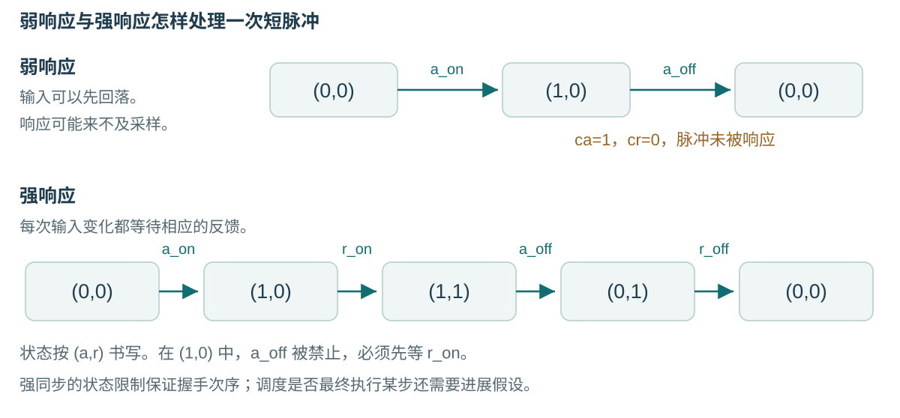
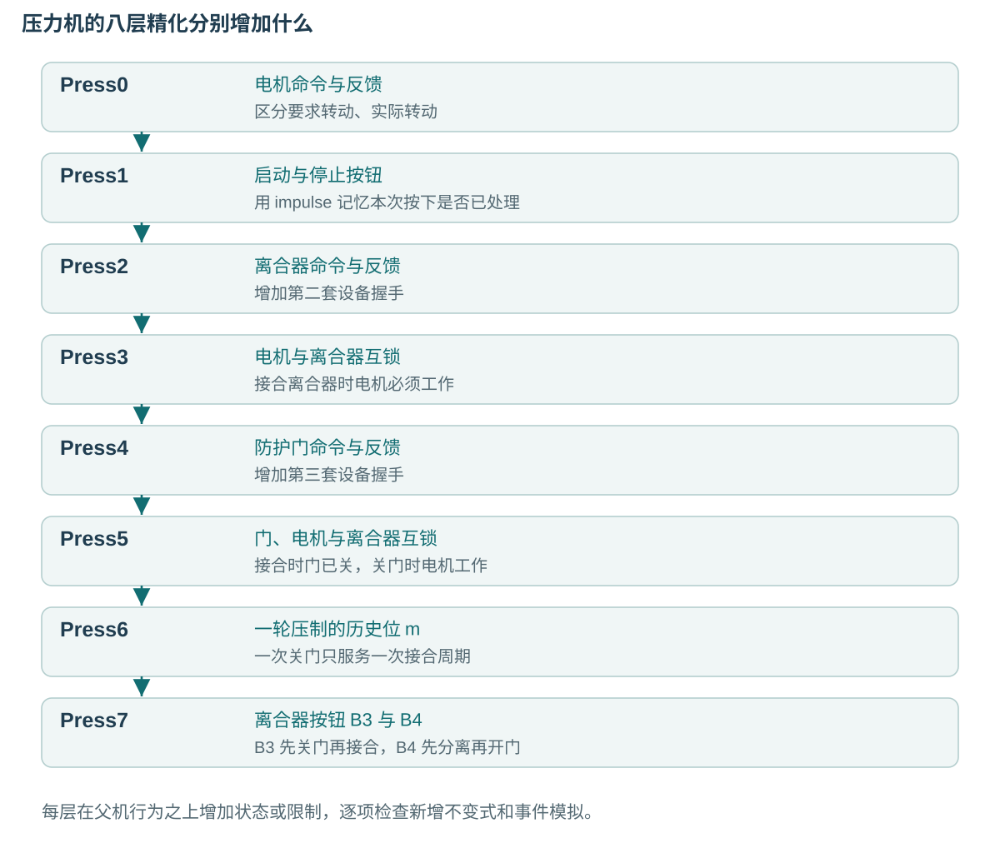
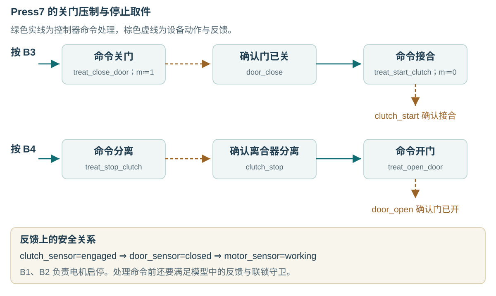

# 第三讲　机械压力机控制器

按下接合离合器的按钮 B3 时，操作者只做了一件事，控制器却至少要区分四个时刻：收到请求、命令关门、收到门已关闭的反馈、命令离合器接合。假如把“命令关门”和“门已关闭”写成同一个变量，模型就无法描述门还在运动的间隙。本讲用这个间隙解释为什么需要执行器、传感器、守卫和逐层精化。

本讲配有两个工程。[L3_Press](../03-Rodin工程/L3_Press) 是压力机的八层开发，[L3_Patterns](../03-Rodin工程/L3_Patterns) 是可单独练习的同步模式。下文页码一律按《course 3 press(1).pdf》从封面起算的 **PDF 页序 1–276**。原稿右上角的幻灯片编号和页序有偏移。

## 1　先看设备和需求

### 1.1　从动画读出哪些量需要建模（第 3–92 页）

电机通过离合器、连杆带动滑块和工具。电机转动时，滑块可以停着，取决于离合器是否接合。课件假定离合器分离后滑块立即停止。工作区前有一扇防护门。门没有专用按钮，控制器根据 B3、B4 和设备反馈决定何时操作门。这里的开关状态、反馈和原子事件是课堂抽象，模型中没有滑块制动距离、故障、连续时间或人员位置。

| 回看页码 | 动画中的动作 | 如何读成模型 |
|---|---|---|
| 5–16 | B1 启动电机，B2 停机，B3 请求接合离合器，B4 请求分离 | 按钮是输入。控制器发命令，设备通过传感器反馈。换刀、上料和取件说明为什么要有门 |
| 17–35 | 初始、按 B1、电机转动、安装工具、放入工件 | 电机工作和离合器接合是两个不同条件，两个设备分别有状态 |
| 36–54 | 按 B3，关门后开始压制 | 门的反馈达到 closed，才允许发出接合命令 |
| 55–62 | 按 B4，压制停止，取件并再次放入工件 | 等待离合器的分离反馈，再发开门命令 |
| 63–91 | 第二次压制、取件、取下工具、按 B2，回到停机状态 | 同一模型要能完成第二个周期。按钮回到释放态，控制器重新武装其按键记忆 |
| 92 | 三套设备的接线总图 | 每套设备有 actuator（控制器写、设备读）和 sensor（设备写、控制器读） |

### 1.2　哪些自然语言会变成不变式（第 93–103、130–139、221–233 页）

| 课件需求 | 在工程中查找 | 应如何检验 |
|---|---|---|
| EQP1–3，有电机、离合器、门、四个按钮和控制器 | 变量随着 Press0、1、2、4、7 引入 | 看变量由谁写、谁读，以及初始值 |
| FUN1，按钮与控制器弱同步 | Press1、Press7 中按钮变量与 impulse 变量 | 按下后很快释放，控制器可能错过这次按下 |
| FUN2，控制器与设备强同步 | 三对 actuator/sensor | 新的反向命令要等上一次反馈到达 |
| SAF1，离合器已接合蕴涵电机工作 | Press3 的 clutch_motor_ss | 已下达接合命令、尚未接合的过渡状态也须安全 |
| SAF2，离合器已接合蕴涵门已关 | Press5 的 clutch_door_ss | 检查 clutch_start 能否在门开着时发生 |
| SAF3，电机停止蕴涵门开着 | Press5 的 door_motor_ss 使用逆否式 | 门已关蕴涵电机工作。第 224–228 页是后补需求 |
| FUN3、FUN4，门和离合器的周期一一对应 | Pair2 的计数约束，Press6 的 m | 每轮关门后只允许发一次接合命令，结束这一轮才开门 |
| FUN5，门和离合器动作联动 | Press7 的 B3、B4 与两个自动控制事件 | B3 先触发关门，B4 先触发分离；等待相应反馈再继续 |

第 134 页对 FUN3 的英文条件写作 engaged，第 233–236 页的反例和后续公式使用 disengaged。本讲按后一组图与公式解释：离合器持续分离时，不应空转多个完整的关门周期。第 98–99 页还提出两道区分状态与历史的问题。第一，长按启动键后，另一个键已使电机停下，长按的键应否再次启动？第二，启动反馈和停机按键接近同时到达时，先处理哪一个？前者要有“本次按下已处理”记录，后者用两种可能的事件交错表示。

### 1.3　把一段动画翻译成可以证明的系统边界

看第 17–91 页时，可以在纸上画三栏，分别记“人做了什么”“控制器传出了什么”“设备已经报告了什么”。第 36 页按 B3 属于第一栏；关门命令和接合命令来自第二栏；门关到位与离合器已接合属于第三栏。同一个按钮推动多个后续事件，这正是控制器需要状态的原因。课件连续播放的几张滑块运动图描述一个压制过程，不必为每张图引入一个新变量或一个独立机器。

把“已关门”一词进一步拆开。若它表示控制器想让门关，条件应写成 `door_actuator = closed`；若它表示门的位置反馈，条件应写成 `door_sensor = closed`。门从开向关运动时，前一式已真，后一式仍假。要求“压制时门已关”应以传感器那一式为结论。要让模型保证该结论，控制器发接合命令时又必须查看执行器状态，防止门正要打开。**需求说明观察对象，辅助不变式说明控制器如何对这个对象负责。**

| 需要区分的两件事 | 采用一个变量会丢掉什么 | 在课件哪儿看出差别 |
|---|---|---|
| 按钮按下／控制器读到按下 | 一次短按可能没被读到，一次长按可能被多次读取 | 第 98–99、153–176 页 |
| 电机启动命令／电机确实工作 | 刚发启动命令时还不能驱动离合器，发停机命令后电机可能尚未停 | 第 140–151、209–214 页 |
| 离合器分离命令／实际已分离 | 发出分离命令的瞬间不能立即开门 | 第 217–232、255–260 页 |
| 门已关但尚未发接合命令／门仍关着、一次接合已结束 | 两个阶段可有相同的门和离合器电平，下一项允许操作却不同 | 第 238–254 页 |
| 环境会发生的动作／软件可以拒绝的请求 | 若给物理反馈随意加守卫，就会把安全责任推给无法由软件约束的硬件 | 第 189–208 页 |

**课件使用的理想化。** 设备反馈在状态机中以离散事件出现，故“分离后立即停”的物理假设没有单独的制动计时器。一个事件内的多个赋值同时生效；两个不同事件用先后两种可能顺序表达竞争。第 99 页说两件事可能同时发生，进入这个模型时要分别分析“反馈先被处理”和“按键先被处理”。即使一个事件已经使能，其他同时使能的事件也可能被选中。要求某件事最终发生，需要另外说明设备响应、输入环境和事件调度条件。

**三个学习问题。** ① 规格要保证的是当前状态的合法组合，还是整轮事件的次数和先后？前者可先写状态蕴涵，后者常要保存历史。② 哪一方能够被控制？人可以很快松手，弱同步允许漏采；控制器却可以强制在上条设备命令获反馈前等候。③ 当一个性质在第一层尚不成立时，后面哪一层承诺它？例如电机与离合器在第二次精化里先独立出现，第三次精化才承担 SAF1。把中间抽象当作最终控制器，会把教学过程中故意保留的自由误判为软件错误。

## 2　把四种同步模式单独做一次

打开 L3_Patterns。PatternCtx 是空上下文，下面只用内建自然数和整数 0、1。工程中有三条开发线，打开 WeakCount、WeakSignals、Pair0 可以分别从头做。StrongCount 和 StrongSignals 分别精化同一条线的弱同步机器。Pair1、Pair2 依次精化 Pair0。第 115、122 页的 DEMO 是教学停顿，工程提供推导完成的版本。

### 2.1　弱响应与强响应（第 104–129 页）

令 a 表示外部动作，r 表示响应。0/1 分别表示低电平和高电平。ca、cr 从 0 开始，分别统计 a、r 被置为 1 的总次数。它们是证明用的历史量。以下列出每个普通事件；未被赋值的变量保留原值。

| 事件 | WeakCount 的守卫 | 动作 | StrongCount 新增守卫 |
|---|---|---|---|
| a_on | a = 0 | a ≔ 1，ca ≔ ca + 1 | r = 0 |
| r_on | r = 0 ∧ a = 1 | r ≔ 1，cr ≔ cr + 1 | 无 |
| a_off | a = 1 | a ≔ 0 | r = 1 |
| r_off | r = 1 ∧ a = 0 | r ≔ 0 | 无 |

**弱响应允许漏记短脉冲。** 初始化后执行 a_on、a_off，得到 (a,r,ca,cr) = (0,0,1,0)。r_on 一直没有执行，故只能要求 cr ≤ ca。若仅给出这个不变式，证明 r_on 后的 cr + 1 ≤ ca 会卡住。因为假设允许 (1,0,0,0)，此时目标为 1 ≤ 0。这个状态满足旧不变式，却从初态不可达。加上 pending_edge，即 (r = 0 ∧ a = 1) ⇒ cr < ca，正好把证明缺的一步写出来。可在 WeakCount 的副本里删除该不变式，保存，在 r_on 下查看相关 INV，再恢复。

**强响应按四步握手。** StrongCount 保留上表的赋值，收紧动作方的两个守卫。此时 a_on → r_on → a_off → r_off 是从 (0,0) 回到 (0,0) 的一圈。a_on 之后必须等 r_on 才能 a_off；a_off 之后必须等 r_off 才能再次 a_on。在 (a,r)=(1,0) 时 ca=cr+1，其余组合 ca=cr。这解释了早期模型里“最多领先一次”的性质。设备反馈若在调度中永久得不到执行，守卫自身没有给出真实时间期限。

**在 Rodin 复建。** 在 PatternCtx 中无需声明集合。建立 WeakCount，声明 a、r、ca、cr，写入类型、response_count 和 pending_edge。将四个变量在 INITIALISATION 中分别置 0，再逐行添加上表事件。右击机器选择 Refine，建立 StrongCount，保留变量与赋值，只给 a_on、a_off 添加守卫和机器的两个计数不变式。另开 WeakSignals 和 StrongSignals，可以对照第 118、127 页：删去计数器及其赋值后，守卫和 a、r 上的事件轨迹保持原样。工程把无计数器的表示独立成一条线，以便学生分别比较可观察行为和计数证明。

#### 用状态表逐个检查弱响应事件

`a`、`r` 是两个**当前电平**；`ca`、`cr` 是两个**上升沿累计次数**。松开按钮或清除响应时，计数器不会减一。初始化四个数都是 0，以后每执行一次 `a_on` 才增加 `ca`，每执行一次 `r_on` 才增加 `cr`。因此同样的电平组合可以对应许多不同的计数历史。表中列出仅考虑本模式时全部可能的下一事件。

| 执行前的电平对 | 弱响应允许的下一事件 | 强响应允许的下一事件 | 读法 |
|---|---|---|---|
| `(0,0)` | `a_on` | `a_on` | 双方均低，开始本轮 |
| `(1,0)` | `a_off`、`r_on` | `r_on` | 动作已高、响应仍低；弱模式允许动作先撤回 |
| `(1,1)` | `a_off` | `a_off` | 双方均高，响应已出现，动作方可以撤回 |
| `(0,1)` | `a_on`、`r_off` | `r_off` | 动作已低、响应尚高；弱模式可能漏采这次低电平 |

图的上升和下降只表示先后，横轴没有用毫秒计时。沿强模式闭环走一圈，四步全部完成；在弱模式里，从 `(1,0)` 直接返回 `(0,0)` 就产生一次没有被记录的动作。另一种漏采发生在 `(0,1)`：若动作再次升高，响应仍高，后一次高电平不会产生第二个响应上升沿。

**一条支持严格不等式的轨迹。** 从零开始，依次执行 `a_on`、`a_off`、`a_on`、`r_on`。读数依次是 `(a,r,ca,cr)=(1,0,1,0)`、`(0,0,1,0)`、`(1,0,2,0)`、`(1,1,2,1)`。刚得到第二次按下时，响应还没有看到任何一次按下，故 `cr < ca` 可以差两个以上。在弱机中把 `cr < ca` 擅自改成 `ca = cr + 1`，这个例子就会使它失败。

#### WeakCount 的归纳证明怎样落到每个事件

把“执行以前满足所有不变式”当作归纳假设。为证明某个不变式，把事件的每条赋值同时代入该式。没被赋值的变量取旧值。撇号只在下面的推导中说明后态，输入 Rodin 普通确定赋值时仍使用 `≔`。两条最有内容的不变式是 `response_count` 和 `pending_edge`。

1. **初始化。** 代入 `cr=0, ca=0`，得到 `0 ≤ 0`。第二个式子的前件要求 `a=1`，与初始 `a=0` 冲突，所以蕴涵成立。类型条件则来自 `0 ∈ {0,1}` 和 `0 ∈ ℕ`。
2. **a_on。** 后态 `ca` 加一，`cr` 不动。由旧 `cr ≤ ca` 得 `cr ≤ ca+1`。若新状态还满足 `r=0`，需要的更强结论是 `cr < ca+1`，同样由旧不等式和整数加一得出。可打开 `a_on/pending_edge/INV` 阅读这个目标。
3. **r_on。** 守卫为 `r=0`、`a=1`，正好满足旧 `pending_edge` 的前件。因此旧 `cr < ca`，也就是 `cr+1 ≤ ca`。事件令 `cr ≔ cr+1` 并令 `r ≔ 1`，第一条不变式得到恢复，第二条的前件在后态为假。对应的关键目标是 `r_on/response_count/INV`。
4. **a_off。** 只令 `a ≔ 0`。两个计数没有改动，`response_count` 沿用旧结论；`pending_edge` 的前件失去 `a=1`。这允许一次未获响应的按压直接结束。
5. **r_off。** 守卫要求 `a=0`；即使 `r ≔ 0` 后满足了前件的第一项，第二项 `a=1` 仍为假。若误把 `r_off` 改成只看 `r=1`，响应方就可能在动作仍高时自行清零，随后同一高电平又能触发 `r_on`，从而重复计数。

**弱机与强机的守卫为什么差这两项？** 只给 `a_on` 增加 `r=0`，仍会容许从 `(1,0)` 先执行 `a_off`，得到相等电平状态 `(0,0)` 而 `ca=cr+1`。只给 `a_off` 增加 `r=1`，又会容许 `(0,1)` 还未清零就执行新一轮 `a_on`。前者使响应丢失，后者使两次动作共用一次旧响应。强响应要同时排除两种交错。

#### StrongCount 的两个相位公式怎样互相配合

把一个周期分成“动作已开始而响应尚未到达”及其他三个阶段。在前一阶段 `(a=1 ∧ r=0) ⇒ ca=cr+1`；其他阶段 `(a=0 ∨ r=1) ⇒ ca=cr`。分支穷尽依赖 `a`、`r` 的二值类型。两式蕴涵 `cr ≤ ca`，也蕴涵 `ca ≤ cr+1`；后一条是第 120 页“最多领先一次”的最初规格。

| 跳转 | 旧计数关系从何而来 | 更新后的关系 |
|---|---|---|
| `a_on` 从 `(0,0)` 到 `(1,0)` | 旧 `a=0`，故 `ca=cr` | `ca` 加一，所以下一状态 `ca=cr+1` |
| `r_on` 从 `(1,0)` 到 `(1,1)` | 旧 `ca=cr+1` | `cr` 加一，二者相等 |
| `a_off` 从 `(1,1)` 到 `(0,1)` | 旧 `r=1`，二者相等 | 两个计数不变，仍相等 |
| `r_off` 从 `(0,1)` 到 `(0,0)` | 旧 `a=0`，二者相等 | 两个计数不变，仍相等 |

**分别打开四台机器动手。** 导入 L3_Patterns 后，先双击 WeakCount。在机器编辑器中展开 Invariants 和 Events；确认四个类型、两条关系，及 INITIALISATION 的四条赋值。要体验证明失败，先在另一个练习工作区复制工程。打开 StrongCount，查看 Refines 中的 WeakCount，再对比两台机器的 `a_on`，旧守卫 `a=0` 仍在。最后在 WeakSignals、StrongSignals 中各到达 `(1,0)`，读取当前使能事件集合，回看上方状态表。在两个无计数器的文件中，Variables 应只有 `a` 和 `r`。观察 `r_on` 是否使能只依赖这两个变量，故隐藏计数可保持可观察行为；若未来的需求直接询问历史次数，则应回到带计数器版本。工程没有在这两条开发线之间声明原生 REFINES 关系。

### 2.2　两个强响应的弱耦合（第 183–208 页）

Pair0 同时放入两套强响应，第一套为 (a,r,ca,cr)，第二套为 (b,s,cb,cs)。初始化全为 0。事件 a_on、r_on、a_off、r_off 仍遵循上表的强响应列；第二套把 a、r、ca、cr 分别替换为 b、s、cb、cs。两套初始可以独立运行。现在要求 s = 1 ⇒ r = 1，例如离合器接合时，电机已经工作。

直接给设备反馈事件 s_on 增添 r = 1 守卫，会把控制器负责的约束放到设备身上。课件改用下面四个不变式，让控制器发命令前负责检查。它们合起来表示：第二个设备的命令或反馈为 1 时，第一设备的命令和反馈都必须为 1。

| Pair1 不变式 | 含义或证明用途 |
|---|---|
| s = 1 ⇒ r = 1 | 两个设备实际状态之间的要求 |
| b = 1 ⇒ r = 1 | s_on 本来就需要 b = 1，因此它可以自行完成 |
| a = 0 ⇒ s = 0 | r_off 本来就需要 a = 0，因此它可以自行完成 |
| a = 0 ⇒ b = 0 | 第一设备接到关闭命令时，第二设备已经没有打开命令 |

**在 Rodin 操作。** 从 Pair0 创建 Pair1，加入上表四项。给 b_on 增加 r = 1、a = 1，给 a_off 增加 s = 0、b = 0。其余六个普通事件沿用原守卫与动作。先跟踪 a_on、r_on、b_on、s_on，再执行 b_off、s_off。此时 r 仍为 1，b_on 又能发生。弱耦合容许第一设备一直运行，第二设备开关多次。

#### Pair0 的八个变量描述两条可以交错的握手

第一条通道中，控制信号为 `a`、响应为 `r`，`ca`、`cr` 分别计数这两个信号的上升沿。第二条通道以 `b` 为控制信号、`s` 为响应，`cb`、`cs` 为其上升沿计数。一条通道的事件完全不写另一条通道的变量。课件第 190 页把八个类型和四个相位不变式并列，是为了表达“每条通道自身正确”；没有一条公式把两条通道的相位互相约束。因而只走 `b_on`、`s_on`，就可在 `r=0` 时到达 `s=1`。这是 Pair0 的合法执行，恰好说明还需要 Pair1。

**为何保留四个辅助命题。** 想象设备已经收到 `b=1` 的命令，但由于本次调度尚未执行 `s_on`，仍有 `s=0`。若外层控制器只检查 `s=0` 就关闭 `a`，这条在途命令会在稍后得到响应。反过来，`r=1` 只能说明外层反馈仍高；若 `a=0`，外层正在关闭，不应再允许内层启动。课件在第 193–203 页来回补不变式，就是要同时覆盖“刚刚发出”和“已经确认”两个时刻。

| 接下来可能发生什么 | 只看两个反馈为何不够 | 用哪个约束堵住缺口 |
|---|---|---|
| 内层响应上升 `s_on` | 前态可能是 `s=0`，此时 `s=1 ⇒ r=1` 给不出结论 | 守卫有 `b=1`，由 `b=1 ⇒ r=1` 已可推出 `r=1` |
| 外层响应下降 `r_off` | 动作写入 `r=0`，若内层仍高就会破坏安全式 | 守卫有 `a=0`，由 `a=0 ⇒ s=0` 知内层反馈已低 |
| 控制器发内层启动命令 `b_on` | 门限只看 `r=1` 会忽略外层关闭命令已发出 | 新守卫还必须有 `a=1`，确保设置 `b=1` 后不会违反 `a=0 ⇒ b=0` |
| 控制器发外层关闭命令 `a_off` | 只检查 `s=0` 会遗漏内层已有启动命令的时刻 | 新守卫同时要求 `b=0` 和 `s=0` |

**读一个由环境事件引起的证明。** 打开 Pair1 的 `r_off/b_inside_r/INV`。目标是让新状态继续满足 `b=1 ⇒ r=1`。将 `r ≔ 0` 代入后要证明 `b=1 ⇒ 0=1`，即前件不可能。此事件守卫含 `a=0`，用另一项不变式 `a_off_b_off` 得 `b=0`；与 `b=1` 矛盾，所以蕴涵成立。此处使用的是“控制器已经安排好在途命令”，所以不用修改设备的 `r_off`。

**练习操作。** 在 Event-B Explorer 右击练习版 Pair0，选 Refine，把新机命名为 Pair1。进入 Variables 确认八个共有变量均保留；进入 Invariants 加四条联锁公式；在 Events 找 `b_on` 与 `a_off`，给每个事件增两项 Guard，保留使 `cb` 增加的动作。保存后先读 `b_on/b_inside_r/INV`，再读上一段的 `r_off/b_inside_r/INV`。前一个目标要求发命令时把约束建立起来，后一个目标要求设备响应时约束仍然成立。动画中，执行 `a_on` 后先不要执行 `r_on`，此刻不能 `b_on`；执行 `r_on` 再观察同一事件就能看到差别。

### 2.3　两个强响应的强耦合（第 233–255 页）

Pair2 在 Pair1 上要求两个周期一一对应。只看 a = 1 ∧ b = 0 无法区分“第二设备本轮还没开始”和“第二设备本轮已经结束”。第 238–249 页的波形让这两个时刻有相同的电平。加入一位历史变量 m，0 表示没有尚待发出的第二设备启动命令，1 表示已开始第一设备的本轮、还欠第二设备一次启动。

| 事件 | 对 Pair1 的修改 | 产生的效果 |
|---|---|---|
| a_on | 并行动作 m ≔ 1 | 开始新一轮 |
| b_on | 加守卫 m = 1 和动作 m ≔ 0 | 本轮只消费一次启动机会 |
| a_off | 加守卫 m = 0 | 不能在发出第二设备的启动命令前撤销本轮 |

**在 Rodin 操作。** 从 Pair1 新建 Pair2，声明 m ∈ {0,1}，初始化 m ≔ 0。按表修改三个事件。先看 act_ahead、act_equal：m=1 蕴涵 ca=cb+1，m=0 蕴涵 ca=cb。再看 reaction_ahead、reaction_equal：当 r=1 ∧ s=0 ∧ (m=1 ∨ b=1) 时 cr=cs+1，其余时候 cr=cs。off_memory（a=0 ⇒ m=0）解释了为什么 a_off 还要等待 m=0。最后把 ca=cb ∨ ca=cb+1、cr=cs ∨ cr=cs+1 作为 Theorem，证明可分别对 m 和响应相位分类。比较 Pair1 的轨迹：第二设备已关、第一设备仍开时 m=0，第二次 b_on 会被阻止。课件到具体压力机时丢弃四个计数器，但保留影响守卫的 m。

#### 用一个完整周期推导 m 的含义

如果把 `m` 直译为“门是否关闭”，就不能解释为什么门没动时 `b_on` 也会改写 `m`。它记的是**两次启动命令之间是否还欠着第二次**。下面从 Pair2 的初始化出发，逐步记录命令电平、反馈电平、控制器记忆，以及两组计数差。差值仅用于读表，工程里保存的仍是四个完整自然数。

| 刚执行 | `(a,r,b,s)` | `m` | `ca−cb` | `cr−cs` | 解释 |
|---|---|---:|---:|---:|---|
| INITIALISATION | `(0,0,0,0)` | 0 | 0 | 0 | 两个设备都空闲 |
| a_on | `(1,0,0,0)` | 1 | 1 | 0 | 发出第一命令，第一反馈未到 |
| r_on | `(1,1,0,0)` | 1 | 1 | 1 | 第一反馈已到，允许发送第二命令 |
| b_on | `(1,1,1,0)` | 0 | 0 | 1 | 第二命令已经消费本轮机会，第二反馈还未到 |
| s_on | `(1,1,1,1)` | 0 | 0 | 0 | 两次反馈均已见到 |
| b_off | `(1,1,0,1)` | 0 | 0 | 0 | 第二设备的关闭命令在途 |
| s_off | `(1,1,0,0)` | 0 | 0 | 0 | 外层仍开，内层已完成本轮 |
| a_off | `(0,1,0,0)` | 0 | 0 | 0 | 第一设备的关闭命令在途 |
| r_off | `(0,0,0,0)` | 0 | 0 | 0 | 回到全低，四个累计次数现在均为 1 |

表中 `r_on` 之后与 `s_off` 之后的四个电平完全相同，连 `r=1 ∧ s=0` 也相同，可 `cr−cs` 前者为 1、后者为 0。这就是课件第 245–250 页先猜测、再否定简单电平公式的理由：软件此时能区分两段历史，只因它在恰当事件中维护了 `m`。即使 `m=0`，刚执行 `b_on` 的瞬间仍有一份反馈尚未到达；这部分差值要靠 `b=1` 而非只靠 `m` 来辨认。

**怎样手推反馈计数不变式。** 用 `r=1 ∧ s=0 ∧ (m=1 ∨ b=1)` 描述尚缺第二份上升反馈的时段，此时 `cr=cs+1`；它的逻辑补集为 `r=0 ∨ s=1 ∨ (m=0 ∧ b=0)`，此时 `cr=cs`。这里把“不等于 1”改写成“等于 0”依赖二值类型。两种情形正好穷尽；做 `response_balance/THM` 时，对前一谓词分情况即可得到 `cr=cs ∨ cr=cs+1`。历史量虽然无上界，两个计数的相对领先幅度有上界。

**逐步证明 `b_on/act_equal/INV`。** 事件前有 `m=1`，由 `act_ahead` 得 `ca=cb+1`。事件并行执行 `b ≔ 1`、`cb ≔ cb+1`、`m ≔ 0`。此时 `act_equal` 的前件为真，目标化为 `ca=cb+1`，右边使用的是旧 `cb`，正好是刚才的假设。若只把 `m` 清零却忘记给 `cb` 加一，就会在第一次 `b_on` 后得到 `m=0` 而 `ca≠cb`。这说明计数和控制变量应该挂在同一个事件上。

**逐步证明 `a_off/off_memory/INV`。** 该不变式为 `a=0 ⇒ m=0`。动作 `a ≔ 0` 令前件成真，又没有动作改变 `m`，故需要执行前已知 `m=0`。这就是加入 `m=0` 守卫的直接证明动机。在删掉此守卫的练习副本里，执行 `a_on`、`r_on` 后，`b=0 ∧ s=0` 已经满足原 Pair1 的关闭条件，但本轮尚欠 `b_on`。提前 `a_off` 即得到违反 `off_memory` 的状态。

**在 Rodin 复建最后一层模式。** 从 Pair1 使用 Refine，先建 `m` 的类型和 `m ≔ 0` 初始化，再在对应事件里同步录入新守卫和赋值，最后写计数相位不变式和两项 Theorem。若一开始就勾选所有不变式为 Theorem，Rodin 会要求仅从前文假设推出每一条，而此处很多式子正是需要由所有事件归纳维持的事实。只有 `action_balance`、`response_balance` 在这个文件中勾选。保存后到 Proof Obligations 查 `action_balance/THM` 和 `response_balance/THM`；按上表逐事件重放时，应先执行各设备反馈再发送对应反向命令。

## 3　从电机到完整压力机

### 3.1　文件与复建顺序

| 层 | PDF 页序 | 可见上下文 | 本层的建模决策 |
|---|---|---|---|
| Press0 | 140–152 | MotorCtx | 电机命令和反馈使用强响应 |
| Press1 | 153–178 | MotorCtx | 增加 B1、B2，记录已处理按压 |
| Press2 | 179–182 | ClutchCtx | 离合器有独立命令与反馈 |
| Press3 | 183–216 | ClutchCtx | 接合离合器需要电机工作 |
| Press4 | 217–220 | DoorCtx | 防护门有独立命令与反馈 |
| Press5 | 221–232 | DoorCtx | 门与离合器、门与电机都须联锁 |
| Press6 | 233–262 | DoorCtx | 每次闭门对应一个离合器周期 |
| Press7 | 263–276 | DoorCtx | B3 触发关门，B4 触发分离 |

先将项目导入 Rodin。如果从空白项目手工练习，先创建 MotorCtx，再让 ClutchCtx EXTENDS MotorCtx、DoorCtx EXTENDS ClutchCtx。每一级只有一个直接 SEES 的上下文，可以经由 EXTENDS 使用先前的枚举。接着建 Press0，按表逐级使用 Refine 建立下一台机器。不要把八层建成互不关联的机器。机器保留同名变量，在当前层只需录入新增不变式。导入版逐条显式写出了事件当前的守卫与动作。手工复建时也可以用 Extended 继承旧条目，只填新增部分，避免对同一变量重复赋值。原稿用 open 表示开门，工程统一拼作 opened。枚举以 partition 写出，等价于“这两个取值不同且穷尽该集合”。

从 Press0 的电机二元组开始，每增加一层，只解决图中列出的一个新问题。按箭头读可见：每引入一套独立设备，才有对象可供下一层建立联锁。

#### 三个上下文如何让 Rodin 读懂变量类型

| Context | 新声明的集合 | 两个常量如何约束 | 哪些层直接 SEES |
|---|---|---|---|
| MotorCtx | `STATUS` | `partition(STATUS, {stopped}, {working})` | Press0、Press1 |
| ClutchCtx EXTENDS MotorCtx | `CLUTCH` | `partition(CLUTCH, {disengaged}, {engaged})` | Press2、Press3 |
| DoorCtx EXTENDS ClutchCtx | `DOOR` | `partition(DOOR, {opened}, {closed})` | Press4–Press7 |

展开第一条 `partition` 看它给证明提供了什么。首先，集合的并集覆盖 `STATUS`，因此类型属于 `STATUS` 的状态可以按 stopped、working 两种情况穷尽。其次，两个单元素子集互不相交，因此 `stopped ≠ working`。最后，每个常量属于该集合。若只写 `stopped ∈ STATUS` 和 `working ∈ STATUS`，可能存在第三种电机状态；这时由“不是 working”推出“就是 stopped”的论证便没有依据。后两个上下文以相同方式限定离合器和门的两种状态；电机常量、门常量仍属于不同的集合类型。

**在编辑器上做一次贯通检查。** 从右键菜单依次新建 Event-B Component，先选 Context，录入 Carrier Sets、Constants、Axioms 三栏。在 ClutchCtx 的 Extends 中点选 MotorCtx，在 DoorCtx 中点选 ClutchCtx。接着打开 Press5 的 SEES，仅列 DoorCtx；展开该上下文的扩展链，确认 `working` 可见。若出现 unresolved identifier，先看常量是否拼成 `opened`，再看 SEES/EXTENDS 的方向。把 Press3 直接 SEES DoorCtx 虽然能看到更多符号，却破坏课程“第四次精化才引入门”的边界。

**哪些动作属于哪个模型。** 同一个名字在精化链的不同文件里可以有不同的守卫。当讨论某个事件是否使能时，连同层名一起记，例如 Press4 的 `treat_close_door` 从初态就允许，Press5 同名事件要求电机正在工作，Press7 再加 B3 的按键条件。在手写练习版中，新一层开始时先检查 REFINES、SEES、共有变量列表，再逐条阅读新增需求。若把上一层已有变量原封不动保留，当前事件的新增动作不能悄悄改变那些抽象变量的可见行为。

图中从按钮到设备的线经过控制器。有两条自动命令：确认门关后才发接合命令，确认离合器分离后才发开门命令。把图与课件第 92、135、263 页的接线图对照时，会发现早期机器只有图的一部分。图中的三条安全蕴涵取设备反馈值；第 3.4、3.5 节再把它们向前追溯到各个控制命令的守卫。

### 3.2　Press0　分清“要求转动”和“已经转动”

在 MotorCtx 的 Sets 新建 STATUS，Constants 新建 stopped、working，Axioms 填 partition(STATUS, {stopped}, {working})。在 Press0 的 SEES 指向 MotorCtx。声明 motor_actuator、motor_sensor，各有一个 ∈ STATUS 的类型不变式，两者初始化为 stopped。

| 事件 | 执行条件 | 动作 |
|---|---|---|
| treat_start_motor | 命令停、反馈停 | motor_actuator ≔ working |
| motor_start | 命令转、反馈停 | motor_sensor ≔ working |
| treat_stop_motor | 命令转、反馈转 | motor_actuator ≔ stopped |
| motor_stop | 命令停、反馈转 | motor_sensor ≔ stopped |

保存后，从初态走完这四步。第二步之前，电机的目标状态为 working，传感器仍为 stopped，两者都可合法出现。第 145 页约定 treat 开头的名称属于控制器，其他四步中的电机反馈事件属于环境。后续所有设备都套用这张表。

#### 把“同一个设备有两份状态”画在四个格子里

把 motor_actuator 写在横轴，motor_sensor 写在纵轴。一共有四种组合，四种都可达。初态是 (stopped, stopped)；发启动命令后是 (working, stopped)；有了启动反馈变成 (working, working)；发停机命令后是 (stopped, working)。`motor_stop` 只更新反馈，把状态送回初态。如果把“两者必须相等”写成不变式，发出启动命令的第一步就会违反它。这个反例说明控制目标与设备位置分开是有意为之。

**新建时逐项录入。** 在练习工程中新建 Machine 类型的 Press0，使用 Sees Context Relationship 选 MotorCtx。Add Child 加两个 Variable，再加两个 Invariant，谓词分别为 `motor_actuator ∈ STATUS`、`motor_sensor ∈ STATUS`。进入自动生成的 INITIALISATION，新增两条 Action，分别令这两个变量等于 stopped。接着新增 `treat_start_motor`，分别建 Guard `motor_actuator = stopped`、`motor_sensor = stopped`，再建 Action `motor_actuator ≔ working`。三个剩余事件按上表录入。名称写在 Event 的 Label，赋值写在 Action 的 Assignment；把赋值误放进 Predicate，会在静态检查时被拒绝。

**验收。** 选中 Press0 启动动画时，若实例先要求建立常量或初始化，先完成这些步骤。从初态只应看到 `treat_start_motor` 可以执行；从 (working, stopped) 只应看到 `motor_start`。若 `treat_stop_motor` 此时已能选，先核对其 **两条** 守卫，通常是漏了传感器必须 working。这一层不需要任何事件参数：设备、变量和状态常量都已固定，四条事件无需 ANY，也无需见证。若证明目录显示 0 项，可直接对照四状态表理解生成器已经化简的类型和初始化义务。

#### 带着类型证明进入下一层

举 `motor_start` 为例。执行前的类型假设是 `motor_sensor ∈ STATUS`，执行后需要证明的是“新反馈仍属于 STATUS”。把 `motor_sensor ≔ working` 代入目标，只需证明 `working ∈ STATUS`。这来自 MotorCtx 的枚举公理。另一方面，`motor_actuator` 没有赋值，保持它的类型只需沿用旧假设。同理可处理 `motor_stop`。如果课堂口头说“反馈总会很快到”，本层形式化给出的只是反馈一步如何发生及反向命令何时允许；这里没有表示时钟的变量。

### 3.3　Press1　处理一枚按键的上升沿

在 Press0 上创建 Press1，声明 start_motor_button、start_motor_impulse、stop_motor_button、stop_motor_impulse，全部 ∈ BOOL，初始化为 FALSE。button 是电平，impulse 是控制器已经处理本次按下的记忆。每个按钮各有以下五种事件，以 B1 为例。

| 在 Press1 中展开的事件 | 守卫 | 动作或精化 |
|---|---|---|
| push_start_motor_button | button=FALSE | button ≔ TRUE |
| release_start_motor_button | button=TRUE | button ≔ FALSE |
| treat_push_start_motor_button | button=TRUE，impulse=FALSE，电机命令与反馈均停 | 精化 treat_start_motor；发启动命令，并将 impulse 置 TRUE |
| treat_push_start_motor_button_false | button=TRUE，impulse=FALSE，电机命令或反馈已非停 | 只将 impulse 置 TRUE，记录这次无效按压 |
| treat_release_start_motor_button | button=FALSE，impulse=TRUE | impulse ≔ FALSE，允许下次按压 |

B2 使用相同的五种事件，名字中的 start 换成 stop。有效分支精化 treat_stop_motor，要求电机命令、反馈均为 working；无效分支检查这个合取条件的否定。两个电机反馈事件 motor_start、motor_stop 保留，合计 12 个普通事件。

**在 Rodin 验证一个容易犯的错。** 先推 B1、处理 B1、执行 motor_start，使电机进入工作态。保持 B1 按下，再推 B2、处理 B2、执行 motor_stop。尽管 B1 电平一直为 TRUE，start_motor_impulse 也为 TRUE，所以第一个按钮不能让电机自行重启。再按顺序 release_start_motor_button、treat_release_start_motor_button、push_start_motor_button，启动分支才重新具备按键条件。第 157 页的列表把释放启动键写成 release stop motor button，第 159 页的完整事件确认应是 release_start_motor_button。

**事件怎样叠加。** 在 Event 的 Refines 栏，把成功处理 B1 的事件关联到 Press0 的 treat_start_motor。保留两条电机条件与电机赋值，另加两条按钮条件和一条 impulse 赋值。这样有效事件同时完成了“弱响应的接收”和“强响应的发送”。无效、释放等新事件均不改变 Press0 的变量，可在这一步精化抽象的 skip。

#### 为什么物理放开与软件复位分成两个事件

以 B1 为例，只看 `(start_motor_button,start_motor_impulse)`。这两个变量都使用内建 `BOOL`，实际值是 `FALSE`、`TRUE`。整数模式的 `0/1` 在此通过实例化变为布尔常量，不能给布尔变量输入赋值 `≔ 1`。

| 元组与物理意义 | 谁能改变它 | 控制器此时可做什么 |
|---|---|---|
| (FALSE,FALSE)，已松手且可接新按压 | 环境 `push_start_motor_button` | 等待 B1 按下 |
| (TRUE,FALSE)，有尚未处理的按下 | 环境可以快速释放，控制器也可先采样 | 若采样，按设备条件在成功和 false 两个分支中选其一 |
| (TRUE,TRUE)，同一次按下已被消费 | 环境可以释放 | 长按期间不再重新发出启动命令 |
| (FALSE,TRUE)，已放手但软件尚未确认 | 控制器可清除 impulse，环境也可能再次按下 | 若先处理释放，下一次按下能形成新脉冲；若先再次按下，可能漏掉释放 |

一次 `release_start_motor_button` 只把按钮变 FALSE。若又按回去而控制器还没执行 `treat_release_start_motor_button`，就回到 (TRUE,TRUE)；软件可能无法察觉中间的放手。这是弱同步的另一面。同样，`treat_release_start_motor_button` 只清除软件记忆，不改变电机命令，不会关闭电机。B1、B2 是两套独立的按钮变量，按 B2 也不会替 B1 清除 impulse。

**第 99 页的两种交错。** 在 Press1 从初始状态执行 `push_start_motor_button`、`treat_push_start_motor_button`。此时已发出启动命令，但反馈仍为 stopped。执行 `push_stop_motor_button`，两种处理顺序都应在动画中试一次：

| 接下来的选择 | 决策时的电机条件 | 结果 |
|---|---|---|
| 先 `motor_start` 再 `treat_push_stop_motor_button` | 采样停机请求时双方 working | 成功发送停机命令，等 `motor_stop` 反馈 |
| 先 `treat_push_stop_motor_button_false` 再 `motor_start` | 采样时执行器 working、反馈 stopped，合取条件为假 | impulse 已置 TRUE，B2 仍按住也不能自动补发一次停机命令 |

**这一步怎样检查 GRD 和 SIM。** 在 Press1 中打开 `treat_push_start_motor_button`，沿 Refines 定位 Press0 的 `treat_start_motor`。① 具体守卫的第 3、4 项就是抽象两项电机条件，第 1、2 项只要求按钮已按且尚未处理；所以所有具体守卫成立时，抽象守卫必成立。② 看具体并行动作后，将状态投影到 Press0 的两个变量。抽象机要求把 actuator 变为 working、sensor 保持旧值，具体事件恰好如此。③ 新增的 `start_motor_impulse ≔ TRUE` 位于 Press0 的观察范围外，因此不影响动作模拟。不同变量的两条赋值在同一事件中原子提交，不能拆成两个任意交错的事件。④ 对 false 分支做同一投影，电机命令和反馈均不动，它在本次精化中对应一个抽象不可见步。这里展示的是 GRD/SIM 数学判断；Rodin 可把这些直接匹配的义务化简，界面未必另外列出同名节点。

**手工实现容易漏的连接。** 在练习副本上对 Press0 右击 Refine。若向导以 Extended 方式生成旧的电机事件，编辑其具体事件 Label，把 Refines 留作旧事件；若改用显式模式，则逐条保留旧守卫和动作。随后给每枚按键加入 push、release、treat_release 和处理无效按压的事件。false 分支只取两个设备条件合取的否定，且仍须“按键已按、尚未处理”。若把整个成功守卫都取反，按钮从未按下时也可触发 false 分支，初态实验就会暴露错误。

### 3.4　Press2 和 Press3　从独立离合器到电机联锁

**Press2 的建立。** 在 ClutchCtx 声明 CLUTCH、disengaged、engaged，用 partition 限定恰好两个值。创建 Press2，SEES 改为 ClutchCtx。新增 clutch_actuator 和 clutch_sensor，类型都是 CLUTCH，初始化皆为 disengaged。复制 Press0 四步握手并替换名字：treat_start_clutch 下达接合命令、clutch_start 确认接合、treat_stop_clutch 下达分离命令、clutch_stop 确认分离。每个事件只写自己的 actuator 或 sensor。此时从停机初态就可以执行 treat_start_clutch、clutch_start；这个轨迹说明独立建模尚未实现 SAF1。

**Press3 的建立。** 对 Press2 作精化，依照 Pair1，把上层设备 (a,r) 实例化为电机命令、反馈，把内层设备 (b,s) 实例化为离合器命令、反馈。新增 clutch_motor_ss、clutch_motor_as、clutch_motor_sa、clutch_motor_aa 四个不变式，分别读作：

1. 离合器反馈为 engaged 时，电机反馈必须为 working。
2. 离合器命令为 engaged 时，电机反馈必须为 working。
3. 电机命令为 stopped 时，离合器反馈必须为 disengaged。
4. 电机命令为 stopped 时，离合器命令必须为 disengaged。

给 treat_start_clutch 加上“电机命令与反馈均为 working”；给 treat_push_stop_motor_button 加上“离合器命令与反馈均为 disengaged”。接合守卫同时检查电机命令和反馈：若停机命令已发出但反馈还在转，单凭反馈不能允许接合。设备的反馈事件不需要增加这些联锁条件。

**在 Rodin 检查。** 打开 Press3，在两个事件上逐条读 Guards，再点开 Invariants。以 clutch_start 保持第 1 条为例，执行后离合器反馈变为 engaged；事件要求执行前离合器命令为 engaged，第 2 条推出电机反馈 working，事件也没有改动电机反馈。动画时先重放 Press2 的反例，应在第一步被挡住。运行电机并收到反馈以后，再试离合器握手即可成功。

**一个与精化有关的边界。** 第 214 页只收紧 B2 成功分支，课件没有给出把第 176 页的旧 false 分支改写成“任何新增联锁不满足”的规则。工程保留其旧守卫。若电机双方都在 working 但离合器仍接合，这次长按可能在联锁解除后才由成功分支处理，也可能提前松开而被漏过。把新阻塞条件直接并入旧 false 事件会放宽抽象守卫，GRD 需要重新处理。这个例子适合区分需求中的“等待允许”与“立即拒绝”。

#### 分两次精化读懂“先给设备，再给设备加约束”

在 Press2 中，离合器四个事件相对 Press1 都是新事件。它们只写新增的 clutch_actuator 或 clutch_sensor，投影到 Press1 时，即使离合器转了一整轮，电机与 B1、B2 的六个原有量一个也没有改变。这解释了“第二层可以在停机时接合”并未违反第一层的精化要求：第一层本来就没有任何离合器可供观察。第三层要履行的是新增的安全要求。

**核验 Press2 的可执行串。** 从初始化直接执行 `treat_start_clutch` → `clutch_start` → `treat_stop_clutch` → `clutch_stop`。四步后电机仍是 stopped，离合器的两个量都回到 disengaged。把这一串录在练习纸上后，切换到 Press3 的初始化，再找同名的第一个事件。新守卫要求 motor_actuator 与 motor_sensor 都为 working，因此这条轨迹被截断。合乎第三层要求的串改为先 `push_start_motor_button` → `treat_push_start_motor_button` → `motor_start`，再开始刚才的四步。

**真实反馈到达稍迟时，哪一个守卫先挡住了危险命令？** 在 Press3 已经启动电机的状态发出离合器接合命令，暂不让 `clutch_start` 发生。此时离合器 actuator 已 engaged，sensor 仍 disengaged。按 B2 时，检查停机成功分支的离合器两项守卫，其中“sensor 已分离”成立，但“actuator 已分离”不成立。反方向，在发出分离命令后、`clutch_stop` 反馈之前，actuator 已 disengaged，却是 sensor 这一项不成立。这两个瞬间分别说明守卫不能少写哪一半。

**两道证明沿同一条联锁往回找。** 第一项是 `clutch_start/clutch_motor_ss/INV`。① 目标为 `clutch_sensor = engaged ⇒ motor_sensor = working`。② 代入反馈动作，前件成为真，所以目标缩为 `motor_sensor = working`。③ 环境事件守卫中有 `clutch_actuator = engaged`。④ 应用旧不变式 `clutch_motor_as` 得结论，电机反馈又没被本事件改变。第二项是 `treat_start_clutch/clutch_motor_as/INV`。① 把 `clutch_actuator ≔ engaged` 代入 `clutch_motor_as`。② 新目标又是 `motor_sensor = working`。③ 此次发命令事件自己的新守卫已经要求这个条件。前一个证明使用命令到反馈的桥，后一个证明解释这座桥何时建立。

**复建的编辑顺序。** Press2 建好后，检查 REFINES=Press1、SEES=ClutchCtx；从两个新变量展开 Find/Usage 或逐个打开四事件，确认写 actuator 的是 treat 开头的事件，写 sensor 的是环境事件。接着对 Press2 使用 Refine 得到 Press3，Variables 列表与 Press2 相同，初始化没有新增量。录入四个 `clutch_motor` 不变式；只在成功的停机控制和启动离合控制里添加守卫。切换 Problems 排除拼写与类型错，再到 Proof Obligations 对照上一段的两个真实节点。一开始把门的条件也写进来会报未知名，因为此时 DoorCtx 尚未引入。

**被联锁延迟的 B2 能否稍后生效？** 在 Press3，电机双方 working、离合器已接合，把 B2 按住。成功分支有离合器必须已分离的附加条件，此时不能执行；旧 false 分支的设备判据是“电机命令与反馈不同时为 working”，此时也不成立。继续 `treat_stop_clutch`、`clutch_stop`。若一路保持 B2 且 impulse 仍 FALSE，原按压现在可以通过成功分支；若中间执行过 `release_stop_motor_button`，它就可能从未被处理。这个差别是当前精化的具体决策，可在状态表中逐项读出；如应用需求要求“当场拒绝并记录”，应从较早层重新设计处理请求的抽象边界。

### 3.5　Press4 和 Press5　加入防护门并补上遗漏的需求

**Press4 的建立。** 声明 DoorCtx EXTENDS ClutchCtx，加入枚举 DOOR={opened,closed} 及两值互异的约束。建立 Press4，SEES DoorCtx。新增 door_actuator、door_sensor，初始化均为 opened。增加四个事件：当门命令和反馈都为 opened，treat_close_door 可把命令改为 closed；door_close 等到命令为 closed、反馈仍为 opened 时更新反馈。反方向由 treat_open_door、door_open 完成。由 Press3 继承的电机与离合器联锁还在。此时可以在电机停着时关门，新的设备还没有与旧设备关联。

**Press5 的建立。** 把 Pair1 用两遍。以门为外层、离合器为内层，得到 clutch_door_ss 等四式，确保离合器在门已关闭的区间内运行。再以电机为外层、门为内层，得到 door_motor_ss 等四式。后者的核心式为 door_sensor=closed ⇒ motor_sensor=working；在二值枚举中，这也表示电机停止时门一定开着。课件因换刀、换件时需要接近工作区而补出这条性质。两条核心式串接，可推出 SAF1。保留 Press3 单独学习，仍有助于看清控制器如何在尚无防护门的模型里实现 SAF1。

| 修改的控制事件 | 在 Press5 中要额外保证 |
|---|---|
| treat_start_clutch | 发接合命令前门的命令、反馈均为 closed，且仍需电机双方 working |
| treat_open_door | 发开门命令前离合器的命令、反馈均为 disengaged |
| treat_close_door | 发关门命令前电机的命令、反馈均为 working |
| treat_push_stop_motor_button | 发停机命令前门的命令、反馈均为 opened，且离合器双方仍为 disengaged |

**在 Rodin 核对。** 打开 Press5 的 Invariants，找出 door_motor_ss 和 clutch_door_ss，手写 SAF1 的两步蕴涵证明。再在 Event-B Explorer 并列打开 Press4、Press5 的 door_close：反馈事件守卫相同。改变的是发命令的时机。进入动画，使电机工作，执行 treat_close_door、door_close、treat_open_door、door_open，再重复。全程离合器始终分离。这是 Press5 合法允许、第六层要排除的行为。第 229–230 页另给了可省掉独立 SAF1 层的精化顺序；工程保留完整授课顺序，便于重做两次联锁推导。

#### 两个不同方向的联锁共用同一扇门

Press4 为门分配四种命令/反馈组合。门刚收到关命令时可达 `(door_actuator,door_sensor)=(closed,opened)`；刚收到开命令时可达 `(opened,closed)`。二者都能说明“非稳定状态”需要保留。第 221–228 页的 SAF2 与 SAF3 约束同一扇门在两个不同关系中的角色：对离合器而言门是必须先就绪的外层设备，对电机而言门是只能在电机工作区间内关闭的内层设备。

| 想证明或禁止的状态 | 应用哪个不变式或守卫 | 看一个边界时刻 |
|---|---|---|
| 已接合时门开着 | `clutch_door_ss` | 离合器反馈变为 engaged 的那一步要能推出门已实际关好 |
| 门开着时已经发出了接合命令 | `clutch_door_as` | 即使离合器尚未反馈，也不应存在这个在途命令 |
| 开门命令在途时离合器仍接合或命令仍为接合 | `clutch_door_sa`、`clutch_door_aa` | 发开门命令要求离合器反馈和命令均为 disengaged |
| 门已经关闭而电机实际已停 | `door_motor_ss` | 默认初态门开；关门反馈需由正确发令的控制器保障 |
| 电机已收到停止命令而门仍关或尚在关闭 | `door_motor_sa`、`door_motor_aa` | 在此之前必须确认 door_sensor 与 door_actuator 都是 opened |
| 刚发关门命令但电机反馈未工作 | `door_motor_as` | 关门事件必须首先检查电机双方 working |

**从实体可操作性得到状态蕴涵。** 操作者在电机停机时，需要正面工作区可进入。课件将它表达为 `motor_sensor = stopped ⇒ door_sensor = opened`。取逆否得到“门非 opened ⇒ 电机非 stopped”；借助两个二值分区，把它改写成 `door_sensor = closed ⇒ motor_sensor = working`。这是从 SAF3 到 SAF3′ 的逻辑推导。它不能反过来要求“电机只要工作门一定关着”——电机可以空转，人仍能换件。电机已工作、离合器仍分离且门仍开着是合法状态。

**验证跨两项义务的一次开门反馈。** 打开 Press5 的 `door_open/clutch_door_ss/INV`。动作为 `door_sensor ≔ opened`；要维持 `clutch_sensor = engaged ⇒ door_sensor = closed`，事件发生时离合器反馈必须处于 disengaged。旧守卫要求 `door_actuator = opened`，所以用旧不变式 `clutch_door_sa` 推出这个事实，两个 CLUTCH 枚举值互异即可。再看 `treat_open_door/clutch_door_sa/INV`，发开门命令的动作令该不变式前件为真，新增的“clutch_sensor 已分离”守卫正是后件。若把约束加在环境的 door_open 上，虽然阻挡了错误反馈，却允许控制器在离合器运行时错误地下发开门命令。

**手工逐层核对。** 建 Press4 时，先确认 DoorCtx EXTENDS ClutchCtx。将新机器 SEES 指向 DoorCtx，重复三步：建立 door_actuator、door_sensor 的类型；在初始化写两项 opened；创建两条命令和两条反馈。运行 `treat_close_door`、`door_close`，验证门可在电机静止时关闭，以确认这层刻意保留的自由。随后建立 Press5，Variables 与 Press4 完全相同，增加八条跨设备不变式，修改表中四个控制事件。先单独检查 `treat_start_clutch` 是否同时包含电机与门两组条件，再检查 `treat_push_stop_motor_button` 是否同时包含门与离合器两组条件。所有设备反馈守卫和 Press4 一致，成功、无效处理 B2 的边界仍按 Press3 的规则理解。

**两条用于区分安全与顺序的轨迹。** 第一条在 Press5 上先启动电机，发关门命令但不等反馈，此刻不能 `treat_start_clutch`；等 `door_close` 后可发接合命令。第二条同样先启动电机，在离合器双方一直 disengaged 时重复 `treat_close_door`、`door_close`、`treat_open_door`、`door_open` 两次。两条安全蕴涵始终成立，因为每次关门电机都工作，而离合器根本没接合。后面引入历史记忆，正是为了排除第二条在功能上多余的周期。

### 3.6　Press6　让一次关门只服务一个离合器周期

把 Pair2 的第一设备换成门，第二设备换成离合器。进入 Press6，声明变量 m，并设 memory_type 为 m ∈ {0,1}，open_memory 为 door_actuator=opened ⇒ m=0。初始化 m ≔ 0。Press5 已有的联锁仍须保留。

| 展开的事件 | 精化后的关键新增内容 | 紧接着可观察什么 |
|---|---|---|
| treat_close_door | 除原关门命令外，m ≔ 1 | 门在关闭途中时，m 已经为 1 |
| treat_start_clutch | 增加 m=1，并随接合命令执行 m ≔ 0 | 同一次闭门机会被用掉 |
| treat_open_door | 增加 m=0 | 发过接合命令并收到分离反馈后方可开门 |

**在 Rodin 核对。** 在电机已工作时连续执行关门命令和门关闭反馈，然后尝试开门。虽然离合器双方均是分离，m=1 仍挡住开门。继续执行接合命令、接合反馈、分离命令、分离反馈。此时 m=0 挡住第二次接合，却准许开门。第 251–254 页的计数证明可以在 Pair2 中找到；本机把 m 留在具体控制器，因为它直接决定下一步是否可发命令。

#### 只有一位记忆，为什么仍然足够

第 237–254 页通过四个无界计数器说明两种设备的次数关系，第 255–259 页把这一结果用于具体门和离合器。Press6 对 Pair2 做模式实例化；它在 Rodin 工程里的直接抽象父机是 Press5。四个计数器用于说明与证明模式的历史性质，压力机控制器实际作下一次选择时只需读取 `m` 和各设备的命令、反馈。这里应分别核对数学模式中的计数关系，和实例机中保留的两条机器不变式。

| 到达时刻 | 门的命令与反馈 | 离合器的命令与反馈 | m | 接下来允许什么 |
|---|---|---|---:|---|
| 已启动电机，尚未关门 | opened / opened | disengaged / disengaged | 0 | 可发关门命令 |
| 已关门，尚未接合 | closed / closed | disengaged / disengaged | 1 | 可发接合命令；尚不能空开一次门 |
| 一轮接合和分离都已反馈 | closed / closed | disengaged / disengaged | 0 | 可发开门命令；不能再次接合 |
| 已命令开门，反馈仍关 | opened / closed | disengaged / disengaged | 0 | 可以等开门反馈；不可在此时停电机 |

第二、三行设备状态对齐后完全一样。若去掉 `m`，同一种电平组合就要无条件地同时容许或同时禁止接合与开门，不能表达“已做过一次”的区别。初始化以 0 开始，因为系统还没有关门请求。`m` 在发关门命令时置 1，这时门可能仍反馈 opened；`m` 在发接合命令时复位，此时离合器可能仍反馈 disengaged。这也解释了为何它不能用单个传感器替代。

**从 Press5 创建 Press6。** 在 Variables 多建一行 m；Invariants 中加 `memory_type`、`open_memory`；INITIALISATION 加 `m ≔ 0`。在 `treat_close_door` 加一条 Action，在 `treat_start_clutch` 各加一条 Guard 和 Action，在 `treat_open_door` 加一条 Guard。设备反馈、B1/B2 事件及共享变量赋值一律沿上一层。为区分“允许关门”和“独立门按钮”，在本层允许直接执行 `treat_close_door`；下一层才把它联到外部 B3。

**手推 `treat_open_door/open_memory/INV`。** 目标为 `door_actuator = opened ⇒ m = 0`。开门动作让前件为真，事件保持 m 的旧值，故目标只余 `m=0`；新增守卫直接给出它。再看 `treat_close_door/open_memory/INV`：事件一边令 m=1，一边把门命令改为 closed，所以新前件 `closed=opened` 为假，蕴涵成立。把这两条动作拆分成可自由交错的两个事件，就可能出现 `door_actuator=opened ∧ m=1`，打破本来正确的性质。初态也满足 open_memory，因为此时是 opened 和 0。用三个赋值点来读这个历史位，比把 m 背成“一个新的开关”更容易发现错误。

**对照迁移。** 若练习时删掉 `treat_open_door` 的 `m=0` 守卫，执行“开机、关门命令、关门反馈”后便可立刻开门，开门后的 `m=1` 违反 open_memory。若只删掉 `treat_start_clutch` 的 `m=1`，在本轮已经分离而门未开时可以第二次接合，即使 Press6 显式保存的两个不变式仍可能保持，历史要求已被破坏。这后二者说明“全部当前不变式都通过”并不会自动补出课堂希望表达的全部历史性质，计数模式与反例轨迹必须同时读。

### 3.7　Press7　把 B3 和 B4 接到正确的位置

在 Press6 上精化，加入 start_clutch_button、stop_clutch_button、start_clutch_impulse、stop_clutch_impulse，全部 ∈ BOOL，初始 FALSE。每个新按键仍有 push、release、treat_release 事件，守卫与 Press1 的对应事件相同。

| 按钮 | 处理成功时精化的旧事件 | 有效处理做什么 | 按下但设备条件不满足 |
|---|---|---|---|
| B3 | treat_close_door | 记录 start_clutch_impulse，命令关门，同时 m ≔ 1 | treat_close_door_false 只记录这次按压 |
| B4 | treat_stop_clutch | 记录 stop_clutch_impulse，命令分离离合器 | treat_stop_clutch_false 只记录这次按压 |

**在 Rodin 建立最后的连接。** 在原有 treat_close_door 中加入 B3 电平为 TRUE、对应 impulse 为 FALSE 两项守卫，再加 impulse ≔ TRUE 动作。treat_stop_clutch 对 B4 做相同修改。两个新 false 事件取原设备守卫合取的否定，再结合相应按键条件。treat_start_clutch、treat_open_door 仍为自动控制事件，保留第六层守卫。把 B3 直接接到 treat_start_clutch 会遗漏关门请求，从初始开门状态起就无法完成正常周期。

#### 逐个区分四枚按钮的触发效果

| 谁被按下 | 表示“按下”的变量 | 控制器中的消费记录 | 成功分支最终写哪个设备命令 |
|---|---|---|---|
| B1 | `start_motor_button` | `start_motor_impulse` | `motor_actuator ≔ working` |
| B2 | `stop_motor_button` | `stop_motor_impulse` | `motor_actuator ≔ stopped` |
| B3 | `start_clutch_button` | `start_clutch_impulse` | `door_actuator ≔ closed`，同时 `m ≔ 1` |
| B4 | `stop_clutch_button` | `stop_clutch_impulse` | `clutch_actuator ≔ disengaged` |

B3 名称里的 start_clutch 表示人的目的，但其直接作用对象是门。若把命令立即写成 `clutch_actuator ≔ engaged`，将越过等待门关闭确认的条件。B4 的直接作用对象确实是离合器，它也没有同时命令门打开。实际“自动”指门或离合器条件满足后，相关控制事件无需新的专用按键即可使能；软件调度仍要选择该事件，设备仍要分别反馈。

**新层怎样精化旧事件。** 在 Press6 的 `treat_close_door` 上已有电机双方 working 和门双方 opened 这些条件；在 Press7 成功分支前面加上 `start_clutch_button = TRUE`、`start_clutch_impulse = FALSE`，动作中再记下 `start_clutch_impulse ≔ TRUE`。具体守卫逐项蕴涵抽象守卫，具体后态在 Press6 的 11 个变量上与原关门动作完全相同。false 分支读取同一按键条件，但取 Press6 **全部设备守卫合取** 的否定，这个分支只改本层新增的 impulse。可见设备或门条件不允许时，记录按压本身仍可精化上一层的 skip。B4 成功分支照此精化 Press6 的 `treat_stop_clutch`，失败分支的否定检查离合器命令和反馈是否都 engaged。

**三个时机测 B3。** 初态按 B3，门恰好开着，电机双方却停着，因此有效关门分支关闭、false 分支使能。电机已工作而门还是开着时按 B3，成功，立即得到门的关命令与 `m=1`；这一步还没有离合器接合。门已经关好而本轮离合器尚未启动时再按 B3，仍会落在 false 分支（前一轮按键若未复位需先松手并处理释放）；不允许用它给 m 再造一个机会。自动 `treat_start_clutch` 与 false 分支可能同时使能，事件顺序仍由调度选择。

**早到的 B4 要等还是会被消费？** 假设已执行 `treat_start_clutch` 而 `clutch_start` 尚未发生，命令 engaged、反馈 disengaged。按下 B4 后，若先处理 `treat_stop_clutch_false`，本次按压即被消费，稍后收到接合反馈也不能借用同一次长按来分离。若先由环境执行 `clutch_start`，此时两者皆 engaged，成功分支可处理这次尚未消费的按压。把两条路径都走一次，就能在最终机器上重现第 99 页强调的“处理先后影响结果”。

**从空白细化到最后一步。** 在 Press6 上建 Press7，检查变量数由 11 增到 15。逐一创建四个 BOOL 变量和四条 FALSE 初始化。保留有名字的同名精化 `treat_close_door`、`treat_stop_clutch`；依照每个按钮建立 push、release、treat_release、false 四个新增事件，共新增八个。打开另外两个控制事件 `treat_start_clutch`、`treat_open_door`，它们的守卫里不应出现 start_clutch_button 或 stop_clutch_button。最后按第 3.8 节走一圈：只需四种外部按压，不需要“手动按下开门键”或第二次按 B3 发起接合。如果事件面板没有显示期待的动作，应查看按钮是否保持、impulse 是否已消费，以及设备双方是否一致。

### 3.8　在最终机器上跑完一件工件

下面是一条可直接在 Press7 中选择的事件轨迹。初始时按钮和 impulse 全为 FALSE、电机停、离合器分离、门开、m=0。假设每次按下后先由控制器采样，再执行松开和相应的 treat_release；一次完整操作会让四枚按钮都可以在下一轮使用。

| 顺序 | 在 Press7 中按顺序选择事件 | 想看到的状态变化 |
|---|---|---|
| 1 | push_start_motor_button → treat_push_start_motor_button → motor_start | 电机命令先 working，反馈随后 working |
| 2 | release_start_motor_button → treat_release_start_motor_button | B1 和其 impulse 回到 FALSE |
| 3 | push_start_clutch_button → treat_close_door → door_close | 命令关门并置 m=1，门反馈随后 closed |
| 4 | release_start_clutch_button → treat_release_start_clutch_button → treat_start_clutch → clutch_start | B3 复位，m 变为 0，离合器反馈 engaged |
| 5 | push_stop_clutch_button → treat_stop_clutch → clutch_stop | B4 引发分离，等待分离反馈 |
| 6 | release_stop_clutch_button → treat_release_stop_clutch_button → treat_open_door → door_open | B4 复位，门反馈回到 opened |
| 7 | push_stop_motor_button → treat_push_stop_motor_button → motor_stop | 此时门已开且离合器已分离，电机停下 |
| 8 | release_stop_motor_button → treat_release_stop_motor_button | B2 复位，回到初始状态，可以重新运行 |

三个适合自己试的分支：① 从初态只执行 push_start_motor_button、release_start_motor_button，启动脉冲可能漏采。② 在电机停机时按 B3，再选 treat_close_door_false，观察只有 impulse 置 TRUE。③ 关门命令之后、关门反馈之前，检查 treat_start_clutch 为什么尚未使能。把每一条缺失的守卫值写在状态表旁，通常比单看一串绿色图标更能解释系统行为。

#### 给完整轨迹做逐步验算

把下表作为动画时的记录纸。每个设备单元中斜线左边是命令、右边是反馈。为节省宽度，用“转、停”“合、离”“关、开”标注同一设备的两枚常量。这些中文只在读表时使用，不是 Rodin 标识符。

| 观察点 | 电机 | 防护门 | 离合器 | m | 应当观察的使能变化 |
|---|---|---|---|---:|---|
| 初态 | 停/停 | 开/开 | 离/离 | 0 | 四枚按钮物理上均可按下 |
| B1 已成功处理，反馈尚未到 | 转/停 | 开/开 | 离/离 | 0 | `motor_start` 可执行，仍不能接合 |
| 电机反馈到，B3 关门命令刚发出 | 转/转 | 关/开 | 离/离 | 1 | `door_close` 可执行，自动接合尚未使能 |
| 门已关好 | 转/转 | 关/关 | 离/离 | 1 | 自动 `treat_start_clutch` 可执行 |
| 接合命令已发，反馈尚未到 | 转/转 | 关/关 | 合/离 | 0 | `clutch_start` 可执行，不可提前开门 |
| B4 已成功处理，分离反馈尚未到 | 转/转 | 关/关 | 离/合 | 0 | 等 `clutch_stop`，此刻不可发开门命令 |
| 分离已确认 | 转/转 | 关/关 | 离/离 | 0 | 可自动 `treat_open_door`，不能在同一闭门周期再次接合 |
| 开门命令已发，开门反馈尚未到 | 转/转 | 开/关 | 离/离 | 0 | `door_open` 可执行，不可发送停机命令 |
| B2 成功发停机命令后 | 停/转 | 开/开 | 离/离 | 0 | 等 `motor_stop`，其余设备已就绪 |
| 电机停止、所有按钮都已释放并复位 | 停/停 | 开/开 | 离/离 | 0 | 与初态相同，可以开始下一周期 |

**投影回低层机器。** 从上表挑“B3 关门，反馈未到”的那一行。在 Press7 中需要描述四枚按钮、记忆 m 及三个设备；在 Press0 只看电机，状态始终是 (working,working)。从 Press0 的角度，从关门到开门的一连串内部动作可以完全不可见。从 Press5 的角度，则必须能看见门命令、门反馈、离合器命令及离合器反馈的相同变化。读精化链时，不同抽象层应忽略的量各不相同。这也是为何在 Press1 新建的按钮处理绝不能暗中改变 Press0 不允许改变的电机变量。

## 4　读懂证明与检查结果

### 4.1　如何定位一次失败

| 现象 | 从哪里查 | 应能回答的问题 |
|---|---|---|
| WeakCount 的 r_on 保持计数不等式困难 | 看守卫 r=0、a=1 和 pending_edge | 执行后目标是 cr+1≤ca，执行前为什么能断言严格小于？ |
| Press3 或 Press5 的设备反馈无法保持安全式 | 看对应的命令到反馈不变式，如 clutch_motor_as | 刚刚到达的反馈凭什么安全？常用假设是命令此前已被联锁 |
| 修改无效按键处理后出现 GRD | 比较当前与被精化事件的条件 | 有没有把以前满足有效条件的情况放进旧无效分支？ |
| 做了 press/feedback 轨迹却看不到动作 | 查当前按钮、impulse、命令、反馈，以及 m | 是否漏做 release/treat_release、设备反馈，或重复消费了本轮 m？ |
| 所有安全性义务已过，仍想知道“最终一定关门” | 单独指定公平性、进展性质和可接受的环境假设 | 一直按放其他键能否让该反馈一直得不到调度？ |

本工程的命令、环境和按钮事件使用 ordinary。一个被加入的普通事件可相对上一层形成无限个抽象不可见步，例如用户只反复按下、松开按钮。这里验证的核心是状态安全和精化模拟；给真机控制器规定响应截止时间、证明调度公平、论证故障时的行为都需要另外的模型及假设。Rodin 关于守卫强化、动作模拟以及新事件对应 skip 的语义见[精化教程](https://stups.hhu-hosting.de/handbook/rodin/current/html/tut_refinement.html)与[机器与事件手册](https://stups.hhu-hosting.de/handbook/rodin/current/html/machine.html)。

#### 选哪条证明假设才有用

设待证事件执行前满足机器不变式与该事件全部守卫。第一步把目标写成后态性质，第二步作并行代入，第三步删去与目标无关的变量类型或恒真前件，最后找能说明**剩下那个量**的守卫、枚举或旧不变式。以 `Press5 / door_close / door_motor_ss / INV` 为例，下面每一步都能在机器元素中定位依据。

| 步骤 | 当前问题 | 在机器中找什么 |
|---|---|---|
| 写出待证式 | 事件后仍须“门反馈已关 ⇒ 电机反馈在转” | 不变式 `door_motor_ss` |
| 用动作代入 | `door_sensor ≔ closed`，后态结论缩成 `motor_sensor = working` | 环境事件 `door_close` 的 Action |
| 回到事件发生条件 | 这个反馈为何现在到达？因为此前已经有 `door_actuator = closed` | 同一事件的 Guards |
| 连起两者 | 只要关门命令为 closed，电机反馈就已 working | 旧不变式 `door_motor_as` |
| 检查所用事实是否仍有效 | 本事件只写 door_sensor，motor_sensor 的旧值就是新值 | Actions 只含一项 |

如果换一项待证式，上述最后一步不能机械照抄。例如 `Press5 / motor_stop / door_motor_ss / INV` 中，motor_sensor 刚被赋为 stopped；这次必须证明前件 `door_sensor=closed` 不可能。motor_stop 的守卫含 `motor_actuator=stopped`，用 `door_motor_sa` 得 `door_sensor=opened`，再用枚举值不同推出前件为假。这里通过证明“不会发生危险组合”来维持同一条安全式。

**选一条布尔守卫做 GRD 练习。** 假设有人把 `Press3.treat_push_stop_motor_button_false` 改成只要“电机未稳定工作 **或** 离合器正在接合”就执行，并仍声明精化 Press2 的旧 false 事件。让 B2 按住、其 impulse 为 FALSE，电机双方都 working、离合器双方都 engaged。这个状态按 Press3 的合法流程可以到达。修改后的具体守卫为真，而抽象 false 分支的 `¬(motor_actuator = working ∧ motor_sensor = working)` 为假，故具体不能模拟声称的父事件。即使变量类型正确，GRD 也会有真反例。把 false 分支整条删去同样不能简单解释“所有请求都会被处理”；这关乎进展与需求分支覆盖，应另作讨论。

**检查共享变量的动作模拟。** 在 Press7 的 B3 成功事件中，具体动作有三项：关门、`m ≔ 1`、记录 B3 的 impulse。与 Press6 共享的前两项都一致，第三项为具体层新变量。若漏掉 `m ≔ 1`，抽象关门后必须 `m=1`，具体关门后留下初始 `m=0`，同一共享变量相矛盾；若误让 false 分支也改变 m，相对抽象 skip 又会出现共享变量改变的问题。由此可以在导入时即用 Refines 和动作投影排查结构错误，不必先猜某个自动证明器应如何配置。

### 4.2　最终模型的尺寸为什么是 15 个变量、28 个普通事件（第 263–276 页）

环境拥有 7 个输入量：三套设备反馈及四个按钮电平。控制器写 3 个执行器、4 个 impulse、1 个 m。环境有 6 个设备反馈事件和 8 个按钮按放事件。控制器有处理 B1、B2 的 6 个事件，处理 B3、B4 的 6 个事件，以及自动接合、自动开门 2 个事件。共 14+14，另有 INITIALISATION。第 267–268 页按读写责任解释环境与控制器的边界；这里可以在同一 Press7 中直接按事件观察这个划分。

课件第 272–275 页统计了四次按键弱响应、三次设备强响应、三次弱耦合、一次强耦合，以及原作者复用模式证明时的 126 个模式义务与实例端 0 个新增义务。随包工程用普通 Rodin 机器显式重建各次实例，Rodin 会为这些机器生成自己的证明义务。比较计数时应区分课件原开发、Rodin 当前版本和下列独立状态检查。

**独立复核。** 从随包的 .bum 文件读取具体守卫、赋值和不变式，将各独立二值枚举分别编码后，从初始化广度优先枚举每层所有可达状态。下表“边”按事件标签和源状态计数，排除初始化。每层均未见可达不变式违例或死锁，每个普通事件至少在一个状态下使能。Press6 增加 m，因此其可达状态数可以大于 Press5。这个数字和抽象状态的数量并不冲突。

| 机器 | 状态变量 | 普通事件 | 可达状态 | 带标签的边 |
|---|---:|---:|---:|---:|
| Press0 | 2 | 4 | 4 | 4 |
| Press1 | 6 | 12 | 64 | 224 |
| Press2 | 8 | 16 | 256 | 1,152 |
| Press3 | 8 | 16 | 112 | 420 |
| Press4 | 10 | 20 | 448 | 2,128 |
| Press5 | 10 | 20 | 160 | 616 |
| Press6 | 11 | 20 | 176 | 660 |
| Press7 | 15 | 28 | 2,816 | 18,496 |

含计数器的模式可无限运行。对两个工程全部 15 台机器，还将 XML 中的当前层不变式初始化与保持、定理、守卫蕴涵和共有变量的动作模拟翻译为整数及二值逻辑，用 Z3 做了独立符号检查。共检查 1,266 个子目标，均未找到反例。这个数字是交叉检查脚本的分解数，Rodin 的证明状态以 Rodin 构建结果为准。

### 4.3　复习时用四个问题检验自己

1. **为什么按下 B3 时不能同时把 door_sensor 改成 closed？** 那样会擦除门正在关闭的中间状态，模型便无法检查这段时间是否可能错误地发出接合命令。
2. **为什么弱响应要记 impulse？** 按钮电平只说明手指现在是否按住。impulse 记录这次按压是否处理过，并在控制器观察到释放后清零。
3. **为什么 SAF1 只写一条传感器蕴涵不够指导实现？** 设备根据已收命令自主反馈。命令与反馈之间的辅助不变式才能把设备反馈的证明责任追溯到控制器发命令的时刻。
4. **为什么 Press5 还需要 Press6？** Press5 排除了不安全的同时状态，但允许门空关空开。Press6 用 m 保留一位历史，使同样的当前电平可以对应不同的后续操作。

## 5　逐机录入时的公式和事件对照

手工复建时可把本节放在 Rodin 旁边。每一小节按实际文件列出本层新增的变量、初始化项与不变式，然后列出本层新建或发生修改的事件。未变的事件列在表后；其守卫和动作在直接父机的小节中可查。独立根机完整列出全部事件。这样既能恢复每个事件，也能找出这一层究竟改变了什么。

本讲全部课堂事件的 Parameters 和 Witnesses 栏均为空。每行守卫都必须同时满足；同一事件各 Action 也在一次原子转移中同时执行。表中逐项用中文顿号隔开的谓词或赋值，各自在 Rodin 编辑器里占一行。初始化同样是并行赋值，保留父机中同名共有变量的初始化项。

### 5.1　WeakCount

初建弱响应模型时，先用四个电平事件运行两次短脉冲，再用 pending_edge 补足计数归纳。

**组件关系。** 独立的起始机器，可见上下文 `PatternCtx`。共有 4 个当前变量、4 个普通事件及一个初始化事件。 [机器文件](../03-Rodin工程/L3_Patterns/WeakCount.bum) · [上下文文件](../03-Rodin工程/L3_Patterns/PatternCtx.buc)

**新增变量和初始化。** `a ≔ 0`、`r ≔ 0`、`ca ≔ 0`、`cr ≔ 0`。

| Label | 在 Invariant 的 Predicate 栏填写 |
|---|---|
| `bit_1` | `a ∈ {0,1}` |
| `bit_2` | `r ∈ {0,1}` |
| `count_1` | `ca ∈ ℕ` |
| `count_2` | `cr ∈ ℕ` |
| `response_count` | `cr ≤ ca` |
| `pending_edge` | `(r = 0 ∧ a = 1) ⇒ cr < ca` |

| 事件与精化关系 | Guards（每项一行） | Actions（每项一行） |
|---|---|---|
| `a_on` | `a = 0` | `a ≔ 1`、`ca ≔ ca + 1` |
| `r_on` | `r = 0`、`a = 1` | `r ≔ 1`、`cr ≔ cr + 1` |
| `a_off` | `a = 1` | `a ≔ 0` |
| `r_off` | `r = 1`、`a = 0` | `r ≔ 0` |

### 5.2　StrongCount

打开与 WeakCount 同名的事件并对照守卫。在 r 未确认时动作方不能反向，计数差便被限制在一以内。

**组件关系。** 直接精化 `WeakCount`，可见上下文 `PatternCtx`。共有 4 个当前变量、4 个普通事件及一个初始化事件。 [机器文件](../03-Rodin工程/L3_Patterns/StrongCount.bum) · [上下文文件](../03-Rodin工程/L3_Patterns/PatternCtx.buc)

**初始化。** 当前层沿用父机全部变量及初值。

| Label | 在 Invariant 的 Predicate 栏填写 |
|---|---|
| `a_ahead` | `(a = 1 ∧ r = 0) ⇒ ca = cr + 1` |
| `a_equal` | `(a = 0 ∨ r = 1) ⇒ ca = cr` |

| 事件与精化关系 | Guards（每项一行） | Actions（每项一行） |
|---|---|---|
| `a_on`，精化同名事件 | `a = 0`、`r = 0` | `a ≔ 1`、`ca ≔ ca + 1` |
| `a_off`，精化同名事件 | `a = 1`、`r = 1` | `a ≔ 0` |

**沿用父机的同名事件。** `r_on`、`r_off`。

### 5.3　WeakSignals

这一文件刻意只保存电平。用相同的事件名，读出课件删除计数器后可见的动作和响应。

**组件关系。** 独立的起始机器，可见上下文 `PatternCtx`。共有 2 个当前变量、4 个普通事件及一个初始化事件。 [机器文件](../03-Rodin工程/L3_Patterns/WeakSignals.bum) · [上下文文件](../03-Rodin工程/L3_Patterns/PatternCtx.buc)

**新增变量和初始化。** `a ≔ 0`、`r ≔ 0`。

| Label | 在 Invariant 的 Predicate 栏填写 |
|---|---|
| `bit_1` | `a ∈ {0,1}` |
| `bit_2` | `r ∈ {0,1}` |

| 事件与精化关系 | Guards（每项一行） | Actions（每项一行） |
|---|---|---|
| `a_on` | `a = 0` | `a ≔ 1` |
| `r_on` | `r = 0`、`a = 1` | `r ≔ 1` |
| `a_off` | `a = 1` | `a ≔ 0` |
| `r_off` | `r = 1`、`a = 0` | `r ≔ 0` |

### 5.4　StrongSignals

在不带计数器的弱机上精化。当前层无需添加状态公式，通过两个动作方守卫收紧可执行轨迹。

**组件关系。** 直接精化 `WeakSignals`，可见上下文 `PatternCtx`。共有 2 个当前变量、4 个普通事件及一个初始化事件。 [机器文件](../03-Rodin工程/L3_Patterns/StrongSignals.bum) · [上下文文件](../03-Rodin工程/L3_Patterns/PatternCtx.buc)

**初始化。** 当前层沿用父机全部变量及初值。

本层无新增不变式。

| 事件与精化关系 | Guards（每项一行） | Actions（每项一行） |
|---|---|---|
| `a_on`，精化同名事件 | `a = 0`、`r = 0` | `a ≔ 1` |
| `a_off`，精化同名事件 | `a = 1`、`r = 1` | `a ≔ 0` |

**沿用父机的同名事件。** `r_on`、`r_off`。

### 5.5　Pair0

先建两套独立的强握手。读事件时看首字母，a、r 的事件不改 b、s 通道及其计数，反向也成立。

**组件关系。** 独立的起始机器，可见上下文 `PatternCtx`。共有 8 个当前变量、8 个普通事件及一个初始化事件。 [机器文件](../03-Rodin工程/L3_Patterns/Pair0.bum) · [上下文文件](../03-Rodin工程/L3_Patterns/PatternCtx.buc)

**新增变量和初始化。** `a ≔ 0`、`r ≔ 0`、`b ≔ 0`、`s ≔ 0`、`ca ≔ 0`、`cr ≔ 0`、`cb ≔ 0`、`cs ≔ 0`。

| Label | 在 Invariant 的 Predicate 栏填写 |
|---|---|
| `bit_1` | `a ∈ {0,1}` |
| `bit_2` | `r ∈ {0,1}` |
| `bit_3` | `b ∈ {0,1}` |
| `bit_4` | `s ∈ {0,1}` |
| `count_1` | `ca ∈ ℕ` |
| `count_2` | `cr ∈ ℕ` |
| `count_3` | `cb ∈ ℕ` |
| `count_4` | `cs ∈ ℕ` |
| `a_ahead` | `(a = 1 ∧ r = 0) ⇒ ca = cr + 1` |
| `a_equal` | `(a = 0 ∨ r = 1) ⇒ ca = cr` |
| `b_ahead` | `(b = 1 ∧ s = 0) ⇒ cb = cs + 1` |
| `b_equal` | `(b = 0 ∨ s = 1) ⇒ cb = cs` |

| 事件与精化关系 | Guards（每项一行） | Actions（每项一行） |
|---|---|---|
| `a_on` | `a = 0`、`r = 0` | `a ≔ 1`、`ca ≔ ca + 1` |
| `r_on` | `r = 0`、`a = 1` | `r ≔ 1`、`cr ≔ cr + 1` |
| `a_off` | `a = 1`、`r = 1` | `a ≔ 0` |
| `r_off` | `r = 1`、`a = 0` | `r ≔ 0` |
| `b_on` | `b = 0`、`s = 0` | `b ≔ 1`、`cb ≔ cb + 1` |
| `s_on` | `s = 0`、`b = 1` | `s ≔ 1`、`cs ≔ cs + 1` |
| `b_off` | `b = 1`、`s = 1` | `b ≔ 0` |
| `s_off` | `s = 1`、`b = 0` | `s ≔ 0` |

### 5.6　Pair1

合并两套设备的安全边界。只需在外层的关闭及内层的启动处加强条件，环境反馈仍沿用父层。

**组件关系。** 直接精化 `Pair0`，可见上下文 `PatternCtx`。共有 8 个当前变量、8 个普通事件及一个初始化事件。 [机器文件](../03-Rodin工程/L3_Patterns/Pair1.bum) · [上下文文件](../03-Rodin工程/L3_Patterns/PatternCtx.buc)

**初始化。** 当前层沿用父机全部变量及初值。

| Label | 在 Invariant 的 Predicate 栏填写 |
|---|---|
| `s_inside_r` | `s = 1 ⇒ r = 1` |
| `b_inside_r` | `b = 1 ⇒ r = 1` |
| `a_off_s_off` | `a = 0 ⇒ s = 0` |
| `a_off_b_off` | `a = 0 ⇒ b = 0` |

| 事件与精化关系 | Guards（每项一行） | Actions（每项一行） |
|---|---|---|
| `a_off`，精化同名事件 | `a = 1`、`r = 1`、`s = 0`、`b = 0` | `a ≔ 0` |
| `b_on`，精化同名事件 | `b = 0`、`s = 0`、`r = 1`、`a = 1` | `b ≔ 1`、`cb ≔ cb + 1` |

**沿用父机的同名事件。** `a_on`、`r_on`、`r_off`、`s_on`、`b_off`、`s_off`。

### 5.7　Pair2

强制外层一轮对应内层一轮。对照 m 的三个读写点及四个计数器的变化，再看两个 Theorem 的分类证明。

**组件关系。** 直接精化 `Pair1`，可见上下文 `PatternCtx`。共有 9 个当前变量、8 个普通事件及一个初始化事件。 [机器文件](../03-Rodin工程/L3_Patterns/Pair2.bum) · [上下文文件](../03-Rodin工程/L3_Patterns/PatternCtx.buc)

**新增变量和初始化。** `m ≔ 0`。其余初始化赋值与父机相同。

| Label | 在 Invariant 的 Predicate 栏填写 |
|---|---|
| `memory_type` | `m ∈ {0,1}` |
| `act_ahead` | `m = 1 ⇒ ca = cb + 1` |
| `act_equal` | `m = 0 ⇒ ca = cb` |
| `reaction_ahead` | `(r = 1 ∧ s = 0 ∧ (m = 1 ∨ b = 1)) ⇒ cr = cs + 1` |
| `reaction_equal` | `(r = 0 ∨ s = 1 ∨ (m = 0 ∧ b = 0)) ⇒ cr = cs` |
| `off_memory` | `a = 0 ⇒ m = 0` |
| `action_balance`（勾选 Theorem） | `ca = cb ∨ ca = cb + 1` |
| `response_balance`（勾选 Theorem） | `cr = cs ∨ cr = cs + 1` |

| 事件与精化关系 | Guards（每项一行） | Actions（每项一行） |
|---|---|---|
| `a_on`，精化同名事件 | `a = 0`、`r = 0` | `a ≔ 1`、`ca ≔ ca + 1`、`m ≔ 1` |
| `a_off`，精化同名事件 | `a = 1`、`r = 1`、`s = 0`、`b = 0`、`m = 0` | `a ≔ 0` |
| `b_on`，精化同名事件 | `b = 0`、`s = 0`、`r = 1`、`a = 1`、`m = 1` | `b ≔ 1`、`cb ≔ cb + 1`、`m ≔ 0` |

**沿用父机的同名事件。** `r_on`、`r_off`、`s_on`、`b_off`、`s_off`。

### 5.8　Press0

先写出四步电机握手。两个状态变量属于同一个枚举，但分别由控制器和环境写入。

**组件关系。** 独立的起始机器，可见上下文 `MotorCtx`。共有 2 个当前变量、4 个普通事件及一个初始化事件。 [机器文件](../03-Rodin工程/L3_Press/Press0.bum) · [上下文文件](../03-Rodin工程/L3_Press/MotorCtx.buc)

**新增变量和初始化。** `motor_actuator ≔ stopped`、`motor_sensor ≔ stopped`。

| Label | 在 Invariant 的 Predicate 栏填写 |
|---|---|
| `motor_1` | `motor_actuator ∈ STATUS` |
| `motor_2` | `motor_sensor ∈ STATUS` |

| 事件与精化关系 | Guards（每项一行） | Actions（每项一行） |
|---|---|---|
| `treat_start_motor` | `motor_actuator = stopped`、`motor_sensor = stopped` | `motor_actuator ≔ working` |
| `motor_start` | `motor_sensor = stopped`、`motor_actuator = working` | `motor_sensor ≔ working` |
| `treat_stop_motor` | `motor_actuator = working`、`motor_sensor = working` | `motor_actuator ≔ stopped` |
| `motor_stop` | `motor_sensor = working`、`motor_actuator = stopped` | `motor_sensor ≔ stopped` |

### 5.9　Press1

引入两枚电机按钮，每个电平都配有独立的消费记忆。两条成功处理精化了旧命令，其余新增按钮事件对 Press0 不可见。

**组件关系。** 直接精化 `Press0`，可见上下文 `MotorCtx`。共有 6 个当前变量、12 个普通事件及一个初始化事件。 [机器文件](../03-Rodin工程/L3_Press/Press1.bum) · [上下文文件](../03-Rodin工程/L3_Press/MotorCtx.buc)

**新增变量和初始化。** `start_motor_button ≔ FALSE`、`start_motor_impulse ≔ FALSE`、`stop_motor_button ≔ FALSE`、`stop_motor_impulse ≔ FALSE`。其余初始化赋值与父机相同。

| Label | 在 Invariant 的 Predicate 栏填写 |
|---|---|
| `buttons_1` | `start_motor_button ∈ BOOL` |
| `buttons_2` | `start_motor_impulse ∈ BOOL` |
| `buttons_3` | `stop_motor_button ∈ BOOL` |
| `buttons_4` | `stop_motor_impulse ∈ BOOL` |

| 事件与精化关系 | Guards（每项一行） | Actions（每项一行） |
|---|---|---|
| `treat_push_start_motor_button`，精化 `treat_start_motor` | `start_motor_button = TRUE`、`start_motor_impulse = FALSE`、`motor_actuator = stopped`、`motor_sensor = stopped` | `motor_actuator ≔ working`、`start_motor_impulse ≔ TRUE` |
| `treat_push_start_motor_button_false`，本层新增 | `start_motor_button = TRUE`、`start_motor_impulse = FALSE`、`¬(motor_actuator = stopped ∧ motor_sensor = stopped)` | `start_motor_impulse ≔ TRUE` |
| `push_start_motor_button`，本层新增 | `start_motor_button = FALSE` | `start_motor_button ≔ TRUE` |
| `release_start_motor_button`，本层新增 | `start_motor_button = TRUE` | `start_motor_button ≔ FALSE` |
| `treat_release_start_motor_button`，本层新增 | `start_motor_button = FALSE`、`start_motor_impulse = TRUE` | `start_motor_impulse ≔ FALSE` |
| `treat_push_stop_motor_button`，精化 `treat_stop_motor` | `stop_motor_button = TRUE`、`stop_motor_impulse = FALSE`、`motor_actuator = working`、`motor_sensor = working` | `motor_actuator ≔ stopped`、`stop_motor_impulse ≔ TRUE` |
| `treat_push_stop_motor_button_false`，本层新增 | `stop_motor_button = TRUE`、`stop_motor_impulse = FALSE`、`¬(motor_actuator = working ∧ motor_sensor = working)` | `stop_motor_impulse ≔ TRUE` |
| `push_stop_motor_button`，本层新增 | `stop_motor_button = FALSE` | `stop_motor_button ≔ TRUE` |
| `release_stop_motor_button`，本层新增 | `stop_motor_button = TRUE` | `stop_motor_button ≔ FALSE` |
| `treat_release_stop_motor_button`，本层新增 | `stop_motor_button = FALSE`、`stop_motor_impulse = TRUE` | `stop_motor_impulse ≔ FALSE` |

**沿用父机的同名事件。** `motor_start`、`motor_stop`。

### 5.10　Press2

引入独立离合器。新事件只写本层新变量，尚无条件要求电机先工作。

**组件关系。** 直接精化 `Press1`，可见上下文 `ClutchCtx`。共有 8 个当前变量、16 个普通事件及一个初始化事件。 [机器文件](../03-Rodin工程/L3_Press/Press2.bum) · [上下文文件](../03-Rodin工程/L3_Press/ClutchCtx.buc)

**新增变量和初始化。** `clutch_actuator ≔ disengaged`、`clutch_sensor ≔ disengaged`。其余初始化赋值与父机相同。

| Label | 在 Invariant 的 Predicate 栏填写 |
|---|---|
| `clutch_1` | `clutch_actuator ∈ CLUTCH` |
| `clutch_2` | `clutch_sensor ∈ CLUTCH` |

| 事件与精化关系 | Guards（每项一行） | Actions（每项一行） |
|---|---|---|
| `treat_start_clutch`，本层新增 | `clutch_actuator = disengaged`、`clutch_sensor = disengaged` | `clutch_actuator ≔ engaged` |
| `clutch_start`，本层新增 | `clutch_sensor = disengaged`、`clutch_actuator = engaged` | `clutch_sensor ≔ engaged` |
| `treat_stop_clutch`，本层新增 | `clutch_actuator = engaged`、`clutch_sensor = engaged` | `clutch_actuator ≔ disengaged` |
| `clutch_stop`，本层新增 | `clutch_sensor = engaged`、`clutch_actuator = disengaged` | `clutch_sensor ≔ disengaged` |

**沿用父机的同名事件。** `motor_start`、`motor_stop`、`treat_push_start_motor_button`、`treat_push_start_motor_button_false`、`push_start_motor_button`、`release_start_motor_button`、`treat_release_start_motor_button`、`treat_push_stop_motor_button`、`treat_push_stop_motor_button_false`、`push_stop_motor_button`、`release_stop_motor_button`、`treat_release_stop_motor_button`。

### 5.11　Press3

控制器开始承担 SAF1。把四条公式分成两条“通往电机反馈”和两条“电机停令禁止离合器”的蕴涵。

**组件关系。** 直接精化 `Press2`，可见上下文 `ClutchCtx`。共有 8 个当前变量、16 个普通事件及一个初始化事件。 [机器文件](../03-Rodin工程/L3_Press/Press3.bum) · [上下文文件](../03-Rodin工程/L3_Press/ClutchCtx.buc)

**初始化。** 当前层沿用父机全部变量及初值。

| Label | 在 Invariant 的 Predicate 栏填写 |
|---|---|
| `clutch_motor_ss` | `clutch_sensor = engaged ⇒ motor_sensor = working` |
| `clutch_motor_as` | `clutch_actuator = engaged ⇒ motor_sensor = working` |
| `clutch_motor_sa` | `motor_actuator = stopped ⇒ clutch_sensor = disengaged` |
| `clutch_motor_aa` | `motor_actuator = stopped ⇒ clutch_actuator = disengaged` |

| 事件与精化关系 | Guards（每项一行） | Actions（每项一行） |
|---|---|---|
| `treat_push_stop_motor_button`，精化同名事件 | `stop_motor_button = TRUE`、`stop_motor_impulse = FALSE`、`motor_actuator = working`、`motor_sensor = working`、`clutch_actuator = disengaged`、`clutch_sensor = disengaged` | `motor_actuator ≔ stopped`、`stop_motor_impulse ≔ TRUE` |
| `treat_start_clutch`，精化同名事件 | `clutch_actuator = disengaged`、`clutch_sensor = disengaged`、`motor_actuator = working`、`motor_sensor = working` | `clutch_actuator ≔ engaged` |

**沿用父机的同名事件。** `motor_start`、`motor_stop`、`treat_push_start_motor_button`、`treat_push_start_motor_button_false`、`push_start_motor_button`、`release_start_motor_button`、`treat_release_start_motor_button`、`treat_push_stop_motor_button_false`、`push_stop_motor_button`、`release_stop_motor_button`、`treat_release_stop_motor_button`、`clutch_start`、`treat_stop_clutch`、`clutch_stop`。

### 5.12　Press4

增加门的独立握手。把门的 opened/closed 与离合器的 disengaged/engaged 视作不同基类型，不交叉赋值。

**组件关系。** 直接精化 `Press3`，可见上下文 `DoorCtx`。共有 10 个当前变量、20 个普通事件及一个初始化事件。 [机器文件](../03-Rodin工程/L3_Press/Press4.bum) · [上下文文件](../03-Rodin工程/L3_Press/DoorCtx.buc)

**新增变量和初始化。** `door_actuator ≔ opened`、`door_sensor ≔ opened`。其余初始化赋值与父机相同。

| Label | 在 Invariant 的 Predicate 栏填写 |
|---|---|
| `door_1` | `door_actuator ∈ DOOR` |
| `door_2` | `door_sensor ∈ DOOR` |

| 事件与精化关系 | Guards（每项一行） | Actions（每项一行） |
|---|---|---|
| `treat_close_door`，本层新增 | `door_actuator = opened`、`door_sensor = opened` | `door_actuator ≔ closed` |
| `door_close`，本层新增 | `door_sensor = opened`、`door_actuator = closed` | `door_sensor ≔ closed` |
| `treat_open_door`，本层新增 | `door_actuator = closed`、`door_sensor = closed` | `door_actuator ≔ opened` |
| `door_open`，本层新增 | `door_sensor = closed`、`door_actuator = opened` | `door_sensor ≔ opened` |

**沿用父机的同名事件。** `motor_start`、`motor_stop`、`treat_push_start_motor_button`、`treat_push_start_motor_button_false`、`push_start_motor_button`、`release_start_motor_button`、`treat_release_start_motor_button`、`treat_push_stop_motor_button`、`treat_push_stop_motor_button_false`、`push_stop_motor_button`、`release_stop_motor_button`、`treat_release_stop_motor_button`、`treat_start_clutch`、`clutch_start`、`treat_stop_clutch`、`clutch_stop`。

### 5.13　Press5

两次实例化 Pair1。四个控制事件需要增加新守卫，早先的电机–离合器联锁与其他事件保留。

**组件关系。** 直接精化 `Press4`，可见上下文 `DoorCtx`。共有 10 个当前变量、20 个普通事件及一个初始化事件。 [机器文件](../03-Rodin工程/L3_Press/Press5.bum) · [上下文文件](../03-Rodin工程/L3_Press/DoorCtx.buc)

**初始化。** 当前层沿用父机全部变量及初值。

| Label | 在 Invariant 的 Predicate 栏填写 |
|---|---|
| `clutch_door_ss` | `clutch_sensor = engaged ⇒ door_sensor = closed` |
| `clutch_door_as` | `clutch_actuator = engaged ⇒ door_sensor = closed` |
| `clutch_door_sa` | `door_actuator = opened ⇒ clutch_sensor = disengaged` |
| `clutch_door_aa` | `door_actuator = opened ⇒ clutch_actuator = disengaged` |
| `door_motor_ss` | `door_sensor = closed ⇒ motor_sensor = working` |
| `door_motor_as` | `door_actuator = closed ⇒ motor_sensor = working` |
| `door_motor_sa` | `motor_actuator = stopped ⇒ door_sensor = opened` |
| `door_motor_aa` | `motor_actuator = stopped ⇒ door_actuator = opened` |

| 事件与精化关系 | Guards（每项一行） | Actions（每项一行） |
|---|---|---|
| `treat_push_stop_motor_button`，精化同名事件 | `stop_motor_button = TRUE`、`stop_motor_impulse = FALSE`、`motor_actuator = working`、`motor_sensor = working`、`clutch_actuator = disengaged`、`clutch_sensor = disengaged`、`door_actuator = opened`、`door_sensor = opened` | `motor_actuator ≔ stopped`、`stop_motor_impulse ≔ TRUE` |
| `treat_start_clutch`，精化同名事件 | `clutch_actuator = disengaged`、`clutch_sensor = disengaged`、`motor_actuator = working`、`motor_sensor = working`、`door_actuator = closed`、`door_sensor = closed` | `clutch_actuator ≔ engaged` |
| `treat_close_door`，精化同名事件 | `door_actuator = opened`、`door_sensor = opened`、`motor_actuator = working`、`motor_sensor = working` | `door_actuator ≔ closed` |
| `treat_open_door`，精化同名事件 | `door_actuator = closed`、`door_sensor = closed`、`clutch_actuator = disengaged`、`clutch_sensor = disengaged` | `door_actuator ≔ opened` |

**沿用父机的同名事件。** `motor_start`、`motor_stop`、`treat_push_start_motor_button`、`treat_push_start_motor_button_false`、`push_start_motor_button`、`release_start_motor_button`、`treat_release_start_motor_button`、`treat_push_stop_motor_button_false`、`push_stop_motor_button`、`release_stop_motor_button`、`treat_release_stop_motor_button`、`clutch_start`、`treat_stop_clutch`、`clutch_stop`、`door_close`、`door_open`。

### 5.14　Press6

m 被列入控制器的状态。对照初始化及三个修改过的事件，追踪从关门到发出接合命令的历史。

**组件关系。** 直接精化 `Press5`，可见上下文 `DoorCtx`。共有 11 个当前变量、20 个普通事件及一个初始化事件。 [机器文件](../03-Rodin工程/L3_Press/Press6.bum) · [上下文文件](../03-Rodin工程/L3_Press/DoorCtx.buc)

**新增变量和初始化。** `m ≔ 0`。其余初始化赋值与父机相同。

| Label | 在 Invariant 的 Predicate 栏填写 |
|---|---|
| `memory_type` | `m ∈ {0,1}` |
| `open_memory` | `door_actuator = opened ⇒ m = 0` |

| 事件与精化关系 | Guards（每项一行） | Actions（每项一行） |
|---|---|---|
| `treat_start_clutch`，精化同名事件 | `clutch_actuator = disengaged`、`clutch_sensor = disengaged`、`motor_actuator = working`、`motor_sensor = working`、`door_actuator = closed`、`door_sensor = closed`、`m = 1` | `clutch_actuator ≔ engaged`、`m ≔ 0` |
| `treat_close_door`，精化同名事件 | `door_actuator = opened`、`door_sensor = opened`、`motor_actuator = working`、`motor_sensor = working` | `door_actuator ≔ closed`、`m ≔ 1` |
| `treat_open_door`，精化同名事件 | `door_actuator = closed`、`door_sensor = closed`、`clutch_actuator = disengaged`、`clutch_sensor = disengaged`、`m = 0` | `door_actuator ≔ opened` |

**沿用父机的同名事件。** `motor_start`、`motor_stop`、`treat_push_start_motor_button`、`treat_push_start_motor_button_false`、`push_start_motor_button`、`release_start_motor_button`、`treat_release_start_motor_button`、`treat_push_stop_motor_button`、`treat_push_stop_motor_button_false`、`push_stop_motor_button`、`release_stop_motor_button`、`treat_release_stop_motor_button`、`clutch_start`、`treat_stop_clutch`、`clutch_stop`、`door_close`、`door_open`。

### 5.15　Press7

四个新变量接入 B3、B4，各自保留独立的按键电平与处理记忆。此前引入的 m 继续由原抽象命令约束。

**组件关系。** 直接精化 `Press6`，可见上下文 `DoorCtx`。共有 15 个当前变量、28 个普通事件及一个初始化事件。 [机器文件](../03-Rodin工程/L3_Press/Press7.bum) · [上下文文件](../03-Rodin工程/L3_Press/DoorCtx.buc)

**新增变量和初始化。** `start_clutch_button ≔ FALSE`、`start_clutch_impulse ≔ FALSE`、`stop_clutch_button ≔ FALSE`、`stop_clutch_impulse ≔ FALSE`。其余初始化赋值与父机相同。

| Label | 在 Invariant 的 Predicate 栏填写 |
|---|---|
| `buttons_1` | `start_clutch_button ∈ BOOL` |
| `buttons_2` | `start_clutch_impulse ∈ BOOL` |
| `buttons_3` | `stop_clutch_button ∈ BOOL` |
| `buttons_4` | `stop_clutch_impulse ∈ BOOL` |

| 事件与精化关系 | Guards（每项一行） | Actions（每项一行） |
|---|---|---|
| `treat_close_door`，精化同名事件 | `start_clutch_button = TRUE`、`start_clutch_impulse = FALSE`、`door_actuator = opened`、`door_sensor = opened`、`motor_actuator = working`、`motor_sensor = working` | `door_actuator ≔ closed`、`m ≔ 1`、`start_clutch_impulse ≔ TRUE` |
| `treat_close_door_false`，本层新增 | `start_clutch_button = TRUE`、`start_clutch_impulse = FALSE`、`¬(door_actuator = opened ∧ door_sensor = opened ∧ motor_actuator = working ∧ motor_sensor = working)` | `start_clutch_impulse ≔ TRUE` |
| `push_start_clutch_button`，本层新增 | `start_clutch_button = FALSE` | `start_clutch_button ≔ TRUE` |
| `release_start_clutch_button`，本层新增 | `start_clutch_button = TRUE` | `start_clutch_button ≔ FALSE` |
| `treat_release_start_clutch_button`，本层新增 | `start_clutch_button = FALSE`、`start_clutch_impulse = TRUE` | `start_clutch_impulse ≔ FALSE` |
| `treat_stop_clutch`，精化同名事件 | `stop_clutch_button = TRUE`、`stop_clutch_impulse = FALSE`、`clutch_actuator = engaged`、`clutch_sensor = engaged` | `clutch_actuator ≔ disengaged`、`stop_clutch_impulse ≔ TRUE` |
| `treat_stop_clutch_false`，本层新增 | `stop_clutch_button = TRUE`、`stop_clutch_impulse = FALSE`、`¬(clutch_actuator = engaged ∧ clutch_sensor = engaged)` | `stop_clutch_impulse ≔ TRUE` |
| `push_stop_clutch_button`，本层新增 | `stop_clutch_button = FALSE` | `stop_clutch_button ≔ TRUE` |
| `release_stop_clutch_button`，本层新增 | `stop_clutch_button = TRUE` | `stop_clutch_button ≔ FALSE` |
| `treat_release_stop_clutch_button`，本层新增 | `stop_clutch_button = FALSE`、`stop_clutch_impulse = TRUE` | `stop_clutch_impulse ≔ FALSE` |

**沿用父机的同名事件。** `motor_start`、`motor_stop`、`treat_push_start_motor_button`、`treat_push_start_motor_button_false`、`push_start_motor_button`、`release_start_motor_button`、`treat_release_start_motor_button`、`treat_push_stop_motor_button`、`treat_push_stop_motor_button_false`、`push_stop_motor_button`、`release_stop_motor_button`、`treat_release_stop_motor_button`、`treat_start_clutch`、`clutch_start`、`clutch_stop`、`door_close`、`treat_open_door`、`door_open`。

